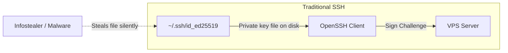

[🇺🇦 Читати цю статтю українською мовою](/posts/fido2-ssh-passkeys-hardware-security-keys/)

---

For decades, the standard mantra of systems engineering and DevOps security was simple: *“Disable password authentication, generate a 4096-bit RSA or Ed25519 SSH keypair, deploy the public key to the server, and sleep soundly.”*

However, the threat landscape has shifted dramatically. In today's reality, traditional file-based SSH keys have become one of the most targeted weak points in infrastructure security:
* **Infostealer Malware (Lumma, Redline, Vidar, Stealc):** Modern malware specifically scours developer and administrator machines for `~/.ssh/` folders. Even if a private key is encrypted with a passphrase, background keyloggers or ssh-agent memory scraping can compromise it in seconds.
* **Human Error:** Accidental git pushes of dotfiles or configuration directories to public GitHub repositories, unencrypted home directory backups left on flash drives, or compromised workstation system images.

If an attacker gets their hands on your `id_ed25519` file, your servers are breached.

The modern remedy to this systemic threat is already built into OpenSSH: **FIDO2/U2F Hardware Security Keys and Passkeys** (using the `ed25519-sk` and `ecdsa-sk` key algorithms).

In this deep dive, we explore how hardware security keys work in SSH, why they are physically immune to malware exfiltration, the difference between standard and Resident (Discoverable) keys, and how to set up authentication using a YubiKey or built-in biometric security enclaves (Windows Hello / Touch ID).


_Fig. 1. Architectural comparison between traditional filesystem-based SSH keys and hardware-isolated FIDO2/WebAuthn authentication_

---

## Under the Hood: How FIDO2 Works in OpenSSH

Starting with **OpenSSH 8.2**, upstream developers added native support for the **FIDO2 / CTAP2 (Client to Authenticator Protocol)** standard via the `libfido2` library. This introduced two specialized key types:
* `ed25519-sk` — The modern Ed25519 elliptic curve bound to a security token (the recommended choice).
* `ecdsa-sk` — The NIST P-256 curve (for older FIDO2 tokens lacking hardware support for Ed25519).

The **`-sk`** suffix stands for **Security Key**.

### The Fundamental Shift from Traditional SSH Keys

With traditional SSH keys, the sensitive private key resides directly on your workstation's disk:



With **FIDO2 Security Keys**:
1. The private cryptographic material is generated and **permanently sealed inside a hardware tamper-resistant microchip** (Secure Element or TPM). It cannot be exported, extracted from OS RAM, or copied by any software tool.
2. The file on your workstation's drive (`~/.ssh/id_ed25519_sk`) contains only a **Key Handle** (an opaque reference descriptor) and the public key.
3. When the SSH client initiates an authentication handshake, it passes the cryptographic challenge from the server down to the hardware authenticator.
4. The physical token demands **physical human touch (User Presence)** or **biometric/PIN verification (User Verification)**, performs the cryptographic signature inside its isolated chip, and returns only the final signature.

Even if an attacker gains full root access to your workstation, copies all files from `~/.ssh/`, and sets up remote surveillance — they **cannot log into your server** without physically pressing the button on your hardware token or presenting your biometric verification.

---

## Non-Resident vs Resident (Discoverable) Keys

Before generating your keys, it is critical to understand the two persistence models:

| Feature | Non-Resident Key (Default) | Resident (Discoverable) Key |
| :--- | :--- | :--- |
| **Where is the Key Handle stored?** | Only on the client computer's disk (`id_ed25519_sk`) | In the FIDO2 key's internal flash memory + local file |
| **Switching between computers** | Must manually copy the `id_ed25519_sk` handle | **Zero file transfers needed!** Run `ssh-add -K` |
| **Storage capacity** | Unlimited (consumes zero token memory) | Limited by token storage (typically 25 to 100+ slots) |
| **Best for** | Fixed primary workstations | **Engineers working across multiple laptops** |

---

## Security Levels: User Presence (UP) vs User Verification (UV)

OpenSSH and FIDO2 differentiate between two crucial levels of confirmation:

1. **User Presence (`UP`):**
   * The token requires a physical finger touch on its capacitive gold contact or a physical button press.
   * Defends against remote malware, automated background scripts, and botnets.
2. **User Verification (`UV`):**
   * The token requires entering a hardware FIDO2 PIN (4–63 characters) or completing a biometric scan (on YubiKey Bio, Windows Hello, or Touch ID).
   * Defends your servers even if your physical token is stolen or lost in transit — nobody can use it without your PIN or fingerprint.

---

## Hands-On: Generating FIDO2 SSH Keys

Ensure your client-side OpenSSH is version 8.2 or newer (`ssh -V`).

### Option 1: Standard Touch-Protected Key (User Presence)

Plug your YubiKey or compatible FIDO2 token into a USB port and run:

```bash
ssh-keygen -t ed25519-sk -C "yubikey-primary-touch"
```

The tool will prompt for a save destination (defaulting to `~/.ssh/id_ed25519_sk`), and your security key's LED will begin blinking. **Touch the metal contact**. Your keypair is generated!

### Option 2: Enforcing Hardware PIN / Biometrics (User Verification)

To require that every authentication session prompts for your token PIN or fingerprint:

```bash
ssh-keygen -t ed25519-sk -O verify-required -C "yubikey-with-pin"
```

Each connection attempt will prompt for the device's FIDO2 PIN or biometric check before releasing the signature.

### Option 3: Resident Keys (The Multi-Machine Superpower)

If you switch frequently between multiple workstations, a discoverable resident key eliminates the need to copy files between devices:

```bash
ssh-keygen -t ed25519-sk -O resident -O application=ssh:myservers -C "yubikey-resident"
```

> [!TIP]
> **Connecting from a brand new machine:**  
> When sitting down at a newly formatted computer with an empty `~/.ssh/` directory, insert your token and run:
> ```bash
> ssh-keygen -K
> # Or load directly into your running agent:
> ssh-add -K
> ```
> OpenSSH queries the token, extracts the public keys and handle descriptors from the internal chip, and makes you instantly ready to authenticate — no flash drives, no cloud syncing of private credentials!

---

## Using Windows Hello / Touch ID as a Virtual Security Key

What if you don't carry a physical USB YubiKey? Can you leverage **Passkeys** and your motherboard's built-in **TPM 2.0** chip or Apple's **Secure Enclave**?

Yes! Modern operating systems provide seamless integrations:
* **On Windows 11:** The native WebAuthn API interfaces directly with OpenSSH. When executing `ssh-keygen -t ecdsa-sk` or `ed25519-sk`, Windows invokes **Windows Hello** (facial recognition, fingerprint, or Windows PIN), binding the cryptographic root inside your machine's TPM 2.0.
* **On macOS:** Tools like `Secretive` or modern OpenSSH builds allow bridging Secure Enclave-protected keys via Touch ID.

---

## Server Configuration: Preparing Your VPS

To accept `-sk` credentials, the target server must run OpenSSH **8.2 or newer** (default on modern distributions including Ubuntu 20.04+, Debian 11+, AlmaLinux/Rocky Linux 8/9, and Fedora).

### 1. Adding the Public Key

Inspect your generated public key on your client machine:

```bash
cat ~/.ssh/id_ed25519_sk.pub
```

The output begins with the security key identifier:
```text
sk-ssh-ed25519@openssh.com AAAAGnNrLXNzaC1lZDI1NTE5QG9wZW5zc2guY29tAAAAI... yubikey-primary-touch
```

Deploy it to the server's `authorized_keys` file:

```bash
ssh-copy-id -i ~/.ssh/id_ed25519_sk.pub user@your-server-ip
```

### 2. Enforcing Biometric Verification on the Server

The server can enforce strict client policies. If you want to reject any connection that didn't pass PIN or biometric verification, prepend `verify-required` to the entry in `~/.ssh/authorized_keys`:

```text
verify-required sk-ssh-ed25519@openssh.com AAAAGnNrLXNzaC1lZDI1NTE5... yubikey-paranoid
```

If a client attempts to log in with a token that only provided touch (UP) without proving identity verification (UV), the server's `sshd` immediately rejects the handshake.

---

## Streamlining Daily Access: `~/.ssh/config`

Configure your client-side SSH settings to associate the security key automatically:

```sshconfig
Host myserver
    HostName 198.51.100.42
    User root
    Port 22
    IdentityFile ~/.ssh/id_ed25519_sk
    IdentitiesOnly yes
```

Now, running:
```bash
ssh myserver
```
Immediately pulses your security token. Touch the contact, and you are securely logged in.

---

## Troubleshooting: Linux "Device Not Found" Errors

If key generation fails with:
`Key enrollment failed: device not found` or `communication with agent failed`:

1. **Install the FIDO2 Userland Libraries:**
   ```bash
   # Debian / Ubuntu:
   sudo apt update && sudo apt install libfido2-1 libfido2-dev fido2-tools -y

   # RHEL / AlmaLinux / Fedora:
   sudo dnf install libfido2 libfido2-devel -y
   ```

2. **Configure Udev Permissions for Non-Root Access:**
   Linux distributions often restrict unprivileged user access to raw USB HID interfaces. Install standard udev rules:
   ```bash
   # Ubuntu / Debian:
   sudo apt install u2f-host libu2f-udev -y

   # Or download official Yubico udev rules:
   sudo curl -sSL -o /etc/udev/rules.d/70-u2f.rules https://raw.githubusercontent.com/Yubico/libu2f-host/master/70-u2f.rules
   sudo udevadm control --reload-rules && sudo udevadm trigger
   ```

---

## FIDO2 SSH Cheat Sheet

```bash
# 1. Generate standard touch-protected key (User Presence)
ssh-keygen -t ed25519-sk -C "name@workstation"

# 2. Generate key enforcing PIN / Biometrics (User Verification)
ssh-keygen -t ed25519-sk -O verify-required -C "name@workstation"

# 3. Generate a discoverable Resident Key stored inside the token
ssh-keygen -t ed25519-sk -O resident -O application=ssh:production -C "resident-key"

# 4. Extract resident keys on a fresh computer
ssh-keygen -K

# 5. Manage or update your FIDO2 token PIN
ykman fido access change-pin
```

---

## Conclusion: A New Baseline for Infrastructure Defense

Migrating to FIDO2-backed credentials fundamentally eliminates the biggest vulnerability of SSH:
* **The private key is no longer a transferable file** that can be scraped, leaked, or stolen.
* **Malware is neutralized:** Even full user-level workstation compromise cannot synthesize the physical human touch required to authorize authentication.
* **Seamless mobility:** With Resident Keys, hardware tokens provide portable, secure access across multiple environments without leaving credential residue behind.

Upgrading your SSH workflow to `ed25519-sk` is one of the highest-ROI security enhancements any sysadmin or developer can implement today.
