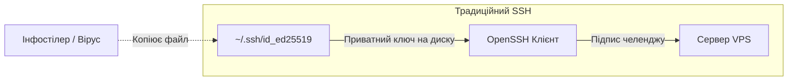

[🇬🇧 Read this article in English](/posts/fido2-ssh-passkeys-hardware-security-keys-en/)

---

Роками в індустрії системного адміністрування та DevOps панувало непохитне правило: *«Вимкни автентифікацію за паролем, згенеруй SSH-ключ на 4096-біт RSA або сучасний Ed25519, закинь публічну частину на сервер — і спи спокійно»*.

Але кіберзагрози суттєво еволюціонували. У реаліях сьогодення традиційні файлові SSH-ключі перетворилися на одну з найуразливіших ланок у захисті інфраструктури:
* **Інфостілери (Lumma, Redline, Vidar, Stealc):** шкідливе ПЗ спеціально сканує директорії `~/.ssh/` на комп'ютерах розробників і системних адміністраторів. Навіть якщо приватний ключ захищений парольною фразою (passphrase), кейлогер або дамп пам'яті ssh-agent миттєво нівелюють цей захист.
* **Людський фактор:** випадковий `git push` конфігураційних файлів чи dotfiles у публічний репозиторій GitHub, забутий бекап домашньої папки на незашифрованій флешці або витік образу робочої машини.

Якщо файл `id_ed25519` викрадено — сервер скомпрометовано.

Рішення цієї фундаментальної проблеми вже вбудоване у ваш OpenSSH: це **апаратні ключі безпеки FIDO2/U2F та Passkeys** (алгоритми `ed25519-sk` та `ecdsa-sk`).

Сьогодні детально розберемося, як влаштовані апаратні ключі в SSH, чому їх фізично неможливо вкрасти вірусом, чим відрізняються звичайні та Resident (Discoverable) ключі, а також як налаштувати автентифікацію через YubiKey або навіть вбудований сканер відбитка пальця / Windows Hello.


_Мал. 1. Порівняння традиційного зберігання ключів на файловій системі та апаратного захисту за стандартом FIDO2/WebAuthn_

---

## Як працює FIDO2 в OpenSSH: під капотом

Починаючи з версії **OpenSSH 8.2**, розробники додали нативну підтримку протоколів **FIDO2 / CTAP2 (Client to Authenticator Protocol)** через бібліотеку `libfido2`. Було впроваджено два нових типи ключів:
* `ed25519-sk` — сучасна еліптична крива Ed25519 у зв'язці з токеном безпеки (рекомендований вибір).
* `ecdsa-sk` — крива NIST P-256 (для пристроїв FIDO2, які апаратно не підтримують Ed25519).

Префікс **`-sk`** розшифровується як **Security Key**.

### Головна відмінність від звичайного ключа

У традиційній схемі приватний ключ зберігається безпосередньо у файлі на диску вашого ПК:



У схемі з **FIDO2 Security Key**:
1. Приватний ключ генерується та **назавжди запечатується всередині криптографічного чіпа** (Secure Element або TPM). Його неможливо експортувати, витягнути пам'яттю ОС чи скопіювати файловим менеджером.
2. Файл на диску вашого комп'ютера (`~/.ssh/id_ed25519_sk`) містить лише **Key Handle** (покажчик/дескриптор) та публічний ключ.
3. Коли SSH-клієнт хоче автентифікуватися, він передає криптографічний виклик (challenge) від сервера до апаратного токена.
4. Токен чекає **фізичного дотику людини (User Presence)** або **підтвердження біометрією/PIN-кодом (User Verification)**, підписує виклик усередині свого чіпа і повертає лише готовий підпис.

Навіть якщо зловмисник повністю зламає ваш комп'ютер, викраде всі файли з `~/.ssh/` та встановить віддалене керування — він **не зможе підключитися до сервера**, доки фізично не натисне кнопку на вашому USB-ключі або не підтвердить вхід відбитком пальця.

---

## Два типи ключів: Non-Resident vs Resident (Discoverable)

Перед генерацією важливо розуміти різницю між двома концепціями збереження:

| Характеристика | Non-Resident Key (За замовчуванням) | Resident (Discoverable) Key |
| :--- | :--- | :--- |
| **Де лежить Key Handle?** | Лише на файловій системі комп'ютера (`id_ed25519_sk`) | У внутрішній пам'яті FIDO2-ключа + локальний файл |
| **Перенесення між ПК** | Потрібно вручну копіювати файл `id_ed25519_sk` | **Не потрібно нічого копіювати!** Достатньо виконати `ssh-add -K` |
| **Кількість ключів на токені** | Необмежена (токен не витрачає внутрішню пам'ять) | Обмежена пам'яттю токена (зазвичай від 25 до 100+ слотів) |
| **Рекомендація** | Для робочого стаціонарного ПК | **Для мобільної роботи з різних пристроїв** |

---

## Рівні захисту: User Presence (UP) проти User Verification (UV)

OpenSSH та FIDO2 підтримують два рівні підтвердження:

1. **User Presence (`UP` / Наявність людини):**
   * Токен вимагає простого дотику пальцем до металевої сенсорної зони (чи натискання кнопки).
   * Захищає від фонових ботів, мережевих черв'яків та автоматизованих скриптів.
2. **User Verification (`UV` / Верифікація особи):**
   * Токен вимагає введення апаратного PIN-коду (від 4 до 63 символів) або сканування відбитка пальця (на YubiKey Bio чи Windows Hello / Touch ID).
   * Захищає навіть у випадку, якщо ваш фізичний ключ украли або ви забули його в офісі — без PIN-коду чи вашого пальця ним не зможе скористатися ніхто.

---

## Практика: Генеруємо FIDO2 SSH-ключі

Перевірте, щоб ваш клієнтський OpenSSH мав версію не нижче 8.2 (перевірка: `ssh -V`).

### Варіант 1: Звичайний ключ із захистом дотиком (Touch)

Вставте ваш YubiKey або інший сумісний FIDO2/U2F токен у USB-порт і виконайте:

```bash
ssh-keygen -t ed25519-sk -C "yubikey-primary-touch"
```

Команда запросить шлях для збереження файлу (за замовчуванням `~/.ssh/id_ed25519_sk`), а світлодіод на вашому ключі почне блимати. **Торкніться сенсора токена**. Ключ згенеровано!

### Варіант 2: Ключ із примусовою перевіркою PIN / біометрії (User Verification)

Якщо ви хочете максимальний захист, щоб токен запитував PIN-код або сканування пальця:

```bash
ssh-keygen -t ed25519-sk -O verify-required -C "yubikey-with-pin"
```

При кожному підключенні токен спочатку попросить ввести апаратний FIDO2 PIN (або прикласти палець), і лише після цього підпише сесію.

### Варіант 3: Resident Key (Магія мобільності)

Це найзручніший режим для тих, хто працює з кількох ноутбуків (наприклад, робочий + домашній). 

Створюємо ключ, який збереже свій дескриптор прямо у флеш-пам'яті токена:

```bash
ssh-keygen -t ed25519-sk -O resident -O application=ssh:myservers -C "yubikey-resident"
```

> [!TIP]
> **Як підключитися з абсолютно нового комп'ютера?**  
> Ви сідаєте за новий ноутбук, де немає ваших файлів `~/.ssh/`. Вставляєте свій YubiKey і виконуєте:
> ```bash
> ssh-keygen -K
> # або завантажуємо одразу в ssh-agent:
> ssh-add -K
> ```
> OpenSSH самостійно витягне дескриптори та публічні ключі прямо з мікрочипа токена і створить файли у поточній папці. Жодних флешок і пересилань ключів через месенджери!

---

## Використання Windows Hello / Touch ID замість USB-токена

Якщо у вас немає апаратного YubiKey, чи можна використовувати **Passkeys** та вбудований чіп материнської плати **TPM 2.0** або **Apple Secure Enclave**?

Так! Сучасний стек підтримує це нативно:
* **У Windows 11:** Вбудований механізм WebAuthn API інтегрується з OpenSSH. При генерації `ssh-keygen -t ecdsa-sk` або `ed25519-sk` операційна система викликає вікно **Windows Hello** (розпізнавання обличчя, відбиток пальця або PIN-код Windows), зберігаючи криптографічний матеріал у захищеному TPM 2.0.
* **У macOS:** Утиліти на кшталт `Secretive` або нові версії OpenSSH можуть прив'язувати FIDO2-подібні ключі безпосередньо до Secure Enclave через Touch ID.

---

## Налаштування сервера: що прописати на VPS

Для того щоб сервер приймав нові типи ключів, на ньому повинен працювати OpenSSH версії **8.2 або вище** (всі сучасні ОС: Ubuntu 20.04+, Debian 11+, AlmaLinux/Rocky Linux 8/9, Fedora).

### 1. Додавання публічного ключа

Подивіться вміст вашого згенерованого публічного ключа на комп'ютері:

```bash
cat ~/.ssh/id_ed25519_sk.pub
```

Ви побачите щось схоже на:
```text
sk-ssh-ed25519@openssh.com AAAAGnNrLXNzaC1lZDI1NTE5QG9wZW5zc2guY29tAAAAI... yubikey-primary-touch
```

Скопіюйте цей рядок на сервер у файл `~/.ssh/authorized_keys`:

```bash
ssh-copy-id -i ~/.ssh/id_ed25519_sk.pub user@your-server-ip
# Або вручну вставити рядок у ~/.ssh/authorized_keys
```

### 2. Серверна вимога біометрії (Опція максимальної параної)

Сервер може самостійно примушувати клієнта до верифікації особи. Якщо ви хочете гарантувати, що на сервер не зможуть зайти, якщо на ключі вимкнено PIN/біометрію, додайте префікс `verify-required` перед ключем у файлі `authorized_keys`:

```text
verify-required sk-ssh-ed25519@openssh.com AAAAGnNrLXNzaC1lZDI1NTE5... yubikey-paranoid
```

Тепер, якщо хтось спробує скористатися токеном без введення PIN-коду або біометричного підтвердження, sshd на сервері негайно розірве з'єднання з помилкою відмови в автентифікації.

---

## Зручний клієнтський конфіг: `~/.ssh/config`

Щоб не вказувати шлях до ключа щоразу, пропишіть його у своєму локальному конфігу:

```sshconfig
Host myserver
    HostName 198.51.100.42
    User root
    Port 22
    IdentityFile ~/.ssh/id_ed25519_sk
    IdentitiesOnly yes
```

Тепер команда:
```bash
ssh myserver
```
Миттєво активує підсвітку сенсора на вашому YubiKey. Торкаєтеся пальцем — і ви в системі!

---

## Розв'язання проблем: якщо Linux не бачить USB-токен

Якщо при спробі генерації ви отримуєте помилку:
`Key enrollment failed: device not found` або `communication with agent failed`:

1. **Встановіть системну бібліотеку FIDO2:**
   ```bash
   # Debian / Ubuntu:
   sudo apt update && sudo apt install libfido2-1 libfido2-dev fido2-tools -y

   # RHEL / AlmaLinux / Fedora:
   sudo dnf install libfido2 libfido2-devel -y
   ```

2. **Налаштуйте правила udev (доступ без sudo):**
   За замовчуванням Linux може блокувати прямий доступ звичайного користувача до USB HID-інтерфейсу ключа безпеки.  
   Встановіть пакет офіційних правил:
   ```bash
   # Ubuntu / Debian:
   sudo apt install u2f-host libu2f-udev -y

   # Або завантажте офіційні udev-правила Yubico:
   sudo curl -sSL -o /etc/udev/rules.d/70-u2f.rules https://raw.githubusercontent.com/Yubico/libu2f-host/master/70-u2f.rules
   sudo udevadm control --reload-rules && sudo udevadm trigger
   ```

---

## Шпаргалка команд (FIDO2 SSH Cheat Sheet)

```bash
# 1. Генерація простого ключа з вимогою дотику (User Presence)
ssh-keygen -t ed25519-sk -C "name@host"

# 2. Генерація ключа з обов'язковим PIN/біометрією (User Verification)
ssh-keygen -t ed25519-sk -O verify-required -C "name@host"

# 3. Генерація Resident-ключа (збереження дескриптора всередині токена)
ssh-keygen -t ed25519-sk -O resident -O application=ssh:prod -C "resident-prod"

# 4. Вивантаження Resident-ключів з токена на новому комп'ютері
ssh-keygen -K

# 5. Зміна PIN-коду FIDO2 токена
ykman fido access change-pin
```

---

## Підсумки: нова ера захисту інфраструктури

Перехід на FIDO2-ключі в SSH кардинально змінює модель безпеки:
* **Файловий приватний ключ перестає існувати як сутність**, яку можна скопіювати чи злити в мережу.
* **Атака через шкідливе ПЗ стає безпорадною:** навіть якщо зловмисник отримав сесію термінала, він не може сфальсифікувати фізичний дотик пальця до апаратного токена.
* **Зручність перевершує звичайні паролі:** технологія Resident Keys дозволяє мати один фізичний ключ на брелоку і безпечно адмініструвати сервери з будь-якого довіреного пристрою.

Якщо у вас на полиці лежить YubiKey або ви давно шукали привід почати користуватися апаратними засобами безпеки — переведення ваших SSH-сесій на `ed25519-sk` це найкраща інвестиція в кібербезпеку вашої інфраструктури.
