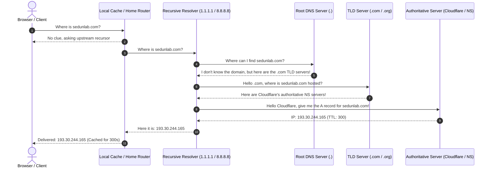

[🇺🇦 Читати цю статтю українською мовою](/posts/its-always-dns-sysadmin-guide/)

---

In the collective folklore of systems administrators, network engineers, and DevOps specialists, there is one universal haiku etched in tears and sweat:

> *It’s not DNS.*  
> *There’s no way it’s DNS.*  
> *It was DNS.*

Friday, 4:45 PM. You can already smell the weekend, mentally popping the cap off an ice-cold craft beer, when suddenly the corporate Slack channel explodes with red alert sirens: **“Production is down! Customers cannot reach the login portal! The app is completely dead!”**.

You frantically open your terminal and SSH into the servers:
* CPU load is chilling at 2% — virtually idle.
* Memory is plentiful, NVMe disks have hundreds of gigabytes free.
* Nginx, reverse proxies, and Docker microservices are all healthy and humming.
* A local `curl localhost:8080` returns an immaculate HTTP 200 OK.
* You test from your local laptop: `curl https://mysite.com` — fatal error: `Could not resolve host`.

A chill runs down your spine. Deep within the fabric of the global network, the ancient beast has awakened: **The Domain Name System (DNS)**. A protocol designed back in 1983 by Paul Mockapetris that still holds the entire modern internet together with digital duct tape.

In honor of Friday, let’s explore why the internet's simplest “phone book” repeatedly brings tech giants to their knees, why clearing DNS cache feels like an exorcism, and how a few diagnostic commands can save your sanity before your beer gets warm.


_Fig. 1. The full DNS resolution path: from client browser to authoritative nameserver and the treacherous caching layers in between_

---

## How DNS Actually Works: The Under-the-Hood Reality

Introductory computer textbooks describe DNS simply: *“DNS is like a phone book. A computer requests `sedunlab.com`, and the server returns `193.30.244.165`.”*

If it were that straightforward, sysadmins wouldn't start graying in their mid-twenties. In reality, every single DNS lookup is a multi-hop detective investigation spanning across global backbones:



Now here is the catch: **almost every single step in this chain maintains its own independent cache**:
1. The application cache (Google Chrome maintains its own internal DNS cache completely separate from Windows or macOS).
2. The operating system resolver (`systemd-resolved` on Linux or `mDNSResponder` on macOS).
3. The home/office Wi-Fi router (often running on outdated firmware with congested memory).
4. Your ISP’s recursive resolver (which often disregards low TTLs and caches entries for days).
5. Public upstream resolvers (Cloudflare `1.1.1.1`, Google `8.8.8.8`).

If stale records linger in just one of these hops, you enter the classic support twilight zone: **“It loads fine on my 5G phone, the CEO sees an error, the client sees last week’s website, and our monitoring agent is throwing a 502 error.”**

---

## Epic DNS Catastrophes in Internet History

If you think DNS blunders only happen to junior developers on \$5 hobby VPS droplets, recall these historic mega-outages:

### 1. The Great Facebook Blackout of 2021
In October 2021, Facebook, Instagram, WhatsApp, and Messenger vanished from the global internet for nearly six hours. Speculation ran wild with theories of massive cyber warfare.

What actually happened? Facebook engineers were performing routine backbone maintenance via **BGP (Border Gateway Protocol)**. A misconfigured route withdrawal accidentally severed routing paths to their own authoritative DNS servers. To the rest of the planet, Facebook simply ceased to exist. When global root servers were asked for `facebook.com`, they replied: *"No such servers exist."*

**The crowning irony:** Facebook's physical door-badge security systems and conference room locks were also integrated with internal domain authentication! Engineers carrying console cables arrived at the data centers only to find themselves physically locked out of the server rooms, having to use industrial angle grinders to slice through physical door mechanisms to access routers.

### 2. Microsoft Azure & Office 365 Global Collapse
A flawed internal configuration script applied to Azure's DNS infrastructure crippled Office 365, Microsoft Teams, Xbox Live, and thousands of enterprise cloud workloads across the globe, racking up hundreds of millions of dollars in downtime damages.

---

## 4 Classic DNS Traps That Drive Engineers Crazy

### Trap 1: The 86400 TTL Self-Inflicted Wound
The **TTL (Time to Live)** parameter dictates how many seconds downstream resolvers are allowed to hold an IP address in memory before re-querying your authoritative nameserver.

By default, many domain registrars set TTL to `86400` (24 hours) or `43200` (12 hours).
* Friday at 4:00 PM: You switch your application's A record to a newly provisioned server.
* You expect traffic to seamlessly migrate immediately.
* Instead, half of the world's ISPs continue hammering the old (or already decommissioned) server for the next **24 hours straight**!

> [!TIP]
> **The Golden Migration Rule:** 24 to 48 hours prior to any infrastructure migration, reduce your record's TTL to **`60` or `300` seconds** (5 minutes). Once traffic has successfully stabilized on the new destination, raise the TTL back up to conserve lookup overhead.

### Trap 2: The Apex CNAME Trap (@) and Vanishing Email
You want to connect a landing page to Vercel, GitHub Pages, or Netlify, so you add:
```text
Type: CNAME
Name: @ (or sedunlab.com)
Target: my-app.vercel.app
```
Ten minutes later, your company's **entire corporate email infrastructure stops receiving incoming mail**. Why?

Per standard **RFC 1912 (Section 2.4)**: *“If a CNAME record exists for a node, no other data records may exist for that node.”* By assigning a CNAME to the root apex `@`, you legally obliterated all coexisting **MX** (mail exchange), **TXT** (SPF, DKIM, DMARC), and **SOA** records in the eyes of compliant resolvers.

*(Modern DNS providers like Cloudflare employ CNAME Flattening to synthesize dynamic A/AAAA records at the apex, protecting you from this pitfall. Legacy registrar control panels, however, will gladly allow you to shoot yourself in the foot).*

### Trap 3: The Stubborn ISP Resolver
You updated the record, the TTL expired, Google (`8.8.8.8`) and Cloudflare (`1.1.1.1`) already resolve the new server IP. Yet a critical client insists the site is down.
Certain regional consumer ISPs employ aggressively caching upstream resolvers that disregard webmaster TTL directives entirely, caching records for days to save minuscule bandwidth.

### Trap 4: The Phantom of `systemd-resolved` on Linux
You edit `/etc/resolv.conf`, hardcode `nameserver 1.1.1.1`, save the file... yet Linux continues routing queries to the local stub `127.0.0.53:53`!  
Modern Linux distributions utilize `systemd-resolved` as a local DNS multiplexer that actively manages and overwrites this file. Until you purge its internal daemon cache, stale records will haunt your terminal.

---

## The Friday Troubleshooting Toolkit: Diagnostic Commands in 60 Seconds

When production fires ignite, ditch standard `ping` (which is heavily cached and provides zero protocol insight). Use these targeted utilities instead:

### 1. `dig +trace`: Full Path Diagnostic X-Ray
Trace the resolution journey from the root hints down to your authoritative server:
```bash
dig sedunlab.com +trace
```
This isolates the exact hierarchy layer (Root, TLD registry, or your custom NS) returning erroneous records.

### 2. Auditing Public and Authoritative Resolvers
Compare responses across public Anycast resolvers versus your authoritative origin:
```bash
# Query Cloudflare directly:
dig @1.1.1.1 sedunlab.com +short

# Query Google directly:
dig @8.8.8.8 sedunlab.com +short

# Query your authoritative nameserver directly (bypassing all caches):
dig @ns1.cloudflare.com sedunlab.com +short
```
If your authoritative server outputs the new IP while `1.1.1.1` displays the old one, it is strictly a propagation waiting game.

### 3. Flushing Cache Across All Operating Systems

* **🪟 Windows (Administrator cmd / PowerShell):**
  ```cmd
  ipconfig /flushdns
  ```
* **🍎 macOS (Terminal):**
  ```bash
  sudo dscacheutil -flushcache; sudo killall -HUP mDNSResponder
  ```
* **🐧 Linux (systemd-resolved):**
  ```bash
  sudo resolvectl flush-caches
  # Verify cache clearance:
  resolvectl statistics
  ```
* **🌐 Google Chrome / Microsoft Edge:**  
  Browsers maintain an internal socket pool! Navigate to:  
  `chrome://net-internals/#dns` ➔ click **“Clear host cache”**.

---

## Conclusion & The Golden Law of Friday

DNS is a marvel of distributed engineering: when it works, nobody notices. But when it fails, it feels like the digital universe has lost its compass.

The ultimate law of infrastructure survival before the weekend is simple:

> [!CAUTION]
> **Never modify Name Servers (NS) or execute sweeping DNS record changes on a Friday afternoon.**  
> If an issue arises, stubborn global TTL caches will grant you no mercy, and your relaxing weekend will dissolve into a marathon of `dig` commands.

Stay calm, keep your beer cold, and remember: whenever everything falls apart and nobody knows why — **it was definitely DNS!** 🍺🚀
