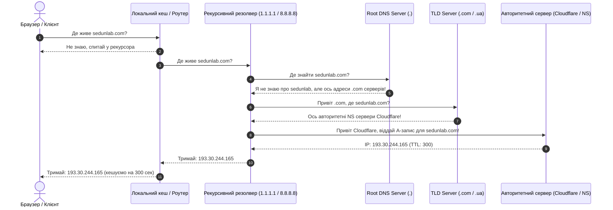

[🇬🇧 Read this article in English](/posts/its-always-dns-sysadmin-guide-en/)

---

У фольклорі системних адміністраторів та DevOps-інженерів є один короткий, але сповнений сліз та болю хоку:

> *It’s not DNS.*  
> *There’s no way it’s DNS.*  
> *It was DNS.*  
> *(Це не DNS. Ну точно не DNS. Це був DNS.)*

П'ятниця, 16:45. Ви вже відчуваєте аромат вихідних, подумки відкриваєте холодну пляшку крафтового пива і раптом у корпоративному Slack спалахує червоне полум'я: **«Сайт лежить! Клієнти не можуть зайти в особистий кабінет! Прод упав!»**.

Ви гарячково підключаєтеся по SSH до сервера:
* Процесор завантажений на 2% — все спить.
* Пам'ять вільна, диски не забиті.
* Nginx та Docker-контейнери зелені й весело шелестять.
* Локальний `curl localhost:8080` віддає бездоганний HTTP 200 OK.
* Перевіряєте з домашнього ноута: `curl https://mysite.com` — помилка `Could not resolve host`. 

І тут настає той самий холодний піт. Ви розумієте, що десь у глибинах всесвітньої павутини прокинувся він — **Domain Name System (DNS)**. Протокол, створений ще у 1983 році Полом Мокапетрісом, який досі тримає весь сучасний інтернет на волосині.

Сьогодні під розслаблений п'ятничний настрій розберемося, чому найпростіша «телефонна книга інтернету» регулярно ставить на коліна техногігантів, чому очищення кешу схоже на сеанс екзорцизму та як за допомогою кількох магічних команд діагностувати будь-яку проблему до того, як нагріється ваше пиво.


_Мал. 1. Повний шлях DNS-резолвінгу: від браузера до авторитетного сервера та головні підводні камені кешування_

---

## Як насправді працює DNS: екскурсія для дорослих

У дитячих підручниках пишуть: *«DNS — це як телефонна книга. Комп'ютер запитує адресу `sedunlab.com`, а сервер відповідає `193.30.244.165`»*.

Якби все було так просто, інженери не сивіли б у 25 років. Насправді кожен DNS-запит — це багатокроковий детективний квест через пів світу:



А тепер уявіть, що **на кожному з цих етапів живе свій власний кеш**:
1. Кеш самого додатка (браузер Chrome має свій DNS-кеш, окремий від Windows чи macOS).
2. Кеш операційної системи (підступний `systemd-resolved` у Linux чи `dnsr` у macOS).
3. Кеш домашнього роутера (який часто купували 7 років тому за акцією і в якого закінчилася пам'ять).
4. Кеш вашого місцевого інтернет-провайдера (який іноді начхати хотів на ваші TTL і кешує записи добами).
5. Публічні резолвери (Cloudflare `1.1.1.1`, Google `8.8.8.8`).

Якщо хоча б на одній ланці цього ланцюга застрягла стара інформація — ви отримуєте ситуацію, від якої сіпається око: **«У мене з телефону відкривається, у шефа не працює, у клієнта відкривається старий сайт, а моніторинг показує 502»**.

---

## Епічні факапи в історії: коли DNS клав світ на лопатки

Якщо ви думаєте, що проблеми з DNS бувають лише у джуніорів на віртуалках за $5, згадайте ці шедеври світового IT:

### 1. Великий блекаут Facebook (2021 рік)
У жовтні 2021 року на 6 годин зникли Facebook, Instagram, WhatsApp та Messenger. Інтернет-користувачі думали, що це кібератака століття. 

Що сталося насправді? Інженери Facebook оновлювали маршрутизацію своєї магістральної мережі через протокол **BGP (Border Gateway Protocol)**. Через помилку в конфігурації BGP-маршрути до їхніх власних DNS-серверів були відкликані. Для решти планети Facebook просто... припинив існувати. Браузери запитували `facebook.com`, а кореневі сервери відповідали: *"Таких серверів у природі немає"*.

**Родзинка трагедії:** Електронні перепустки та розумні двері в офісах і датацентрах Facebook працювали... правильно, через внутрішній домен! Інженери з ноутбуками та консольними кабелями стояли під дверима серверних кімнат і буквально брали болгарки, щоб фізично зрізати замки й дістатися до маршрутизаторів.

### 2. Світовий збій Microsoft Azure та Office 365
Один некоректний скрипт оновлення DNS-серверів Microsoft призвів до того, що корпоративні служби Teams, Outlook, Xbox Live та половина віртуалок Azure перестали резолвитися по всій земній кулі. Збитки вимірювалися сотнями мільйонів доларів за кілька годин.

---

## 4 класичні пастки DNS, які зламають вам мозок

### Пастка №1: Синдром TTL на 86400 (Постріл у ногу на 24 години)
Параметр **TTL (Time to Live)** визначає, скільки секунд резолвери всього світу мають право тримати ваш IP у кеші, не питаючи ваш сервер знову.

За замовчуванням багато реєстраторів ставлять TTL = `86400` (24 години) або `43200` (12 годин).
* У п'ятницю о 16:00 ви перемикаєте A-запис сайту на новий сервер.
* Ви очікуєте, що трафік миттєво піде на новий VPS.
* Але пів світу продовжує довбитися на старий (або вже вимкнений) сервер наступні **24 години**!

> [!TIP]
> **Золоте правило міграції:** За 24–48 годин до запланованих робіт зменшіть TTL для потрібного запису до **`60` або `300` секунд** (5 хвилин). І лише коли зміни приживуться на новому сервері — повертайте високий TTL назад для економії запитів.

### Пастка №2: CNAME у корені домену (@) та зникла пошта
Ви захотіли підключити красивий Vercel або Cloudflare Pages і створили запис:
```text
Type: CNAME
Name: @ (або sedunlab.com)
Target: my-app.vercel.app
```
Через 10 хвилин у компанії **повністю перестає працювати корпоративна пошта**. Чому?

За стандартом **RFC 1912 (Section 2.4)**: *якщо для імені існує запис CNAME, для нього не може існувати жодного іншого типу записів!* Створивши CNAME для кореневого домену `@`, ви автоматично знищили для зовнішнього світу свої записи **MX** (пошта), **TXT** (SPF/DKIM захист від спаму) та **SOA**.

*(Сучасні DNS-провайдери на кшталт Cloudflare використовують так званий CNAME Flattening — вони автоматично перетворюють CNAME на рівні кореня у динамічні A/AAAA-записи, рятуючи вас від цієї халепи. Але старі реєстратори досі дозволять вам вистрелити собі в ногу).*

### Пастка №3: «Німий» інтернет-провайдер
Ви оновили запис, TTL закінчився, Google (`8.8.8.8`) і Cloudflare (`1.1.1.1`) вже бачать новий IP. Але клієнт дзвонить і кричить, що в нього нічого не працює.
Чому? Деякі провайдери домашнього інтернету використовують кешуючі резолвери з "hardcoded" правилами: вони ігнорують низький TTL вебмайстра і тримають старі записи у своєму кеші стільки, скільки заманеться їхнім налаштуванням.

### Пастка №4: Привид `systemd-resolved` у Linux
Ви змінили `/etc/resolv.conf`, вписали туди `nameserver 1.1.1.1`, зберегли файл... а Linux продовжує слати запити на старий локальний DNS `127.0.0.53:53`!  
У сучасних Ubuntu та Debian служба `systemd-resolved` перехоплює всі запити й перезаписує конфіг. Поки ви не скинете її внутрішній кеш — дива не станеться.

---

## П'ятнична шпаргалка: діагностика та лікування DNS за 60 секунд

Коли починається пожежа, забудьте про команду `ping` (вона показує погоду на Марсі та кешується всім, чим можна). Ось джентльменський набір інструментів:

### 1. `dig +trace`: Рентгенівський знімок всього ланцюга
Ця команда показує весь шлях резолвінгу від кореневих серверів до вашого:
```bash
dig sedunlab.com +trace
```
Ви одразу побачите, на якому саме рівні (Root, TLD чи ваш NS) віддається хибна або застаріла відповідь.

### 2. Допит із пристрастю: перевіряємо різні публічні резолвери
Порівняйте, що бачать різні незалежні сервери:
```bash
# Що бачить Cloudflare:
dig @1.1.1.1 sedunlab.com +short

# Що бачить Google:
dig @8.8.8.8 sedunlab.com +short

# Що бачить ваш авторитетний сервер напряму (без жодних проміжних кешів):
dig @ns1.cloudflare.com sedunlab.com +short
```
Якщо на `ns1.cloudflare.com` новий IP, а на `1.1.1.1` старий — це чистий кеш, треба просто почекати TTL.

### 3. Екзорцизм: очищаємо DNS-кеш на всіх системах

* **🪟 Windows (cmd або PowerShell від адміна):**
  ```cmd
  ipconfig /flushdns
  ```
* **🍎 macOS (Terminal):**
  ```bash
  sudo dscacheutil -flushcache; sudo killall -HUP mDNSResponder
  ```
* **🐧 Linux (systemd-resolved):**
  ```bash
  sudo resolvectl flush-caches
  # Перевірити, що кеш очищено:
  resolvectl statistics
  ```
* **🌐 Браузер Google Chrome / Edge:**  
  Браузери тримають власний прихований сокет-кеш! Вставте в адресний рядок:  
  `chrome://net-internals/#dns` ➔ натисніть **«Clear host cache»**.

---

## Підсумки та головний закон п'ятниці

DNS — це дивовижний протокол: коли він працює, про нього ніхто не згадує. Але коли він ламається, здається, що з ладу вийшов увесь цифровий всесвіт.

Головне правило виживання для будь-якого інженера перед вихідними звучить так:

> [!CAUTION]
> **Ніколи не переключайте Name Servers (NS) та не робіть масштабних правок DNS у п'ятницю після обіду.**  
> Якщо щось піде не так — TTL не пробачить поспіху, а замість бару ви проведете ніч із командою `dig` в руках.

Зберігайте спокій, пийте добре пиво і пам'ятайте: якщо все впало і причина незрозуміла — **це точно DNS!** 🍺🚀
