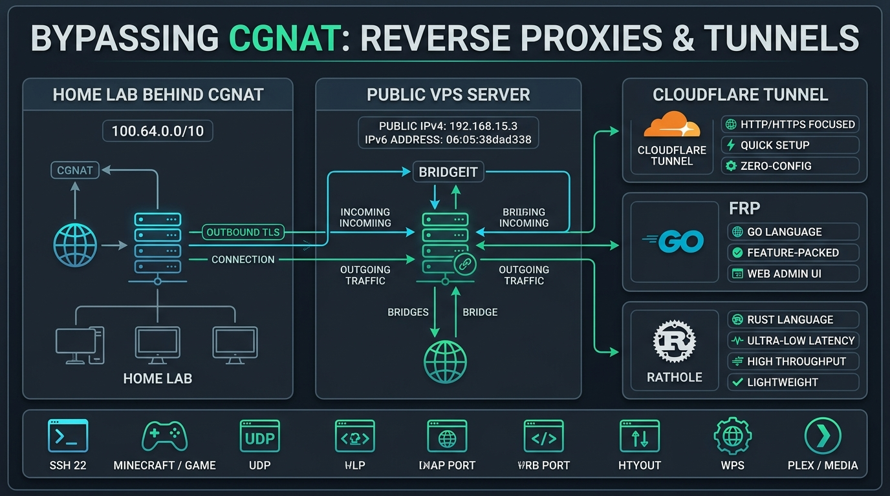
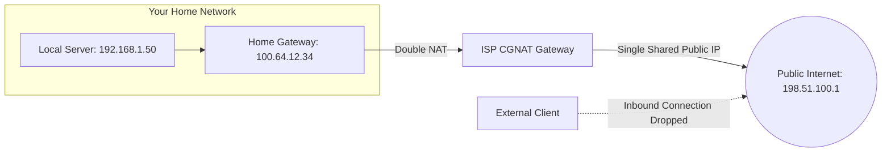

[🇺🇦 Читати цю статтю українською мовою](/posts/cgnat-bypass-rathole-frp-reverse-proxy/)

---

Every self-hosting enthusiast, systems developer, and DevOps practitioner eventually runs into a familiar roadblock:
* You build a sleek home server, spinning up network storage, a Jellyfin media cluster, a Home Assistant hub, or a dedicated multiplayer game server.
* You open your router dashboard to configure standard Port Forwarding...
* Only to discover with dismay that your router’s WAN IP begins with **`100.64.x.x`** or **`10.x.x.x`**.

Welcome to **CGNAT (Carrier-Grade NAT)** — your ISP has pooled thousands of residential subscribers behind a single shared public IPv4 address. From the outside world, your router is practically invisible. Inbound connection requests have no idea which private workstation to route to. Across cellular 4G/5G modems, many regional fiber providers, and satellite links like Starlink, obtaining a dedicated public IPv4 address is either exorbitantly expensive or flatly impossible.

While many turn to **Cloudflare Tunnel**, it suffers from distinct architectural constraints: it excels at proxying web traffic (HTTP/HTTPS), but **strictly restricts or requires a bespoke local client for raw TCP/UDP streams** (SSH, WireGuard, RTSP security cameras, gaming sockets) and prohibits high-volume video streaming under its Terms of Service (Section 2.8).

Today, we dive into how to resolve the private IP dilemma definitively: pairing an inexpensive public VPS with modern reverse proxies like **Rathole (engineered in blazing-fast Rust)** or **FRP (written in Go)** provides total protocol freedom, sub-millisecond overhead, and allows you to expose any local port to the internet in minutes.


_Fig. 1. Reverse tunneling architecture: how outbound connections via Rathole or FRP circumvent CGNAT firewalls and Cloudflare restrictions_

---

## Why Standard Port Forwarding Fails: The Anatomy of CGNAT

In the 1980s, the architects of IPv4 reserved roughly 4.3 billion unique addresses. Decades later, global IPv4 pools officially reached exhaustion.

To avoid overhauling core infrastructure to IPv6 overnight, telecommunication providers implemented **Carrier-Grade NAT (RFC 6598, utilizing `100.64.0.0/10`)**:



When an external client attempts to connect to public IP `198.51.100.1` on port 22 or 8080, the provider's upstream gateway immediately drops the packet because no translation state exists pointing that unsolicited inbound session to your specific residence.

---

## Why Cloudflare Tunnel Isn't a Universal Fix

Cloudflare Tunnel (`cloudflared`) is an exceptional engineering feat, but it was designed primarily to protect web properties, not arbitrary network infrastructure:
1. **Raw TCP and UDP Friction:** To connect to a raw SSH port or play on a gaming server routed through Cloudflare Tunnel, **every single client device** must install `cloudflared` locally and run an access daemon (`cloudflared access tcp`).
2. **Streaming and Bandwidth Restrictions (ToS 2.8):** Funneling raw high-throughput video feeds from Plex/Jellyfin or multi-gigabyte raw backups through Cloudflare's free edge proxy risks account suspension for violating non-HTML content clauses.
3. **Third-Party Interception:** All decrypted traffic terminates directly on Cloudflare’s proxy infrastructure before reaching your origin.

---

## The Solution: Self-Hosted Reverse Proxies via Budget VPS

The architecture is brilliantly simple:
1. Provision a budget VPS in a nearby datacenter (\$2–\$3/month) with a dedicated public IPv4 address.
2. Your home server **initiates an outbound encrypted tunnel** to your VPS.
3. Because the connection is outbound, your ISP's CGNAT and local firewall rules permit it unconditionally!
4. The VPS listens on designated public ports and pipes all incoming external traffic through the encrypted tunnel directly to your local machines.

---

## Clash of Titans: Rathole vs FRP

For years, engineers relied on `SSH Remote Port Forwarding` (`ssh -R`), but OpenSSH tunnels are notoriously heavy, single-threaded, and unstable under sustained workloads. Two specialized modern solutions have taken the crown:

| Feature | **Rathole** (Modern Rust) | **FRP** (Classic Go) |
| :--- | :--- | :--- |
| **Language** | **Rust** (Zero-cost abstractions, memory safe) | **Go** (Golang) |
| **Memory Footprint** | **1–3 MB RAM** (Virtually imperceptible) | 15–30 MB RAM |
| **Throughput** | Blistering (Handles 100k+ concurrent connections) | High |
| **Security Layer** | **Noise Protocol** (WireGuard-grade) / TLS | TLS / KCP / QUIC |
| **Web Dashboard** | None (Pure CLI minimalist zen) | Built-in web administration UI |
| **Best For** | **Gaming, low latency, resource-starved nodes** | Multi-tenant deployments requiring web metrics |

---

## Hands-On: Setting Up Rathole in 5 Minutes

Here is how to expose a local SSH daemon (port `22`) and a local web dashboard (port `8080`) through **Rathole**.

### Step 1: Installing the Rathole Binary (VPS & Home Server)
Rathole distributes as a self-contained, statically linked binary without runtime dependencies:

```bash
# Download latest x86_64 release:
wget https://github.com/rapiz1/rathole/releases/latest/download/rathole-x86_64-unknown-linux-musl.zip
unzip rathole-x86_64-unknown-linux-musl.zip
sudo mv rathole /usr/local/bin/
sudo chmod +x /usr/local/bin/rathole
```

---

### Step 2: Configuring the VPS (Server Mode)

Create the configuration file at `/etc/rathole/server.toml`:

```toml
# /etc/rathole/server.toml

[server]
bind_addr = "0.0.0.0:2333" # Control coordination port
default_token = "SuperSecretCryptographicToken_12345"

# Expose home SSH
[server.services.home_ssh]
type = "tcp"
bind_addr = "0.0.0.0:2222" # Public listening port on the VPS

# Expose home web service (Jellyfin / Dashboard)
[server.services.home_web]
type = "tcp"
bind_addr = "0.0.0.0:8080"
```

Verify your configuration interactively:
```bash
rathole /etc/rathole/server.toml
```

---

### Step 3: Configuring the Home Server (Client Mode)

Create `/etc/rathole/client.toml` on your local home machine:

```toml
# /etc/rathole/client.toml

[client]
remote_addr = "YOUR_VPS_PUBLIC_IP:2333"
default_token = "SuperSecretCryptographicToken_12345"

# Map local SSH
[client.services.home_ssh]
type = "tcp"
local_addr = "127.0.0.1:22"

# Map local web service
[client.services.home_web]
type = "tcp"
local_addr = "127.0.0.1:8080"
```

Start the client daemon:
```bash
rathole /etc/rathole/client.toml
```

Within milliseconds, the Noise handshake completes. From anywhere on Earth, connect directly:
```bash
ssh user@YOUR_VPS_PUBLIC_IP -p 2222
```
You are immediately inside your homelab environment, effortlessly bypassing residential CGNAT.

---

### Step 4: Daemonizing with Systemd

Ensure the tunnel recovers automatically across reboot cycles and network interruptions:

```ini
# /etc/systemd/system/rathole.service
[Unit]
Description=Rathole High-Performance Reverse Proxy
After=network.target

[Service]
Type=simple
ExecStart=/usr/local/bin/rathole /etc/rathole/client.toml
Restart=always
RestartSec=5s
LimitNOFILE=1048576

[Install]
WantedBy=multi-user.target
```
*(On your VPS instance, adjust the command argument to `server.toml`).*

Enable and start the service:
```bash
sudo systemctl daemon-reload
sudo systemctl enable --now rathole
```

---

## Alternative: Deploying FRP with Docker Compose

If your stack relies heavily on containerization and you prefer an interactive web console, **FRP** provides an out-of-the-box solution.

### VPS Server (`docker-compose.yml`):
```yaml
services:
  frps:
    image: snowdreamtech/frps:latest
    container_name: frps
    restart: always
    network_mode: host
    volumes:
      - ./frps.toml:/etc/frp/frps.toml
```

Server configuration (`frps.toml`):
```toml
bindPort = 7000
auth.token = "my_secret_token"
webServer.addr = "0.0.0.0"
webServer.port = 7500
webServer.user = "admin"
webServer.password = "admin_password"
```

### Home Client (`docker-compose.yml`):
```yaml
services:
  frpc:
    image: snowdreamtech/frpc:latest
    container_name: frpc
    restart: always
    network_mode: host
    volumes:
      - ./frpc.toml:/etc/frp/frpc.toml
```

Client configuration (`frpc.toml`):
```toml
serverAddr = "YOUR_VPS_PUBLIC_IP"
serverPort = 7000
auth.token = "my_secret_token"

[[proxies]]
name = "ssh"
type = "tcp"
localIP = "127.0.0.1"
localPort = 22
remotePort = 2222
```

Launch with `docker compose up -d` to establish the tunnel and access live telemetry at `http://YOUR_VPS_IP:7500`.

---

## Security Hardening: Protecting Exposed Services

Routing internal ports to a public IP exposes services to public scanners:
1. **Disable Password Authentication on SSH:** Mandate strong SSH keys (`ed25519` or hardware FIDO2 keys). Never expose an open password prompt to public IPv4 scanners.
2. **Enforce Ingress Rate Limiting:** Deploy Fail2ban on your VPS to block aggressive brute-force bots before packets enter your home network.
3. **Terminate TLS for Web Interfaces:** Place a reverse proxy like Nginx Proxy Manager or Caddy on your VPS to manage automatic Let's Encrypt SSL/TLS certificates.

---

## Conclusion

CGNAT no longer has to confine your homelab.

While other developers pay recurring fees for static residential IPs or compromise under Cloudflare's non-HTTP restrictions, modern reverse proxy utilities like **Rathole** and **FRP** paired with a budget cloud VPS grant you unrestricted network sovereignty.

Unshackle your home servers, leverage the speed of Rust, and enjoy building without artificial limits! 🚀🔌
