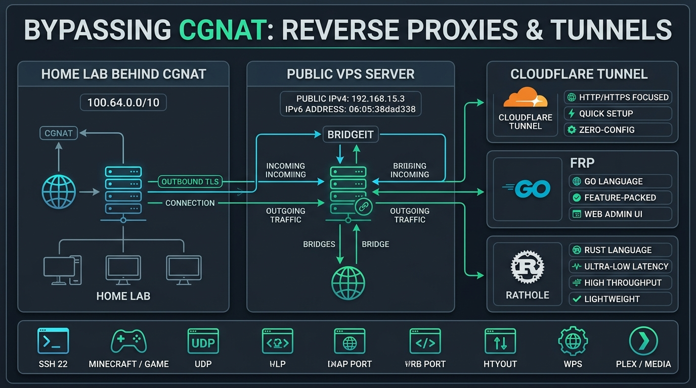
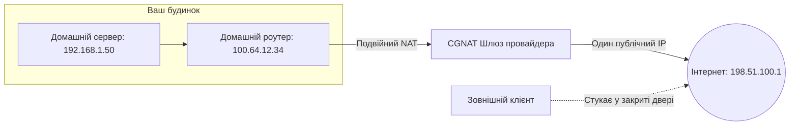

[🇬🇧 Read this article in English](/posts/cgnat-bypass-rathole-frp-reverse-proxy-en/)

---

Кожен ентузіаст Homelab, розробник чи системний адміністратор рано чи пізно стикається з типовою драмою:
* Ви зібрали чудовий домашній сервер, підняли файлове сховище, медіасервер Jellyfin, розумний дім Home Assistant або ігровий сервер Minecraft.
* Заходите в налаштування роутера, щоб налаштувати Port Forwarding (прокидання портів)...
* І з жахом помічаєте, що WAN-адреса вашого роутера починається з **`100.64.x.x`** або **`10.x.x.x`**.

Вітаємо, ви за **CGNAT (Carrier-Grade NAT)** — ваш інтернет-провайдер посадив тисячі користувачів за одну спільну публічну IP-адресу. Ззовні ваш роутер просто недосяжний. Жоден пакет з інтернету не знає, на який саме з тисяч комп'ютерів перенаправити запит. А на оптиці багатьох провайдерів, мобільному 4G/5G інтернеті чи Starlink отримати білий публічний IP взагалі неможливо або коштує захмарних грошей.

Багато хто чув про **Cloudflare Tunnel**, але він має критичні обмеження: він чудово працює з HTTP-сайтами, але **блокує або вимагає встановлення спеціального клієнта для сирого TCP/UDP-трафіку** (SSH, VPN, RTSP-камери, ігри) і забороняє важкий медіапотік за правилами сервісу (ToS).

Сьогодні розберемося, як вирішити проблему «сірого» IP раз і назавжди: чому зв'язка копійчаного VPS та сучасних реверс-проксі **Rathole (на швидкому Rust)** або **FRP (на Go)** дає повну свободу, мінімальну затримку та дозволяє прокинути будь-який порт назовні за лічені хвилини.


_Мал. 1. Архітектура реверс-тунелів: чому вихідне з'єднання через Rathole або FRP перемагає обмеження CGNAT та Cloudflare_

---

## Чому Port Forwarding не працює: анатомія CGNAT

У 1980-х роках творці протоколу IPv4 виділили близько 4,3 мільярда адрес. Здавалося, цього вистачить на все людство. Але у 2011 році вільні пули IPv4 офіційно закінчилися.

Щоб не переводити всю інфраструктуру на IPv6, провайдери впровадили **Carrier-Grade NAT (RFC 6598, діапазон `100.64.0.0/10`)**:



Коли ви стукаєте ззовні на публічний IP `198.51.100.1` за портом 22 чи 8080 — шлюз провайдера просто відкидає ці пакети, бо в його таблиці трансляцій немає запису, що цей вхідний запит призначений саме вашому домашньому роутеру.

---

## Чому Cloudflare Tunnel не рятує в усіх ситуаціях?

Сервіс Cloudflare Tunnel (`cloudflared`) — приголомшливий інструмент, але він створювався для захисту веб-сайтів, а не для повноцінної інфраструктури:
1. **Проблема з сирим TCP/UDP:** Щоб підключитися по звичайному SSH або зіграти з друзями на ігровому сервері через Cloudflare Tunnel, **кожен клієнт** повинен встановити `cloudflared` на свій пристрій і запускати локальний проксі (`cloudflared access tcp`).
2. **Заборона на важкий стрімінг (ToS 2.8):** Якщо ви почнете гнати гігабайти сирого відеопотоку з Plex/Jellyfin або бекапи через безкоштовний проксі Cloudflare, ваш обліковий запис ризикує отримати блокування за порушення правил використання мережі.
3. **Повна залежність від сторонньої корпорації:** Весь ваш незашифрований трафік термінується на серверах Cloudflare.

---

## Рішення: Реверс-проксі через дешевий VPS

Ідея геніальна у своїй простоті:
1. Ви берете найдешевший VPS у найближчому датацентрі (за \$2–3 на місяць) з гарантованою білою публічною IPv4-адресою.
2. Ваш домашній сервер **сам ініціює вихідне зашифроване з'єднання (Outbound connection)** до вашого VPS.
3. Оскільки з'єднання вихідне — жоден CGNAT чи файрвол провайдера його не блокує!
4. Сервер на VPS просто слухає потрібний публічний порт і перенаправляє весь трафік у створений тунель прямо на ваш домашній пристрій.

---

## Битва титанів: Rathole проти FRP

Для побудови таких тунелів роками використовували `SSH Remote Port Forwarding` (`ssh -R`), але SSH важкий, повільний і регулярно відпадає під навантаженням. Йому на зміну прийшли два лідери:

| Критерій | **Rathole** (Нова школа) | **FRP** (Класика) |
| :--- | :--- | :--- |
| **Мова програмування** | **Rust** (максимальна швидкість та безпека) | **Go** (Golang) |
| **Споживання пам'яті** | **1–3 МБ RAM** (майже невагомий) | 15–30 МБ RAM |
| **Пропускна здатність** | Екстремальна (до 100 000+ з'єднань/сек) | Висока |
| **Протокол шифрування** | **Noise Protocol** (як у WireGuard) / TLS | TLS / KCP / QUIC |
| **Веб-дашборд** | Немає (чистий CLI-дзен) | Є вбудована веб-панель керування |
| **Для чого ідеальний?** | **Ігри, високі навантаження, слабкі роутери/VPS** | Складні топології, коли потрібен дашборд |

---

## Практика: Налаштовуємо Rathole за 5 хвилин

Покажемо на практиці, як прокинути домашній SSH-порт (`22`) та веб-сервіс (`8080`) на публічну адресу VPS через надшвидкий **Rathole**.

### Крок 1. Завантаження Rathole (і на VPS, і вдома)
Rathole поширюється як один готовий статичний бінарник без жодних залежностей:

```bash
# Завантажуємо свіжий реліз для x86_64:
wget https://github.com/rapiz1/rathole/releases/latest/download/rathole-x86_64-unknown-linux-musl.zip
unzip rathole-x86_64-unknown-linux-musl.zip
sudo mv rathole /usr/local/bin/
sudo chmod +x /usr/local/bin/rathole
```

---

### Крок 2. Налаштування на VPS (Серверна частина)

Створюємо конфігураційний файл `/etc/rathole/server.toml`:

```toml
# /etc/rathole/server.toml

[server]
bind_addr = "0.0.0.0:2333" # Службовий порт зв'язку з домашнім клієнтом
default_token = "СуперСекретнийКлючБезпеки_12345"

# Прокидаємо SSH домашнього сервера
[server.services.home_ssh]
type = "tcp"
bind_addr = "0.0.0.0:2222" # Цей порт відкриється на VPS для зовнішнього світу

# Прокидаємо веб-сервер (Jellyfin / панель)
[server.services.home_web]
type = "tcp"
bind_addr = "0.0.0.0:8080"
```

Запускаємо сервер у тестовому режимі:
```bash
rathole /etc/rathole/server.toml
```

---

### Крок 3. Налаштування на домашньому сервері (Клієнтська частина)

Створюємо конфігураційний файл `/etc/rathole/client.toml` на домашньому ПК:

```toml
# /etc/rathole/client.toml

[client]
remote_addr = "IP_АДРЕСА_ВАШОГО_VPS:2333"
default_token = "СуперСекретнийКлючБезпеки_12345"

# Мапимо локальний SSH (порт 22)
[client.services.home_ssh]
type = "tcp"
local_addr = "127.0.0.1:22"

# Мапимо локальний веб-сервіс (порт 8080)
[client.services.home_web]
type = "tcp"
local_addr = "127.0.0.1:8080"
```

Запускаємо клієнт:
```bash
rathole /etc/rathole/client.toml
```

**Магія сталася!** За 2 секунди тунель піднято. Тепер із будь-якої точки світу ви можете виконати:
```bash
ssh user@IP_АДРЕСА_ВАШОГО_VPS -p 2222
```
І ви миттєво опинитеся всередині свого домашнього сервера, що сидить за глухим CGNAT або мобільним модемом!

---

### Крок 4. Автозапуск через Systemd

Щоб тунель автоматично підніматися після перезавантаження та перепідключався при збоях інтернету, створимо Systemd-юніт:

```ini
# /etc/systemd/system/rathole.service
[Unit]
Description=Rathole Secure Reverse Tunnel
After=network.target

[Service]
Type=simple
ExecStart=/usr/local/bin/rathole /etc/rathole/client.toml
Restart=always
RestartSec=5s
LimitNOFILE=1048576

[Install]
WantedBy=multi-user.target
```
*(На сервері VPS замініть `client.toml` на `server.toml`).*

Активуємо службу:
```bash
sudo systemctl daemon-reload
sudo systemctl enable --now rathole
```

---

## Альтернатива: FRP у Docker Compose за 1 хвилину

Якщо ви фанат Docker і любите веб-інтерфейси для моніторингу трафіку, **FRP** — чудовий перевірений комбайн.

### На VPS (`docker-compose.yml`):
```yaml
services:
  frps:
    image: snowdreamtech/frps:latest
    container_name: frps
    restart: always
    network_mode: host
    volumes:
      - ./frps.toml:/etc/frp/frps.toml
```

Файл `frps.toml`:
```toml
bindPort = 7000
auth.token = "my_secret_token"
webServer.addr = "0.0.0.0"
webServer.port = 7500
webServer.user = "admin"
webServer.password = "admin_password"
```

### На домашньому сервері (`docker-compose.yml`):
```yaml
services:
  frpc:
    image: snowdreamtech/frpc:latest
    container_name: frpc
    restart: always
    network_mode: host
    volumes:
      - ./frpc.toml:/etc/frp/frpc.toml
```

Файл `frpc.toml`:
```toml
serverAddr = "IP_ВАШОГО_VPS"
serverPort = 7000
auth.token = "my_secret_token"

[[proxies]]
name = "ssh"
type = "tcp"
localIP = "127.0.0.1"
localPort = 22
remotePort = 2222
```

Після запуску `docker compose up -d` на обох кінцях у вас не тільки працюватиме прокидання портів, а й з'явиться гарна веб-панель моніторингу за адресою `http://IP_VPS:7500`.

---

## Чекліст безпеки: як не відкрити двері зловмисникам

Коли ви виставляєте порти домашнього сервера на публічний IP у відкритий інтернет:
1. **Вимкніть авторизацію за паролем для SSH:** Використовуйте виключно SSH-ключі (`ed25519` або `ed25519-sk`), інакше ботнети забрутфорсять ваш сервер за лічені години.
2. **Налаштуйте Fail2ban на VPS:** Фільтруйте атаки на рівні публічного входу до того, як вони навантажать домашній канал.
3. **Для веб-інтерфейсів використовуйте HTTPS:** Повісьте перед прокинутими портами Nginx Proxy Manager чи Caddy на VPS, щоб отримати безкоштовний сертифікат Let's Encrypt.

---

## Підсумки

«Сірий» IP — більше не вирок для вашого Homelab. 

Поки інші платять провайдерам щомісячну данину за статичну білу адресу або страждають від обмежень безкоштовного Cloudflare Tunnel, інструменти на кшталт **Rathole** та **FRP** у зв'язці з бюджетним VPS повертають вам повний контроль над власною мережею.

Забудьте про закриті порти, насолоджуйтеся швидкістю Rust та будуйте інфраструктуру без жодних штучних обмежень! 🚀🔌
