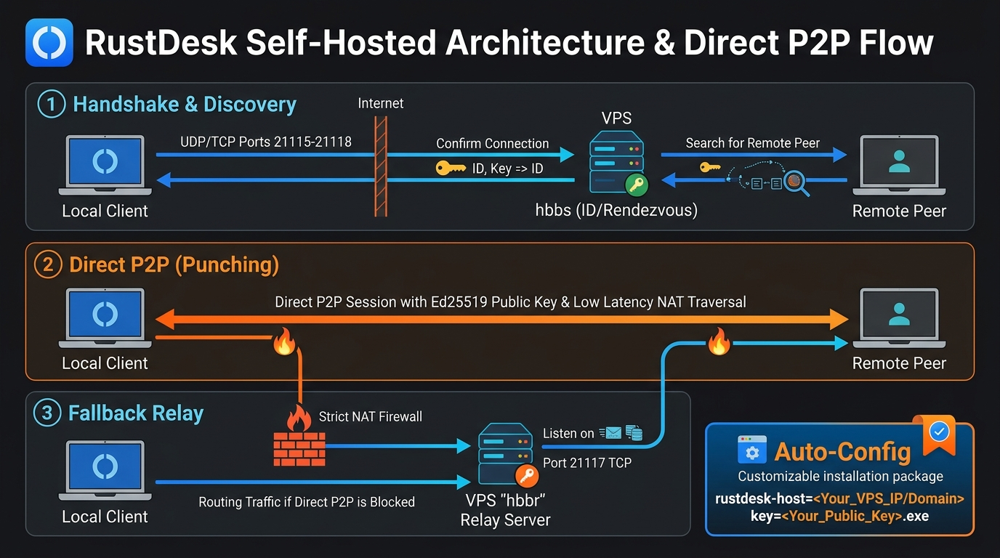

[🇺🇦 Читати цю статтю українською мовою](/posts/rustdesk-self-hosted-server-docker-guide/)

---

A scenario all too familiar to systems administrators, software developers, and anyone who provides technical support to family and colleagues:
* You establish a remote session via TeamViewer or AnyDesk to assist with an application or audit server configurations.
* Exactly five minutes later, the screen freezes, your connection drops, and an aggressive dialog appears: **“Commercial use suspected. Upgrade to an enterprise license for \$30/month or wait 10 minutes before initiating your next session.”**
* And when the connection actually works, input latency floats with a half-second delay while image clarity drops into blurry pixelated soup as public relays in Europe and North America choke under global congestion.

It is time to decommission proprietary monopolies. Enter **[RustDesk](https://rustdesk.com/)** — a completely open-source, highly performant remote desktop suite engineered in memory-safe **Rust**.

The crown jewel of RustDesk? It allows anyone to deploy a **self-hosted coordination and relay cluster (ID & Relay Server) on any entry-level \$2–\$3/month cloud VPS**!

In this deep dive, we break down:
1. Why public relays throttle performance and how self-hosting delivers an uncompromising **60 FPS stream with sub-15ms latency**.
2. How to deploy **`hbbs`** and **`hbbr`** via Docker Compose in under 3 minutes.
3. How to lock down server access using proprietary Ed25519 public keys to prevent unauthorized freeloaders.
4. How to distribute clients to friends and users with zero manual setup using executable renaming.


_Fig. 1. Architecture of a self-hosted RustDesk cluster: direct P2P NAT hole punching backed by fallback relay routing_

---

## Under the Hood: How RustDesk Functions (hbbs vs hbbr)

Unlike bloated monolithic remote solutions, the server backend of RustDesk is composed of two purpose-built binaries:

1. **`hbbs` (RustDesk ID / Rendezvous Server):**  
   The coordination hub. It assigns unique numerical IDs to endpoints, maintains client heartbeats, and orchestrates NAT Hole Punching to negotiate a **Direct Point-to-Point (P2P) encrypted link**.
2. **`hbbr` (RustDesk Relay Server):**  
   The transit bridge. If both endpoints are trapped behind restrictive symmetric corporate firewalls or carrier-grade NAT where direct P2P is mathematically impossible, `hbbr` proxies the end-to-end encrypted video stream with minimal packet buffering.

```mermaid
sequenceDiagram
    autonumber
    actor Admin as Your Workstation (Client A)
    participant VPS as Your VPS (hbbs: ID / hbbr: Relay)
    actor Target as Remote Device (Client B)

    Admin->>VPS: Hello hbbs! I am Client 111, requesting connection to Client 222
    Target->>VPS: I am online (ID 222, matching Ed25519 key verified)
    VPS-->>Admin: Here is Client B's public IP and punch port
    VPS-->>Target: Here is Client A's public IP and punch port
    
    rect rgb(20, 40, 30)
    Note over Admin,Target: Direct P2P Hole Punching Phase
    Admin->>Target: Direct encrypted stream established (0ms relay overhead!)
    end

    alt If Symmetric NAT blocks direct P2P:
    Admin->>VPS: Direct handshake timed out, engage hbbr relay!
    Target->>VPS: Joining relay session on hbbr
    VPS-->>Admin: Relaying 60 FPS end-to-end encrypted stream
    end
```



When you rely on default public infrastructure, you share bandwidth with hundreds of thousands of concurrent sessions globally.  
When you self-host on a **private VPS**, 100% of the network throughput is dedicated to your workflow. Direct P2P succeeds in roughly 90% of connections, and when fallback routing is required, your dedicated VPS relay guarantees crystal-clear responsiveness.

---

## Step 1: Firewall Configuration on VPS

RustDesk requires specific inbound ports. If you run UFW (Ubuntu/Debian) or FirewallD (AlmaLinux/RHEL/Rocky), execute:

```bash
# UFW (Ubuntu / Debian):
sudo ufw allow 21115:21119/tcp
sudo ufw allow 21116/udp
sudo ufw reload

# FirewallD (AlmaLinux / Rocky / Fedora):
sudo firewall-cmd --zone=public --add-port=21115-21119/tcp --permanent
sudo firewall-cmd --zone=public --add-port=21116/udp --permanent
sudo firewall-cmd --reload
```

### Port Breakdown:
* **`21115/tcp`**: NAT classification and speed test service.
* **`21116/tcp`**: TCP hole punching signaling channel.
* **`21116/udp`**: Endpoint heartbeat telemetry and registration.
* **`21117/tcp`**: The active `hbbr` relay transit pipeline.
* **`21118/tcp` & `21119/tcp`**: Optional ports for browser-based WebRTC client access.

---

## Step 2: Deploying RustDesk with Docker Compose

Create an isolated directory on your host:

```bash
mkdir -p /opt/rustdesk-server && cd /opt/rustdesk-server
```

Create `docker-compose.yml`:

```bash
nano docker-compose.yml
```

Paste the following production configuration:

```yaml
services:
  hbbs:
    container_name: rustdesk-hbbs
    image: rustdesk/rustdesk-server:latest
    command: hbbs -r YOUR_VPS_IP_OR_DOMAIN:21117 -k _
    volumes:
      - ./data:/root
    network_mode: host
    restart: unless-stopped
    depends_on:
      - hbbr

  hbbr:
    container_name: rustdesk-hbbr
    image: rustdesk/rustdesk-server:latest
    command: hbbr -k _
    volumes:
      - ./data:/root
    network_mode: host
    restart: unless-stopped
```

> [!IMPORTANT]
> **Replace `YOUR_VPS_IP_OR_DOMAIN`** with your public server IP or an associated A/CNAME record (e.g., `remote.sedunlab.com` or `193.30.244.165`).  
> The **`-k _`** parameter is vital: it mandates that the server auto-generate a cryptographic keypair and **enforce client-side key verification**. Without `-k _`, your server becomes an unauthenticated public relay that any scanner on IPv4 can hijack.

Spin up the cluster:

```bash
docker compose up -d
```

Verify that both containers initialize properly:

```bash
docker compose logs -f
```

---

## Step 3: Extracting the Cryptographic Keypair

During initial startup, `hbbs` generates an Ed25519 keypair within the `./data/` volume.  
Inspect your public key:

```bash
cat ./data/id_ed25519.pub
```

The output is an alphanumeric string resembling:
```text
B3c+ZkG9y7W8E4a2N...=
```

**Save this key securely!** It is required to authorize all incoming client connections.

---

## Step 4: Configuring the RustDesk Client

Download the official RustDesk desktop or mobile client from [rustdesk.com](https://rustdesk.com/).

### Method 1: Manual GUI Configuration (All Platforms)

1. Launch RustDesk on your local desktop or smartphone.
2. Next to your local ID, click the three-dots menu (`⋮`) or navigate to **Settings** ➔ **Network** ➔ **Unlock Network Settings**.
3. Input your server telemetry:
   * **ID Server:** Enter your VPS IP or domain (e.g., `193.30.244.165` or `remote.sedunlab.com`).
   * **Relay Server:** Can remain empty (the ID server passes `21117` dynamically) or specify `193.30.244.165:21117`.
   * **Key:** Paste the public key retrieved in Step 3.
4. Click **Apply**.

The bottom status footer will promptly transition to a solid green badge: **“Ready”**.

---

### Method 2: Zero-Config Deployment for End Users 🪄

Need to connect to a non-technical family member or remote client? Guiding them through network dialogs, IP addresses, and cryptographic keys is an exercise in frustration.

RustDesk features an ingenious native feature for Windows: **Configuration via Executable Filename**!

1. Take the official `rustdesk-x.x.x.exe` installation binary.
2. Rename the file following this exact syntax:
   ```text
   rustdesk-host=YOUR_IP_OR_DOMAIN,key=YOUR_PUBLIC_KEY.exe
   ```
   *Example:*
   ```text
   rustdesk-host=193.30.244.165,key=B3c+ZkG9y7W8E4a2N...=.exe
   ```
3. Deliver this customized binary via cloud storage or flash drive.

When the user launches the renamed binary, RustDesk extracts your server credentials directly from the file string and **automatically connects to your private VPS cluster** without prompting for manual configuration! The user only needs to read their 9-digit ID to you.

---

## Performance Tuning: Unlocking 60 FPS Remote Desktop

Transitioning to your private server dramatically reduces input lag. To maximize fidelity:

1. **Hardware Video Acceleration:**  
   Under RustDesk settings (*Display* panel), ensure hardware decoding is active for **H.264** or **H.265/AV1** (utilizing local NVIDIA, AMD, or Intel GPUs). Remote cursor latency drops to an unnoticeable 5–10ms.
2. **Uncapped File Transfers:**  
   RustDesk features an integrated dual-pane file explorer. Routed through your dedicated VPS, transfers saturate the full upstream/downstream capacity of your ISP rather than artificially throttled vendor tiers.
3. **Cross-Platform Host Support:**  
   Android clients can serve both as remote viewers and managed endpoints via native Android Accessibility Services.

---

## Feature Matrix: TeamViewer vs AnyDesk vs Self-Hosted RustDesk

| Metric | TeamViewer | AnyDesk | **Private RustDesk in Docker** |
| :--- | :--- | :--- | :--- |
| **Licensing Cost** | \$25+/month | \$15+/month | **Free (Only \$2–\$3/mo VPS cost)** |
| **Session Timers** | 5-minute boot kickouts | Forced commercial time limits | **Unlimited 24/7 Persistent** |
| **Frame Rate** | 15–30 FPS (Shared Relays) | 20–30 FPS (Congested Relays) | **Smooth 60 FPS (P2P / Dedicated)** |
| **Key Custody** | Corporate Servers | Corporate Servers | **Self-Owned (Ed25519 Hardware-Grade)** |
| **Client Provisioning** | Account Registration | ID/Password exchange | **1-Click Binary Renaming** |

---

## Conclusion

A self-hosted RustDesk cluster is a quintessential example of self-hosting at its best: it is not merely free, it is **substantially faster, more secure, and infinitely more reliable than costly commercial competitors**.

Consuming a negligible 30–50MB of RAM, the server initializes in minutes and eliminates commercial nagging forever.

Deploy it on your cloud VPS today, and enjoy uninterrupted, private remote desktop administration anywhere in the world! 🖥️🚀
