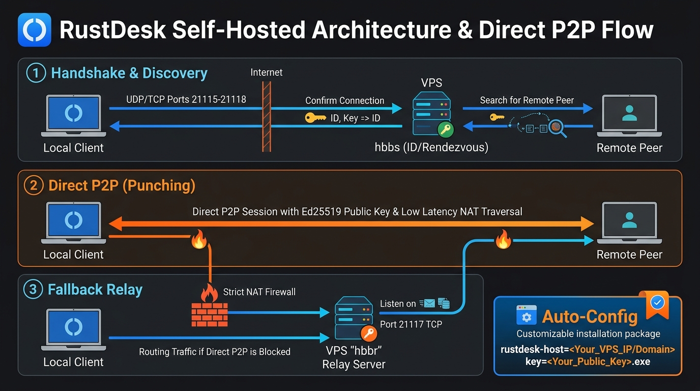

[🇬🇧 Read this article in English](/posts/rustdesk-self-hosted-server-docker-guide-en/)

---

Сценарій, знайомий кожному системному адміністратору, розробнику чи просто людині, яка допомагає налаштовувати комп'ютери батькам чи колегам:
* Ви підключаєтеся через TeamViewer або AnyDesk, щоб оновити конфіги або допомогти з програмою.
* Минає рівно 5 хвилин — екран гасне, з'єднання обривається, а перед очима спливає вікно з ультиматумом: **«Виявлено підозру на комерційне використання. Придбайте ліцензію за \$30 на місяць або зачекайте 10 хвилин перед наступною спробою»**.
* А коли з'єднання таки працює — курсор миші пливе з затримкою у пів секунди, якість картинки падає до мила, бо безкоштовні публічні сервери AnyDesk у Європі тріщать по швах від перевантаження.

Час покласти цьому край. На зміну пропрієтарним монополістам прийшов **[RustDesk](https://rustdesk.com/)** — повністю відкритий, написаний на швидкому та безпечному **Rust** застосунок для віддаленого керування робочим столом.

Але в чому головний секрет RustDesk? Він дозволяє підняти **власний приватний сервер координації та релею (ID & Relay Server) на будь-якому дешевому VPS за \$2–3 на місяць**!

Сьогодні детально розберемося:
1. Чому публічні сервери лагають, а власний сервер видає залізобетонні **60 FPS з пінгом <15 мс**.
2. Як підняти компоненти **`hbbs`** та **`hbbr`** у Docker Compose за 3 хвилини.
3. Як захистити сервер власними криптографічними ключами Ed25519, щоб вашими ресурсами не користувалися сторонні.
4. Як роздавати клієнт друзям та клієнтам в один клік завдяки магії перейменування `.exe`-файлу.


_Мал. 1. Архітектура власного сервера RustDesk: пряме P2P-з'єднання з власним шифруванням та резервний релей hbbr_

---

## Як влаштований RustDesk під капотом: hbbs vs hbbr

На відміну від важких рішень, серверна частина RustDesk складається всього з двох крихітних бінарників:

1. **`hbbs` (RustDesk ID / Rendezvous Server):**  
   Сервер реєстрації та координації. Він видає кожному комп'ютеру унікальний ID, слухає серцебиття (heartbeat) та допомагає двом пристроям пробити NAT (NAT Hole Punching) для встановлення **прямого зв'язку від точки до точки (Direct P2P)**.
2. **`hbbr` (RustDesk Relay Server):**  
   Релейний сервер (транзитний міст). Якщо обидва комп'ютери сидять за складними симетричними файрволами або мобільним інтернетом, де прямий P2P неможливий, `hbbr` бере весь зашифрований трафік сесії на себе і передає його між машинами.

```mermaid
sequenceDiagram
    autonumber
    actor Admin as Ваш ПК (Клієнт A)
    participant VPS as Ваш VPS (hbbs: ID / hbbr: Relay)
    actor Target as Віддалений ПК (Клієнт B)

    Admin->>VPS: Привіт hbbs! Мій ID: 111, хочу підключитися до ID: 222
    Target->>VPS: Я на зв'язку (ID: 222, ключ збігається)
    VPS-->>Admin: Ось публічна IP та порт Клієнта B
    VPS-->>Target: Ось публічна IP та порт Клієнта A
    
    rect rgb(20, 40, 30)
    Note over Admin,Target: Спроба прямого P2P (Hole Punching)
    Admin->>Target: Пряме зашифроване з'єднання Ed25519 (0ms оверхеду!)
    end

    alt Якщо симетричний NAT блокує P2P:
    Admin->>VPS: Прямий зв'язок не вдався, перемикай на hbbr!
    Target->>VPS: Підключаюся до релею hbbr
    VPS-->>Admin: Транзит зашифрованого потоку 60 FPS
    end
```



Коли ви використовуєте офіційні безкоштовні сервери розробників — на них висять сотні тисяч людей з усього світу.  
Коли ви піднімаєте **свій сервер на VPS** — вся пропускна здатність гігабітного каналу належить тільки вам. Пряме P2P-з'єднання піднімається у 90% випадків, а якщо ні — ваш персональний релей забезпечує плавне відео без артефактів.

---

## Крок 1: Відкриваємо порти на VPS

Серверу RustDesk потрібні певні мережеві порти. Якщо у вас увімкнено файрвол (UFW у Ubuntu/Debian або FirewallD у AlmaLinux/RHEL), виконайте:

```bash
# Для UFW (Ubuntu / Debian):
sudo ufw allow 21115:21119/tcp
sudo ufw allow 21116/udp
sudo ufw reload

# Для FirewallD (AlmaLinux / Rocky / Fedora):
sudo firewall-cmd --zone=public --add-port=21115-21119/tcp --permanent
sudo firewall-cmd --zone=public --add-port=21116/udp --permanent
sudo firewall-cmd --reload
```

### За що відповідає кожен порт:
* **`21115/tcp`**: Службовий тест типу NAT для вибору методу з'єднання.
* **`21116/tcp`**: Сигнальний порт для пробиття дірок у NAT (TCP Hole Punching).
* **`21116/udp`**: Реєстрація пристроїв та перевірка доступності (Heartbeat).
* **`21117/tcp`**: Власне релейний сервіс `hbbr` (передача екрана та файлів).
* **`21118/tcp` та `21119/tcp`**: Опціональні порти для веб-клієнта у браузері.

---

## Крок 2: Розгортаємо RustDesk у Docker Compose

Створимо окрему директорію на сервері:

```bash
mkdir -p /opt/rustdesk-server && cd /opt/rustdesk-server
```

Створюємо файл `docker-compose.yml`:

```bash
nano docker-compose.yml
```

Вставте наступну готову конфігурацію:

```yaml
services:
  hbbs:
    container_name: rustdesk-hbbs
    image: rustdesk/rustdesk-server:latest
    command: hbbs -r YOUR_VPS_IP_OR_DOMAIN:21117 -k _
    volumes:
      - ./data:/root
    network_mode: host
    restart: unless-stopped
    depends_on:
      - hbbr

  hbbr:
    container_name: rustdesk-hbbr
    image: rustdesk/rustdesk-server:latest
    command: hbbr -k _
    volumes:
      - ./data:/root
    network_mode: host
    restart: unless-stopped
```

> [!IMPORTANT]
> **Обов'язково замініть `YOUR_VPS_IP_OR_DOMAIN`** на реальну публічну IP-адресу вашого сервера або прив'язаний домен (наприклад, `remote.sedunlab.com` чи `193.30.244.165`).  
> Прапорець **`-k _`** — це найважливіша опція безпеки! Він змушує сервер автоматично згенерувати пару ключів Ed25519 та **вимагати обов'язковий відкритий ключ від усіх клієнтів**. Якщо не вказати `-k _`, будь-яка стороння людина в інтернеті зможе просканувати ваші порти й ганяти свій трафік через ваш VPS.

Запускаємо сервіс:

```bash
docker compose up -d
```

Перевіряємо логи, щоб переконатися, що обидва демони успішно стартували:

```bash
docker compose logs -f
```

---

## Крок 3: Отримуємо публічний ключ шифрування

При першому старті `hbbs` автоматично створив пару ключів у папці `./data/`.  
Подивимося вміст публічного ключа:

```bash
cat ./data/id_ed25519.pub
```

На екран виведеться рядок довжиною близько 44 символів, схожий на такий:
```text
B3c+ZkG9y7W8E4a2N...=
```

**Скопіюйте цей ключ!** Він знадобиться для налаштування всіх ваших клієнтських додатків.

---

## Крок 4: Налаштування клієнта RustDesk

Завантажте клієнт RustDesk для вашої платформи (Windows, macOS, Linux, Android, iOS) з офіційного сайту [rustdesk.com](https://rustdesk.com/).

### Спосіб 1: Ручне налаштування (Усі платформи)

1. Відкрийте RustDesk на вашому комп'ютері чи смартфоні.
2. Біля вашого ID натисніть на меню з трьома крапками (`⋮`) або перейдіть у **Налаштування** ➔ **Мережа (Network)** ➔ **Розблокувати налаштування мережі**.
3. Заповніть поля:
   * **ID-сервер (ID Server):** Вкажіть IP або домен вашого VPS (наприклад: `193.30.244.165` або `remote.sedunlab.com`).
   * **Сервер релею (Relay Server):** Можна залишити порожнім (hbbs сам передасть порт `21117`) або вказати `193.30.244.165:21117`.
   * **Ключ (Key):** Вставте публічний ключ, який ви скопіювали на кроці 3.
4. Натисніть **Застосувати (Apply)**.

Внизу вікна статус-індикатор має засвітитися зеленим: **«Готовий» (Ready)**.

---

### Спосіб 2: Магія для друзів і родичів — автоналаштування в один клік! 🪄

Уявіть ситуацію: вам треба підключитися до комп'ютера мами, друга чи клієнта, які далекі від мережевих технологій. Пояснювати їм, де шукати налаштування мережі, вбивати порти та копіювати довгий ключ — це 20 хвилин нервів.

Розробники RustDesk зробили геніальну фічу для Windows: **конфігурація через назву файлу**!

1. Візьміть стандартний завантажений інсталятор `rustdesk-x.x.x.exe`.
2. Перейменуйте його за наступним шаблоном:
   ```text
   rustdesk-host=ВАШ_IP,key=ВАШ_ПУБЛІЧНИЙ_КЛЮЧ.exe
   ```
   *Наприклад:*
   ```text
   rustdesk-host=193.30.244.165,key=B3c+ZkG9y7W8E4a2N...=.exe
   ```
3. Скиньте цей файл людині через Telegram або флешку.

Коли користувач просто запускає цей файл — RustDesk автоматично витягує IP вашого VPS та ключ безпеки прямо з назви виконуваного файлу і **миттєво підключається до вашого приватного сервера!** Людині залишається лише продиктувати вам 9 цифр свого ID.

---

## Фішки та тюнінг продуктивності: вичавлюємо 60 FPS

Після переходу на власний сервер ви помітите колосальну різницю у швидкості. Ось як зробити досвід керування ще кращим:

1. **Апаратне прискорення кодеків (Hardware Codecs):**  
   У налаштуваннях RustDesk (вкладка *Дисплей / Відображення*) перевірте, щоб було увімкнено апаратне кодування **H.264** або **H.265/AV1** (за наявності відеокарти NVIDIA/AMD/Intel). Затримка введення миші впаде до непомітних 5–10 мілісекунд.
2. **Передача файлів на швидкості каналу:**  
   RustDesk має вбудований двопанельний менеджер файлів. Оскільки транзит іде через ваш сервер, файли летять на повній швидкості вашого інтернету, без штучних обмежень швидкості.
3. **Підтримка мобільних пристроїв:**  
   Клієнт під Android дозволяє не лише переглядати екран, а й повноцінно керувати телефоном віддалено через службу Accessibility Service.

---

## Порівняння: AnyDesk vs TeamViewer vs Власний RustDesk

| Критерій | TeamViewer | AnyDesk | **Власний RustDesk у Docker** |
| :--- | :--- | :--- | :--- |
| **Ціна ліцензії** | Від \$25/міс | Від \$15/міс | **Безкоштовно (тільки ціна VPS \$2)** |
| **Ліміти за часом** | Обрив через 5 хв | Викидає за «комерційне використання» | **Необмежено 24/7** |
| **Швидкість / FPS** | 15–30 FPS (публічні сервери) | 20–30 FPS (перевантажені релеї) | **Плавні 60 FPS (пряме P2P або свій VPS)** |
| **Контроль ключів** | На серверах корпорації | На серверах корпорації | **Тільки у вас (ключ Ed25519)** |
| **Автоналаштування** | Потребує реєстрації | Введення паролів/ID | **1 клік (перейменування файлу)** |

---

## Підсумки

Власний сервер RustDesk — це один із тих рідкісних випадків у світі Self-Hosted, коли відкрите рішення не просто безкоштовне, а **працює на дві голови краще, швидше та стабільніше за розрекламовані платні комерційні сервіси**.

Контейнер споживає мізерні 30–50 МБ оперативної пам'яті, розгортається за 3 хвилини і назавжди позбавляє вас від принизливих повідомлень про платні ліцензії.

Один раз налаштували на своєму VPS — і спокійно адмініструєте будь-які машини з будь-якої точки планети на максимальній швидкості! 🖥️🚀
