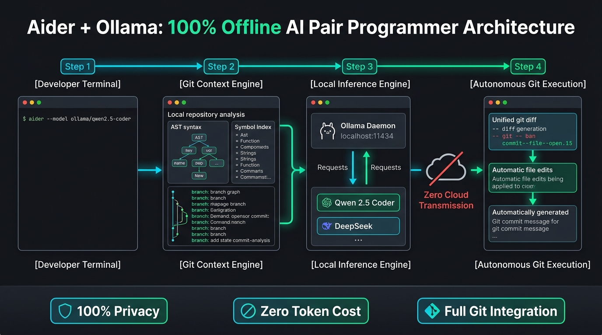

[🇺🇦 Читати цю статтю українською мовою](/posts/aider-ollama-local-ai-coding-assistant/)

---

Just a year ago, AI-assisted software engineering was almost exclusively synonymous with paid SaaS subscriptions: \$10–\$20 monthly for **GitHub Copilot**, proprietary forks of VS Code like **Cursor**, or specialized IDE extensions bound to paid API tokens from OpenAI and Anthropic.

However, commercial cloud-based AI tools pose two critical drawbacks:
1. **Intellectual Property Leaks:** If you work on proprietary internal codebases, NDA-bound client projects, or regulated financial applications, piping private code to third-party telemetry clusters is strictly prohibited by security compliance.
2. **Subscription Fatigue and Outage Vulnerability:** The moment your internet drops during travel or commercial APIs suffer rate limits and 500-series server crashes, your AI-assisted workflow completely freezes.

The open-source AI landscape has dramatically shifted. Thanks to state-of-the-art open-weights models (specifically **Qwen 2.5 Coder** and **DeepSeek-Coder**) combined with two high-leverage tools — **[Aider](https://aider.chat/)** and **[Ollama](https://ollama.com/)** — you can run an **autonomous, full-featured AI pair programmer directly in your terminal**.

It runs 100% offline, costs zero subscription dollars, maps your Git repository, edits files directly on disk, runs tests, and authors clean, granular Git commits automatically!


_Fig. 1. Architecture of a local AI pair programmer: how Aider traverses the Git repository map and coordinates with the local Ollama inference daemon_

---

## Why Aider Beats Traditional Web Chatbots

Most developers begin by manually copy-pasting code snippets into ChatGPT or Claude, asking for fixes, and then manually pasting the output back into their IDE. This is slow, error-prone, and frequently results in broken indentation or missing brackets.

**Aider operates on a completely different paradigm:**
* **Holistic Repository Mapping:** Utilizing the Tree-sitter abstract syntax tree library, Aider builds an in-memory map of your codebase's functions, classes, and types. The model understands relationships between modules, even if you never explicitly feed those files into the chat.
* **Autonomous File Editing:** Say goodbye to copy-paste. Aider generates precise unified Git diffs and applies edits directly to your local working directory.
* **Automated Git Commits:** Upon successfully completing an instruction, Aider executes `git add` and composes a concise, professional commit message (e.g., `feat: implement bcrypt password hashing in auth module`). If you dislike the change, a single `/undo` command reverts the working tree instantly.
* **Test-Driven Self-Correction:** Instruct Aider via `/test pytest` — it executes the test suite, parses the error stack trace, diagnoses the root cause, and edits the code iteratively until all tests pass!

---

## Selecting the Ideal Local Coding Model (2026)

To ensure reliable code synthesis and accurate unified diff formatting, you need a model specialized in syntax trees and software architecture. Currently, Alibaba's **Qwen 2.5 Coder** family dominates open-weights code generation:

| Model Tag | Disk Size | Required Memory (RAM / VRAM) | Recommended Hardware & Workload |
| :--- | :--- | :--- | :--- |
| **`qwen2.5-coder:7b`** | ~4.7 GB | **8–12 GB RAM** (or 6–8 GB VRAM) | **The sweet spot for laptops and standard PCs.** Runs smoothly on Apple Silicon (M1–M4) or an entry-level RTX 3060/4060 GPU. |
| **`qwen2.5-coder:14b`** | ~9.0 GB | **16–24 GB RAM** (or 12–16 GB VRAM) | **Ideal balance of depth and speed.** Exceptional for large refactoring tasks and multi-file dependencies. |
| **`qwen2.5-coder:32b`** | ~20 GB | **32–48 GB RAM** (or RTX 3090/4090 / Mac 36GB+) | Competitive with frontier commercial models like Claude 3.5 Sonnet / GPT-4o on standard coding benchmarks. |
| **`deepseek-coder-v2:16b`** | ~8.9 GB | **16 GB RAM** | A brilliant Mixture-of-Experts (MoE) model tailored for complex algorithmic challenges. |

For 90% of daily engineering tasks, **`qwen2.5-coder:7b`** delivers the ideal compromise between speed and code accuracy.

---

## Step 1: Installing and Launching Ollama

**Ollama** provides the simplest way to manage and serve local models, utilizing GPU acceleration (NVIDIA CUDA, AMD ROCm, or Apple Metal) out of the box.

Install the engine:

```bash
# Linux (Official installation script):
curl -fsSL https://ollama.com/install.sh | sh

# macOS:
brew install ollama

# Windows:
winget install Ollama.Ollama
```

Download and test the coding model:

```bash
ollama run qwen2.5-coder:7b
```
Type `/bye` to exit the interactive prompt. The Ollama daemon remains running as a background service listening on `localhost:11434`.

---

## Step 2: Installing Aider CLI

Aider is distributed via Python's package ecosystem and installs in seconds.

The recommended installation is through the fast package manager `uv` or `pipx`:

```bash
# Recommended via uv:
uv tool install --force --reinstall aider-chat

# Or standard pip:
pip install aider-chat
```

Verify your installation:
```bash
aider --version
```

---

## Step 3: Launching Aider Inside Your Repository

Navigate to the root of any existing Git repository:

```bash
cd ~/my-awesome-project
```

Launch Aider targeting your local Ollama daemon:

```bash
aider --model ollama/qwen2.5-coder:7b
```

Aider will index your project files, construct an AST repository map, and initialize an interactive prompt:

```text
Aider v0.70.0
Model: ollama/qwen2.5-coder:7b with whole edit format
Git repo: .git with 42 files
Repo-map: using 1024 tokens
Use /help <question> for help, run /exit to quit.

my-project> 
```

---

## Daily Workflow: Coding with Aider

Aider is built around intuitive slash-commands and natural language guidance.

### 1. Adding Files to Context (`/add`)
Keep token consumption focused by adding only the files relevant to your task:

```text
> /add src/auth.py src/models.py
```
*(Tip: Use `/read-only src/config.py` for files you want the model to inspect without altering).*

### 2. Instructing in Natural Language
Formulate what you need the agent to build:

```text
> Add email validation using regex in auth.py and update the User database model accordingly.
```

Aider will:
1. Outline the proposed architectural changes.
2. Formulate the unified diffs.
3. Apply edits directly to `src/auth.py` and `src/models.py`.
4. Create an atomic Git commit automatically:
   ```text
   Commit 4f2a1b9 feat: add regex email validation to auth module
   ```

### 3. Automated Test-and-Fix Loops (`/test`)
The ultimate quality assurance capability:

```text
> /test pytest tests/test_auth.py
```
If a test fails, Aider doesn't ask you what went wrong. It **parses the traceback, inspects the failure assertion, fixes the source code, and re-executes the test** until the entire suite passes!

### 4. Rolling Back Undesired Changes (`/undo`)
If the model heads in the wrong direction, do not edit files manually. Simply execute:
```text
> /undo
```
Aider rolls back the last commit, restoring your working tree to its exact prior state.

---

## Quality of Life: `.aider.conf.yml`

To bypass passing CLI flags repeatedly, save a global configuration at `~/.aider.conf.yml`:

```yaml
# ~/.aider.conf.yml
model: ollama/qwen2.5-coder:7b

# Enable automatic Git commits
auto-commits: true

# Prepend commit prefixes
commit-prompt: "feat: {message}"

# Terminal UI enhancements
dark-mode: true
pretty: true
```

Now, inside any Git repository on your machine, launch your assistant with a single command:
```bash
aider
```

---

## Comparison: Cursor / Copilot vs Aider + Ollama

| Metric | GitHub Copilot | Cursor IDE | **Aider + Ollama (Local)** |
| :--- | :--- | :--- | :--- |
| **Cost** | \$10+/month | \$20+/month | **100% Free Forever** |
| **Privacy & NDA** | Code streams to Microsoft | Code streams to Cursor cloud | **Zero Outbound Traffic (localhost)** |
| **Offline Reliability** | Requires Internet | Requires Internet | **Functional Anywhere** |
| **Git Integration** | In-editor hints | File updates | **Auto-diffs + Auto-commits + Auto-tests** |
| **Editor Lock-in** | VS Code / JetBrains | Bespoke VS Code Fork | **Any Terminal, Vim, Neovim, Emacs, IDE** |

---

## Conclusion

The pairing of **Aider + Ollama + Qwen 2.5 Coder** represents a monumental leap forward for developer autonomy.

You no longer have to compromise proprietary source code, balance monthly subscription tiers, or worry about cloud outages. Modern open-weights models possess more than enough algorithmic capability to handle the majority of day-to-day coding tasks: unit tests, refactoring, boilerplate generation, and bug fixing.

Set up this stack today, and turn your terminal into an offline, privacy-first AI development studio! 💻🚀
