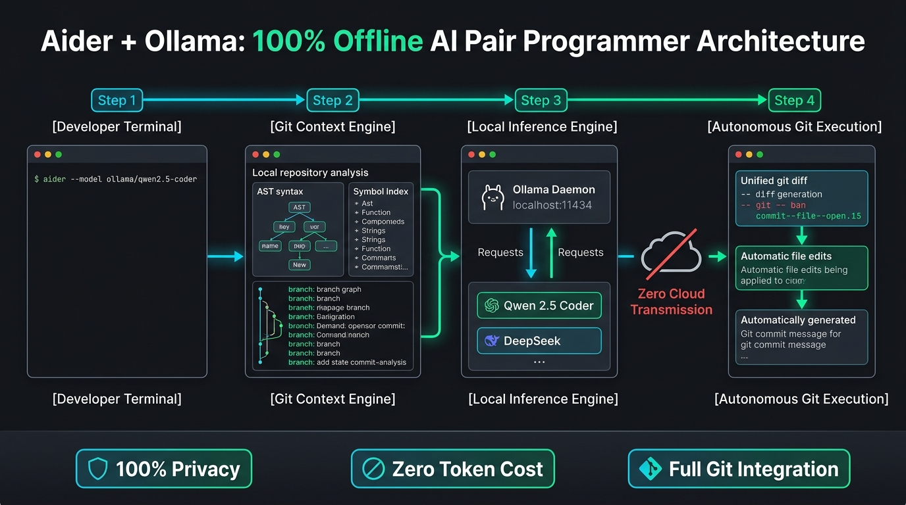

[🇬🇧 Read this article in English](/posts/aider-ollama-local-ai-coding-assistant-en/)

---

Ще рік тому розробка за допомогою штучного інтелекту асоціювалася лише з платними хмарними сервісами: підписка на **GitHub Copilot** за \$10–\$20 на місяць, форк VS Code під назвою **Cursor** або плагіни до популярних IDE, що вимагають ключів OpenAI чи Anthropic.

Але у комерційних хмарних AI-інструментів є дві серйозні проблеми:
1. **Витік інтелектуальної власності:** Якщо ви працюєте над закритим комерційним кодом, NDA-проєктом або чутливою банківською системою — відправляти приватні файли на сторонні сервери категорично заборонено службою безпеки.
2. **Залежність від інтернету та підписок:** Пропав зв'язок під час блекауту чи поїздки, заблокували обліковий запис або сервери OpenAI видали чергову 500-ту помилку — і ви залишаєтеся без улюбленого помічника.

Революція відкритих моделей перевернула правила гри. Завдяки новітнім відкритим моделям (насамперед **Qwen 2.5 Coder** та **DeepSeek-Coder**) і зв'язці двох потужних інструментів — **[Aider](https://aider.chat/)** та **[Ollama](https://ollama.com/)** — ви можете отримати **повноцінного автономного AI парного програміста прямо у своєму терміналі**.

Він працює на 100% офлайн, безкоштовно, самостійно сканує ваш репозиторій через Git, пише код, запускає тести й навіть сам робить красиві комміти!


_Мал. 1. Архітектура локального AI-програміста: як Aider взаємодіє з Git-деревом проєкту та локальним рушієм Ollama_

---

## Чому саме Aider, а не звичайний чат у браузері?

Більшість розробників починають із того, що копіюють шматки коду в ChatGPT або Claude, просять знайти баг, а потім вручну копіюють відповідь назад у свій редактор. Це повільно, нудно й постійно призводить до синтаксичних помилок через пропущені дужки чи не той відступ.

**Aider влаштований принципово інакше:**
* **Він розуміє всю архітектуру проєкту (Repository Map):** Використовуючи бібліотеку Tree-sitter, Aider будує AST-карту всіх функцій, класів та типів вашого репозиторію. Модель бачить зв'язки між файлами, навіть якщо ви їх прямо не передавали.
* **Він сам редагує файли:** Вам не треба нічого копіпастити. Aider генерує точкові Git-дифи й самостійно застосовує їх до вашого коду на диску.
* **Автоматичні комміти:** Після кожної успішної зміни Aider сам виконує `git add` і створює комміт із лаконічним і зрозумілим описом (наприклад, `feat: add regex validation for email field`). Якщо результат вам не сподобався — ви можете відкотити зміни однією командою `/undo`.
* **Запуск тестів і самовиправлення:** Ви можете сказати `/test pytest` — Aider виконає тести, перехопить повідомлення про помилку в консолі, проаналізує стек-трейс і сам виправить код, доки всі тести не стануть зеленими!

---

## Вибір локальної моделі: королі кодингу (2026)

Для комфортної роботи потрібна модель, яка спеціалізується саме на синтаксисі, відступах та генерації точних diff-патчів. Сьогодні беззаперечним лідером є серія **Qwen 2.5 Coder** від Alibaba:

| Модель | Розмір | Необхідна пам'ять (RAM / VRAM) | Для чого підходить? |
| :--- | :--- | :--- | :--- |
| **`qwen2.5-coder:7b`** | ~4.7 ГБ | **8–12 ГБ RAM** (або відеокарта на 6–8 ГБ) | **Рекомендовано для звичайних ПК/ноутбуків.** Літає на Apple Silicon (M1/M2/M3/M4) або будь-якій системі з RTX 3060/4060. |
| **`qwen2.5-coder:14b`** | ~9.0 ГБ | **16–24 ГБ RAM** (або 12–16 ГБ VRAM) | **Золота середина якості.** Значно краще тримає складний контекст і багатокроковий рефакторинг. |
| **`qwen2.5-coder:32b`** | ~20 ГБ | **32–48 ГБ RAM** (або RTX 3090/4090 / Mac 36GB+) | Рівень комерційного Claude 3.5 Sonnet / GPT-4o у завданнях програмування. |
| **`deepseek-coder-v2:16b`** | ~8.9 ГБ | **16 ГБ RAM** | Чудова MoE-модель для алгоритмічних та математичних завдань. |

Для 90% повсякденних завдань версія **`qwen2.5-coder:7b`** є ідеальним вибором: вона швидка, точна і не перевантажує систему.

---

## Крок 1: Встановлення та запуск Ollama

**Ollama** — це найпростіший спосіб запускати локальні LLM. Вона автоматично використовує апаратне прискорення вашої відеокарти (NVIDIA CUDA, AMD ROCm або Apple Metal).

Встановлюємо утиліту:

```bash
# Linux (офіційний скрипт):
curl -fsSL https://ollama.com/install.sh | sh

# macOS:
brew install ollama

# Windows:
winget install Ollama.Ollama
```

Завантажуємо обрану модель кодингу:

```bash
ollama run qwen2.5-coder:7b
```
Після завантаження перевірте, що служба відповідає: напишіть тестове `hello` і натисніть `/bye` для виходу. Служба Ollama залишиться працювати у фоні на порту `11434`.

---

## Крок 2: Встановлення Aider CLI

Aider написаний на Python, тому встановлюється буквально за 30 секунд.

Найкращий спосіб — використати сучасний менеджер `uv` або штатний `pipx` / `pip`:

```bash
# Через uv (найшвидший і рекомендований спосіб):
uv tool install --force --reinstall aider-chat

# Або класичний pip:
pip install aider-chat
```

Перевірте встановлення:
```bash
aider --version
```

---

## Крок 3: Перший запуск у власному репозиторії

Перейдіть у кореневу папку будь-якого вашого Git-проєкту:

```bash
cd ~/my-awesome-project
```

Запустіть Aider, вказавши локальну модель Ollama:

```bash
aider --model ollama/qwen2.5-coder:7b
```

Aider просканує репозиторій, побудує карту символів і відкриє інтерактивну сесію:

```text
Aider v0.70.0
Model: ollama/qwen2.5-coder:7b with whole edit format
Git repo: .git with 42 files
Repo-map: using 1024 tokens
Use /help <question> for help, run /exit to quit.

my-project> 
```

---

## Як працювати з Aider: щоденна практика

Aider працює за принципом команд і природного спілкування.

### 1. Додавання потрібних файлів у контекст (`/add`)
Щоб модель не витрачала зайву пам'ять на файли, які не стосуються задачі, додайте лише ті, які потрібно редагувати:

```text
> /add src/auth.py src/models.py
```
*(Підказка: якщо потрібно тільки читати файл без права редагування, використовуйте `/read-only src/config.py`).*

### 2. Формулюємо завдання людинозрозумілою мовою
Тепер просто напишіть, що потрібно зробити:

```text
> Додай функцію хешування паролів за допомогою bcrypt у auth.py та онови модель користувача.
```

Aider:
1. Запропонує план змін.
2. Згенерує дифи.
3. Сам відредагує `src/auth.py` та `src/models.py`.
4. Автоматично створить акуратний Git-комміт:
   ```text
   Commit 4f2a1b9 feat: add bcrypt password hashing to auth module
   ```

### 3. Автоматичне тестування (`/test`)
Найпотужніша фішка для підтримки якості коду:

```text
> /test pytest tests/test_auth.py
```
Якщо тест упаде з помилкою — Aider не запитає у вас, що робити. Він **сам прочитає стек-трейс помилки, проаналізує причину падіння, виправить код і перезапустить тест**, доки все не запрацює ідеально!

### 4. Відкат змін, якщо результат не сподобався
Якщо модель пішла не тим шляхом, не потрібно вручну правити код. Просто введіть:
```text
> /undo
```
Aider миттєво відкотить останній комміт і поверне стан репозиторію до початкового.

---

## Зручний конфіг на щодень: `.aider.conf.yml`

Щоб не вводити назву моделі щоразу в консолі, створіть файл конфігурації `~/.aider.conf.yml` у вашій домашній директорії:

```yaml
# ~/.aider.conf.yml
model: ollama/qwen2.5-coder:7b

# Автоматично додавати зміни до Git
auto-commits: true

# Додавати префікс до коммітів Aider
commit-prompt: "feat: {message}"

# Темна тема для консолі
dark-mode: true

# Показувати гарні дифи синтаксису
pretty: true
```

Тепер у будь-якій папці вам достатньо просто набрати одне слово:
```bash
aider
```
І ваш локальний помічник одразу готовий до бою!

---

## Порівняння: Cursor / Copilot vs Aider + Ollama

| Параметр | GitHub Copilot | Cursor IDE | **Aider + Ollama (Локально)** |
| :--- | :--- | :--- | :--- |
| **Вартість** | Від \$10/міс | Від \$20/міс | **Повністю безкоштовно** |
| **Приватність** | Код іде на сервери Microsoft | Код іде на сервери Cursor | **100% офлайн (localhost)** |
| **Робота без інтернету** | Неможлива | Неможлива | **Працює навіть у бункері** |
| **Автономність у Git** | Тільки підказки | Редагування файлів | **Авто-правки + авто-комміти + авто-тести** |
| **Прив'язка до редактора** | Тільки VS Code / JetBrains | Окремий форк VS Code | **Будь-який термінал, Vim, Neovim, Emacs, VS Code** |

---

## Підсумки

Зв'язка **Aider + Ollama + Qwen 2.5 Coder** — це новий рівень свободи для розробника. 

Вам більше не потрібно хвилюватися про комерційну таємницю, витік приватних ключів компанії, ліміти токенів чи щомісячні рахунки за підписки. Сучасні відкриті моделі вже достатньо розумні, щоб закривати 90% рутинної роботи: написання тестів, рефакторинг, додавання валідацій та виправлення багів.

Встановіть цей стек сьогодні — і перетворіть свій термінал на затишну студію парного програмування! 💻🚀
