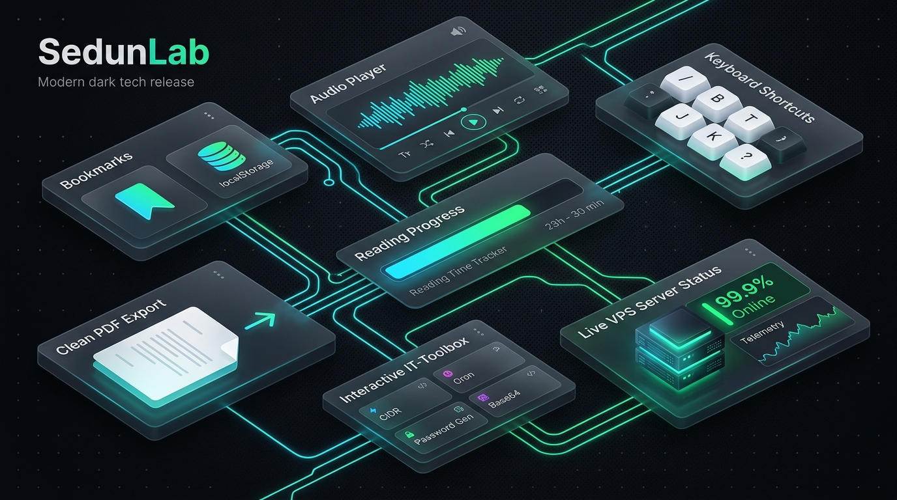

[🇺🇦 Читати цю статтю українською мовою](/posts/sedunlab-big-update-bookmarks-audio-tools/)

---

When I first created **SedunLab**, the primary objective was simple: build a personal, open-access technical laboratory to document hands-on experiments across Linux, VPS hosting, Docker containers, homelab infrastructure, and modern networking protocols. Over time, however, the blog has grown significantly — regularly serving systems administrators, DevOps engineers, and self-hosting enthusiasts looking for verified configurations and step-by-step guides.

Too many modern tech publications have evolved into cluttered, banner-ridden walls of text that force user registrations, disrupt reading with cookie consent modals, and require cumbersome copy-pasting of terminal commands.

Today, I am excited to announce the **largest platform update to SedunLab yet**: 7 powerful features designed to transform the website into an intuitive, responsive, and privacy-first toolkit for every technical professional.

_Fig. 1. Architecture of the new platform capabilities introduced in SedunLab_

---

## 1. 🔖 Zero-Tracking Bookmarks via LocalStorage

You no longer need to clog your browser's bookmark manager or forward links to saved messages in messaging apps. Any guide or tutorial on the site can now be saved in a single click.

### How It Works Under the Hood
* **100% Privacy by Design:** We deliberately avoid tracking cookies. Bookmarks are stored entirely client-side inside your browser's `localStorage` (under the key `sedunlab_bookmarks`).
* **Zero Cookie Banners:** Because no personal analytics or tracking cookies are transmitted to third-party endpoints, the site remains entirely free from intrusive consent prompts.
* **Quick-Save from Post Feeds:** Every article card on the homepage now includes a dedicated bookmark icon `🔖` — save posts for later reading directly while skimming the feed.
* **Dedicated [/bookmarks/](/bookmarks/) Tab:** The sidebar navigation now features an active **BOOKMARKS** tab with a dynamic badge indicating the exact number of saved guides. Bookmarked posts remain accessible even in poor connectivity conditions, complete with individual removal and one-click bulk clearing.

---

## 2. 🎧 In-Browser Text-to-Speech (Web Speech API)

In-depth technical guides can be lengthy and detail-dense. Reading from a smartphone screen is not always ideal while commuting, traveling, or rack-mounting hardware in a server room.

Each article now features a **"Listen"** button directly adjacent to the estimated reading time:
* **Intelligent Content Filtering:** Powered by the browser's native **Web Speech API**, the audio parser automatically strips code snippets, Bash commands, Markdown syntax, tables, and raw SVGs before synthesis. You hear natural, fluent prose rather than mechanical recitation of brackets and semicolons.
* **Automatic Language Matching:** Ukrainian articles utilize the native Ukrainian voice synthesizer (`uk-UA`), while English articles automatically switch to English pronunciation (`en-US`).
* **Playback Speed Control:** The integrated mini-player provides immediate pause/resume and quick speed adjustments: **1x**, **1.25x**, **1.5x**, or **0.85x**.

---

## 3. 📊 Reading Progress Indicator

To improve orientation throughout comprehensive long-reads, a slim gradient progress bar is now pinned to the top of every post.

Occupying only 3 pixels in height, it tracks your exact scroll depth in real time without obscuring headings, ensuring you always know how much material remains.

---

## 4. ⌨️ Power-User Keyboard Shortcuts (Vim / GitHub Style)

Engineers and terminal users appreciate fluid navigation without reaching for the mouse. SedunLab now supports full hotkey navigation:

| Key | Action |
| :---: | :--- |
| <kbd>/</kbd> | **Global Search:** Focuses and opens the instant search dialog across all articles |
| <kbd>B</kbd> | **Bookmark:** Saves or removes the active article from your reading list |
| <kbd>T</kbd> | **Theme Toggle:** Flips smoothly between Light and Dark interface modes |
| <kbd>J</kbd> | **Previous Post:** Navigates chronologically to the preceding publication |
| <kbd>K</kbd> | **Next Post:** Navigates chronologically to the subsequent publication |
| <kbd>H</kbd> | **Home:** Jumps directly to the homepage (`/` or `/en/`) |
| <kbd>?</kbd> | **Cheatsheet:** Displays the keyboard shortcut overview modal |
| <kbd>Esc</kbd> | Closes the shortcut dialog or dismisses active search |

> [!TIP]
> Hotkey triggers are automatically bypassed when focus is placed inside form inputs, search fields, or Giscus comment boxes, preventing unintended actions during text entry.

---

## 5. 📄 Clean PDF Export for Datacenter & Field Work

Field engineers and sysadmins frequently require offline documentation when troubleshooting network closets, remote server rooms, or air-gapped homelab setups without reliable internet.

The **PDF** button in the article header invokes a dedicated `@media print` stylesheet:
* Sidebars, navigation headers, status widgets, share bars, and comment threads are suppressed.
* Typography, contrast, and code styling are optimized for standard A4 formatting.
* Code listings and figures are protected from page splits (`page-break-inside: avoid`).
* The result is a clean, professional technical document ready for paper printing or archival storage.

---

## 6. 🛠 Interactive IT-Toolbox ([/tools/](/tools/))

We have introduced a dedicated [**TOOLS**](/tools/) page in the primary navigation, featuring 4 instant utilities designed to eliminate reliance on ad-heavy web converter tools:

1. **CIDR Subnet Calculator:** Calculates network address, broadcast address, netmask, wildcard mask, first/last usable IP, and total usable host capacity for any IPv4 prefix from `/8` to `/32`.
2. **Cron Expression Explainer:** Input any 5-field cron pattern (such as `*/15 * * * *` or `0 4 * * 1`) to receive human-readable scheduling explanations alongside common sysadmin presets.
3. **Password & Secret Token Generator:** Generates high-entropy passwords, cryptographically secure 32-byte hexadecimal strings (ideal for Docker and API secret keys), and standard UUID v4 values with 1-click clipboard copying.
4. **Base64 & URL Encoder / Decoder:** Instant bidirectional string conversion tailored for config files, JWTs, and encoded headers.

> Every utility operates strictly client-side: your secrets, IPs, and inputs never touch external network endpoints.

---

## 7. 🟢 Live Homelab VPS Status Indicator

Because SedunLab is itself a self-hosted platform running on real hardware, the very top of the left sidebar (in the top-left corner above the profile header) now features an integrated status widget:
* **State:** `🟢 ONLINE` accompanied by a pulsing emerald status indicator.
* **Architecture:** `AlmaLinux 9 • CyberPanel • Nginx`.

This serves as a visual benchmark that this website is powered entirely by independent homelab infrastructure, deployed autonomously via Git hooks.

---

## What's Next?

All of these features are live now on [sedunlab.com](https://sedunlab.com/)! Try saving articles to your [Bookmarks](/bookmarks/), test out keyboard navigation, and explore the new [IT-Toolbox](/tools/).

If you have suggestions for additional tools or features that would benefit your workflow, let me know in the comments below!
