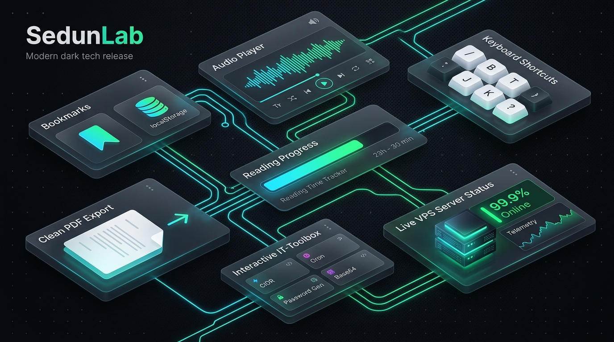

[🇬🇧 Read this article in English](/posts/sedunlab-big-update-bookmarks-audio-tools-en/)

---

Коли я створював **SedunLab**, головною метою було мати власну відкриту технічну лабораторію — місце, де можна фіксувати результати експериментів із Linux, VPS, Docker, Homelab та мережевими протоколами. Але з часом блог виріс у щось значно більше: сюди щодня заходять сисадміни, DevOps-інженери та розробники, які шукають готові перевірені конфіги та практичні інструкції.

Більшість сучасних технічних сайтів перетворилися на перевантажені банерами «полотна тексту», які вимагають реєстрацій, показують нав'язливі спливаючі вікна згоди на кукі та змушують вручну переносити команди в термінал. 

Сьогодні я радий представити **найбільше функціональне оновлення SedunLab**: ми додали 7 крутих можливостей, які перетворюють блог на зручний, швидкий і приватний робочий інструмент для кожного IT-спеціаліста.

_Мал. 1. Архітектура нових можливостей платформи SedunLab_

---

## 1. 🔖 «Обране» (Bookmarks) без реєстрації, трекінгу та кукі

Тепер вам не потрібно зберігати посилання у безкінечні закладки браузера або надсилати їх собі у «Збережене» в Telegram. Будь-яку статтю на сайті можна зберегти в один клік.

### Як це працює під капотом?
* **100% приватність:** Ми принципово **не використовуємо tracking cookies** для збереження ваших закладок. Усі обрані статті зберігаються локально у сховищі вашого браузера (`localStorage` під ключем `sedunlab_bookmarks`).
* **Жодних cookie-банерів:** Оскільки ми не передаємо ваші персональні дані на сторонні аналітичні сервери, сайт залишається кришталево чистим від дратівливих GDPR-попереджень.
* **Швидке збереження зі стрічки:** На кожній картці головної сторінки з'явилася кнопка закладки `🔖` — зберігайте цікаві статті на потім прямо під час перегляду стрічки.
* **Окремий розділ [/bookmarks/](/bookmarks/):** У бічному меню з'явилася вкладка **ОБРАНЕ** з інтерактивним червоним бейджем, який у реальному часі показує кількість збережених публікацій. На самій сторінці збережені матеріали доступні навіть за нестабільного інтернету, з можливістю видалення окремих записів або повного очищення списку.

---

## 2. 🎧 «Слухати статтю» (Web Speech API прямо в браузері)

Технічні гайди бувають довгими та насиченими деталями. Не завжди зручно читати статтю з екрана смартфона в дорозі або під час роботи над залізом у серверній.

Тепер у шапці кожного матеріалу (поруч із часом читання) з'явилася кнопка **«Слухати»**:
* **Розумне відтворення:** Плеєр використовує нативний браузерний рушій **Web Speech API**. Перед озвученням скрипт автоматично вичищає код, Bash-команди, символи Markdown, таблиці та SVG-іконки — ви слухаєте плавний зв'язний текст без механічного бурмотіння дужок чи слешів.
* **Автоматична локалізація:** Для україномовних статей автоматично підключається український синтезатор голосу (`uk-UA`), а для англійських версій публікацій — природна англійська вимова (`en-US`).
* **Керування швидкістю:** Вбудований міні-плеєр дозволяє ставити аудіо на паузу та перемикати швидкість на льоту: **1x**, **1.25x**, **1.5x** або комфортні **0.85x**.

---

## 3. 📊 Смуга прогресу читання (Reading Progress Bar)

Для комфортного орієнтування в довгих технічних туторіалах у верхній частині вікна з'явилася тонка градієнтна смужка. 

Вона не відволікає від контенту, займає всього 3 пікселі у висоту й у режимі реального часу відстежує глибину прокрутки статті. Ви завжди точно бачите, скільки матеріалу вже позаду і скільки ще залишилося до фіналу.

---

## 4. ⌨️ Клавіатурні шорткати для гіків (Vim / GitHub style)

Справжні інженери та системні адміністратори звикли працювати в терміналі й цінують швидкість роботи без відриву рук від клавіатури. Тепер на SedunLab діє повноцінна система шорткатів:

| Клавіша | Дія |
| :---: | :--- |
| <kbd>/</kbd> | **Миттєвий пошук:** Відкриває та фокусує рядок глобального пошуку по всіх статтях |
| <kbd>B</kbd> | **В обране:** Зберігає поточну статтю в закладки або прибирає її |
| <kbd>T</kbd> | **Тема оформлення:** Швидке перемикання між темною та світлою темами |
| <kbd>J</kbd> | **Попередня стаття:** Перехід до попередньої публікації у хронології |
| <kbd>K</kbd> | **Наступна стаття:** Перехід до наступної публікації |
| <kbd>H</kbd> | **Головна:** Швидкий стрибок на домашню сторінку |
| <kbd>?</kbd> | **Довідка:** Спливаюче вікно з усіма гарячими клавішами |
| <kbd>Esc</kbd> | Закрити пошук або вікно довідки |

> [!TIP]
> Шорткати автоматично вимикаються, коли ваш курсор знаходиться всередині полів вводу (наприклад, у вікні пошуку чи коментарях Giscus), тож випадкових спрацювань під час набору тексту не виникне!

---

## 5. 📄 «Зберегти як PDF» (Чистий друк для офлайн-роботи)

Системні адміністратори часто беруть документацію та чеклісти з собою в серверну кімнату чи дата-центр, де немає стабільного Wi-Fi або зв'язку.

Кнопка **PDF** у шапці публікації запускає спеціально оптимізований профіль друку (`@media print`):
* Автоматично приховуються бічний сайдбар, верхня панель, віджет статусу, кнопки соцмереж та коментарі.
* Шрифти та блоки коду оптимізуються під формат А4 з контрастним чорно-білим текстом.
* Блоки коду та зображення захищені від розриву сторінок (`page-break-inside: avoid`).
* Ви отримуєте ідеально зверстаний технічний PDF-посібник, який приємно зберегти на ноутбук або роздрукувати на папері.

---

## 6. 🛠 Інтерактивний розділ «IT-Тулбокс» ([/tools/](/tools/))

Ми додали в головне меню окрему вкладку [«ІНСТРУМЕНТИ»](/tools/) — це набір швидких мікроутиліт, які раніше доводилося шукати на сторонніх сайтах або запускати через однорядкові команди в терміналі:

1. **CIDR Subnet Calculator:** Розраховує мережеву адресу, broadcast, маску підмережі, wildcard, перший і останній корисний хост та загальну кількість доступних IP-адрес для будь-якої маски чи префікса (від `/8` до `/32`).
2. **Cron Перекладач та Помічник:** Введіть будь-який cron-розклад (наприклад, `*/15 * * * *` або `0 4 * * 1`) — тулбокс миттєво розшифрує його простою людською мовою та запропонує популярні шаблони для системних завдань.
3. **Генератор паролів та секретів:** Генерація криптостійких паролів (з гнучким налаштуванням довжини та наборів символів), готових 32-байтових HEX-токенів для Docker / JWT / API та валідних UUID v4 із копіюванням в 1 клік.
4. **Base64 & URL кодувальник/декодер:** Миттєва двостороння конвертація рядків для конфігураційних файлів та заголовків.

> Всі утиліти працюють на 100% клієнтській стороні: ваші паролі, IP-адреси та дані ніколи не надсилаються в мережу!

---

## 7. 🟢 Віджет статусу Homelab / VPS

Оскільки SedunLab — це не просто сайт, а справжній селф-хостинг експеримент, у нижній частині сайдбару тепер інтегровано компактний індикатор статусу:
* **Статус:** `🟢 ONLINE` із плавно пульсуючим неоновим світлодіодом.
* **Стек платформи:** `AlmaLinux 9 • CyberPanel • Nginx`.

Це постійне нагадування про те, що цей блог розгорнутий на власному сервері, керується через Git-хуки та компілюється повністю автономно.

---

## Що далі?

Усі нововведення вже доступні на [sedunlab.com](https://sedunlab.com/)! Тестуйте збереження в **Обране**, пробуйте шорткати клавіатури, слухайте статті фоном та користуйтеся [Тулбоксом](/tools/).

Якщо у вас є ідеї, які ще корисні інструменти варто додати до нашого тулбоксу — пишіть у коментарях нижче, обговоримо!
