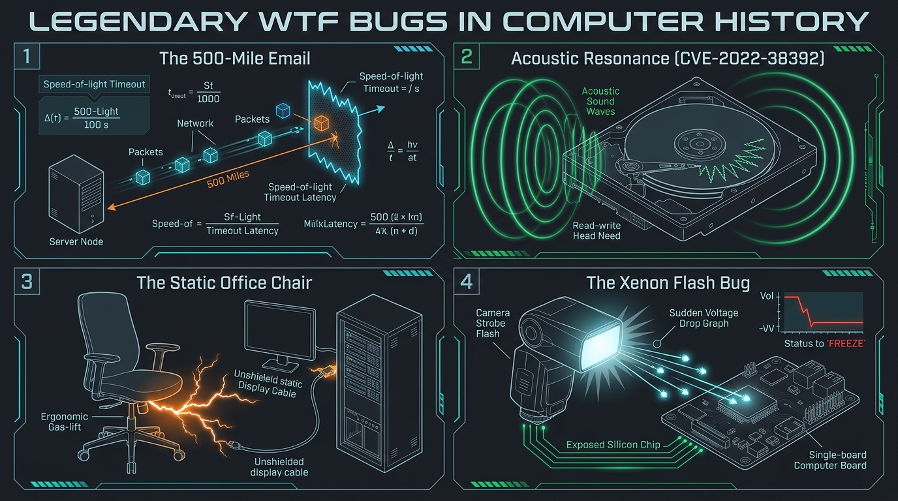

[🇺🇦 Читати цю статтю українською мовою](/posts/weirdest-wtf-bugs-in-tech-history/)

---

Friday evening. All sprint tickets are finally closed, production is miraculously not on fire, a cold beer is poured, and your terminal cursor blinks peacefully in green. The ideal time for some legendary tales around the virtual campfire.

Every systems administrator and DevOps engineer has experienced that eerie feeling that a poltergeist has taken up residence in the server room. A user calls in with complete sincerity: *"My computer reboots every time the department director sits down in his office chair"*, or *"We can’t send emails to anyone farther than 500 miles away"*. The natural instinct of any exhausted admin is to roll their eyes, chuckle, and mentally write it off as user error or an urban myth from the accounting department.

Yet computers are strictly silicon creatures. They don't believe in ghosts, curses, or voodoo. They obey the cold, immutable laws of physics: the speed of light, electromagnetic induction, mechanical acoustic resonance, and the quantum photoelectric effect.

Today, let’s revisit **5 of the most famous, documented, and utterly mind-bending WTF incidents** in computing history, where bizarre symptoms turned out to be pure, unadulterated physics.


_Fig 1. Four physical paradoxes in IT: from the universal speed limit of light to acoustic cyber-attacks_

---

## 1. The Case of the 500-Mile Email

First documented by systems administrator Trey Darley at the University of North Carolina in the early 2000s, this incident has earned a permanent spot in sysadmin folklore.

### The Symptom
The chairman of the statistics department walked into Trey's office with an unusual grievance:
> *"We cannot send emails further than 500 miles (approx. 800 km). Recipients in nearby towns receive messages immediately. But attempting to send an email past 500 miles consistently ends in a timeout or failure."*

Most engineers would have gently urged the user to get some fresh air. But the chairman was a professor of mathematical statistics and had already gathered rigorous empirical data:
* To Richmond (~200 miles) — succeeds instantly.
* To Raleigh (~30 miles) — succeeds.
* To Memphis (~550 miles) — fails.
* To New York City (~600 miles) — fails.
* To Boston (~750 miles) — timeout!

Trey pulled up a map of the eastern United States, placed the point of a compass on the campus, and drew a circle with a 500-mile radius. Every mail server inside the circle responded flawlessly. Every mail server outside the boundary timed out.

```text
[ Campus UNC ]  --- (200 miles: RTT 3ms)  ---> [ Richmond Server ]  -> OK!
[ Campus UNC ]  --- (480 miles: RTT 7ms)  ---> [ Atlanta Server ]   -> OK!
======================= 500 MILES RADIUS BARRIER =======================
[ Campus UNC ]  --- (600 miles: RTT 11ms) ---> [ New York Server ]  -> TIMEOUT!
[ Campus UNC ]  --- (750 miles: RTT 14ms) ---> [ Boston Server ]    -> TIMEOUT!
```

### The Physical Autopsy
How could the SMTP protocol or the `sendmail` daemon have any awareness of geographic distance?

The root cause was uncovered in a recent configuration patch. Trey’s colleague had upgraded the server OS (SunOS) and deployed an updated `sendmail` package. The daemon’s configuration file (`sendmail.cf`) was authored in the notoriously convoluted M4 macro language.

During the upgrade, the directive governing the TCP connection establishment timeout (`Timeout.connect`) was left empty or evaluated to `0`. However, the software maintainers had designed an interesting quirk: when the connection timeout was set to zero, `sendmail` didn't wait indefinitely; instead, it dropped the connection if a response was not received within a few milliseconds (effectively, within a single internal kernel timer quantum).

Now, let's bring in high school physics:
* Speed of light in a vacuum: $c \approx 300,000\text{ km/s}$.
* Optical fiber core has a refractive index of $n \approx 1.5$.
* Speed of a light pulse inside silica optical fiber:
  $$v = \frac{c}{n} \approx \frac{300,000}{1.5} = 200,000\text{ km/s} \approx 124,000\text{ miles/s}$$

For a TCP `SYN` packet to travel to a mail server 500 miles away and return with a `SYN-ACK`, the signal must traverse a round-trip distance of $1,000\text{ miles}$:

$$t_{\text{RTT}} = \frac{1,000\text{ miles}}{124,000\text{ miles/s}} \approx 0.00806\text{ s} \approx 8\text{ milliseconds}$$

Add real-world routing overhead, buffer bloat, and packet processing delays, and it becomes mathematically impossible: with a timeout of just a few milliseconds, packets traveling beyond 500 miles **could not physically return in time**, even moving at the speed of light in a dead-straight glass fiber without a single switch in between!

Adjusting `Timeout.connect` back to the standard several-minute default immediately restored global email delivery.

---

## 2. CVE-2022-38392: How Janet Jackson's Music Video Crashed 5400 RPM Hard Drives

In August 2022, Microsoft veteran Raymond Chen published an astonishing historical anecdote on *The Old New Thing* blog. The story was so technically profound that MITRE formally assigned it a vulnerability identifier: **CVE-2022-38392**.

### The Symptom
During the mid-2000s, a major PC manufacturer approached Microsoft with a bizarre hardware defect: playing the music video for Janet Jackson's 1989 hit **"Rhythm Nation"** caused laptops with 5400 RPM hard drives to freeze up and crash.

The strangest aspect was:
1. The laptop playing the video crashed with a Blue Screen of Death (BSOD).
2. A completely separate laptop resting on a nearby desk that was playing no audio whatsoever **also suffered an immediate, hard lockup**!

```text
 ┌──────────────────────┐                     ┌──────────────────────┐
 │   Laptop A (Music)   │                     │  Laptop B (Adjacent) │
 │                      │                     │                      │
 │ 🔊 Rhythm Nation     │                     │                      │
 │    ~1000 Hz Tone     │   Acoustic Wave     │                      │
 │         )))))))))))) │ ──────────────────> │ (((((((((((((        │
 │                      │      Air/Chassis    │                      │
 │ 💥 HDD Crashes!      │                     │ 💥 HDD Crashes!      │
 │ └────────────────────┘                     └──────────────────────┘
```

### The Physical Autopsy
This was an accidental, organic *Side-Channel Acoustic Resonance Attack*.

In traditional 5400 RPM spinning platter hard drives, the read/write head glides over the magnetic platter on an aerodynamic cushion of air measuring merely a few nanometers thick (over a thousand times thinner than a human hair). Any sudden mechanical vibration can kick the head off track.

It turned out that the audio track of "Rhythm Nation" contained a specific frequency tone around 1000–1200 Hz. This tone happened to match the natural resonant frequency of the read/write head assembly and suspension arm of a widely deployed laptop hard drive series. Acoustic sound waves radiating from the chassis speakers vibrated the drive chassis through the air and desk.

The drive head entered resonance, began oscillating wildly against its physical stops, and lost track synchronization. The drive controller detected a critical off-track positioning error and executed an emergency head park, severing all in-flight I/O requests. The host operating system encountered an unrecoverable disk timeout and crashed into a Kernel Panic or BSOD.

### The Fix
Manufacturers could not recall millions of shipped notebooks. Instead, they devised an ingenious software patch: **audio drivers were quietly updated with a custom digital notch filter** that stripped out that specific narrow frequency band on the fly before sending audio to the internal speakers!

---

## 3. The Mystery of the Office Chair: When a Cheap Gas Lift Reboots Servers

In the annals of industrial automation and homelab engineering, there is a recurring, well-verified phenomenon: an external monitor randomly turns black for 2–3 seconds, or a nearby server suffers an unexplained hardware reboot.

### The Symptom
A workstation display flickers black, or a server chassis triggers a spontaneous hard reset. The glitch occurred exclusively during office hours (9:00 AM to 6:00 PM), never at night or over weekends. System logs (`dmesg`, Windows Event Viewer) showed no kernel faults, driver issues, or power supply sags.

```text
  [ User sits down on Gas-Lift Chair ]
                   │
                   ▼  Triboelectric Friction
      [ High Voltage Static: 10-15 kV ]
                   │
                   ▼  Fast ESD Spark discharge in piston
       (((( Radio Frequency EMI Burst ))))
                   │
                   ▼  Received by unshielded DisplayPort / Reset wire
       [ Monitor Blackout / Server Reboot ]
```

### The Physical Autopsy
The culprit was the engineer's brand-new mesh office chair:
1. **Triboelectric Charging:** Moving around in synthetic clothing generated an electrostatic charge of 10,000 to 15,000 volts on the occupant and chair cushion.
2. **The Gas Piston as a Spark Gap:** Inside budget pneumatic gas-lift cylinders, a metal piston slides inside a pressurized chamber. Without conductive grease or proper grounding between the rod and housing, an invisible internal Electrostatic Discharge (ESD) spark jumped across the cylinder sleeve whenever someone sat down or stood up.
3. **Electromagnetic Interference (EMI) Burst:** This spark produced an ultra-fast electrical transient with nanosecond rise times. The steel wheelbase and cylinder acted as a transmitting antenna, blasting an RF electromagnetic pulse into the immediate workspace.
4. **Unshielded Cabling:** Running near the chair was an unshielded, bargain DisplayPort cable. The high-frequency RF pulse induced a voltage spike into the differential data pairs, corrupting the auxiliary channel. The monitor lost sync (*link training failure*) and cut video for 3 seconds while negotiating a re-sync.

In the case of server hardware, the radiated pulse coupled directly into the exposed, high-impedance reset header wires on the front motherboard panel, triggering an immediate hardware reset.

**The Solution:** Replacing the chair with an ESD-rated office model, upgrading to double-shielded braided DisplayPort/HDMI cables with ferrite cores, and ensuring robust earth ground continuity.

---

## 4. The Flash of Death: When the Raspberry Pi 2 Feared the Paparazzi

In February 2015, the Raspberry Pi Foundation unveiled the eagerly awaited **Raspberry Pi 2 Model B** — packing a quad-core ARM processor and 1 GB of RAM. Within days, the official forums exploded with reports of a bizarre glitch: snapping a photo of the single-board computer with a camera flash immediately killed the machine.

### The Symptom
Power on a Raspberry Pi 2, boot Linux, aim a xenon flash camera at the board, and fire — *click!* — the Raspberry Pi instantly locks up or powers down.

Detailed testing uncovered fascinating specifics:
* Ambient indoor lighting — runs perfectly.
* White LED smartphone torch — runs perfectly.
* Red laser pointer — no effect.
* **Xenon studio flash or focused high-power green laser — instantaneous hard reboot!**

```text
 📸 Xenon Camera Flash
       │ (High Intensity Photons)
       ▼
 [ Bare Silicon Die: U16 NCP6343 Chip ]
       │
       ▼ Photoelectric Effect (Electron-Hole Pairs)
 [ Core Voltage Rail Drops below 1.2V ]
       │
       ▼
 ⚡ Brownout Detector Triggers Instant System Reset!
```

### The Physical Autopsy
The root cause was the **photoelectric effect** — the very physical phenomenon for which Albert Einstein received his 1921 Nobel Prize in Physics.

Next to the processor sat the power management IC: **U16 (an ON Semiconductor NCP6343)** step-down converter. To keep the board compact and cost-efficient, the designers selected a **WLCSP** (Wafer Level Chip Scale Package). In WLCSP packages, the silicon semiconductor die is mounted directly to the board without an opaque epoxy resin casing. The silicon crystal is completely exposed to ambient light.

Xenon flashtubes produce an ultra-intense pulse of broad-spectrum photons. When this blast hit the exposed silicon, photons penetrated into the internal bandgap, exciting electron-hole pairs across the p-n junctions of the regulator's differential feedback amplifiers.

This sudden surge of parasitic photocurrent disrupted the internal PWM feedback loop for a fraction of a microsecond. The CPU core voltage rail plummeted below its critical threshold ($1.2\text{ V}$), triggering the on-chip *Brownout Detector*, which promptly forced an emergency hardware reset to safeguard registers from memory corruption.

**The Fix:** A tiny square of black electrical tape, a dab of opaque nail polish, or a blob of Blu-Tack placed over the U16 IC permanently shielded the die from stray photons.

---

## 5. "This Script Only Crashes on Wednesdays": The Dark Art of Time & Locales

Ask any seasoned backend developer or database administrator about their recurring nightmares, and date/time manipulation will invariably make the list.

One classic incident unfolded at a major European freight logistics company: a critical nightly cron job ran seamlessly on Mondays, Tuesdays, Thursdays, Fridays, and weekends. But like clockwork, every Wednesday morning, it crashed with an inexplicable database ingestion error.

```text
Day of Week:    Monday    Tuesday   Wednesday   Thursday   Friday
POSIX (%a):      Mon       Tue        Wed         Thu       Fri   -> 3 chars (OK!)
Ukrainian (%a):   Пн        Вт         Ср          Чт        Пт   -> 2 chars!
German (%a):     Mo        Di         Mi          Do        Fr   -> 2 chars!
Russian (%a):    Пн        Вт        Среда        Чт        Пт   -> 5 chars! (BUFFER OVERFLOW!)
```

### Anatomy of the Bug
The batch pipeline constructed file storage paths using the standard C/POSIX format specifier `strftime("%a")` (abbreviated day of the week).

* In the default US-English locale (`en_US`), every weekday abbreviation is strictly 3 ASCII characters: `Mon`, `Tue`, `Wed`, `Thu`, `Fri`, `Sat`, `Sun`.
* The developer hardcoded a fixed-size 3-byte char buffer and a validation regex: `^[A-Z][a-z]{2}$`.
* However, the deployment host defaulted to inheriting the system environment locale. Under several European and Cyrillic locales, Wednesday was formatted as 2 characters (`Ср`, `Mi`), or in legacy `glibc` tables, expanded to the full 5-character string (`Среда`).

Come Wednesday, the regex rejected the generated filename, or the fixed buffer overflowed, grinding the logistics queue to a halt.

### The 2012 Leap Second Meltdown
Equally unforgettable was midnight on June 30, 2012, when the International Earth Rotation Service inserted a positive leap second (`23:59:60 UTC`) to compensate for Earth's slowing rotation.

The Linux kernel contained a latent concurrency bug in its high-resolution timer subsystem (`hrtimer`). When NTP servers signaled the leap-second flag, kernel threads became trapped in a spinning loop, pegging CPU cores at 100%. Within minutes, high-profile infrastructure worldwide stumbled: **Reddit, LinkedIn, Mozilla, Foursquare, Yelp, Gizmodo**, and Australian airline **Qantas** (which had to ground dozens of flights due to booking system halts) were simultaneously knocked offline.

---

## Practical Takeaways for Homelabbers and DevOps Engineers

These bizarre computing tales are more than entertaining trivia — they serve as potent engineering reminders:

1. **The speed of light is a hard constraint, not an abstract constant.** Every 100 km of fiber-optic transit adds approximately 1 millisecond of round-trip latency. Always configure timeouts with geographic network topography in mind.
2. **Proper shielding and earthing preserve sanity.** Don't cut corners on unshielded display cables or overlook chassis grounding. Electrostatic discharges from an office chair or refrigerator compressor can effortlessly knock down a mini-PC or router.
3. **Locales belong in standard constraints.** Always enforce `LC_ALL=C` or `LANG=C.UTF-8` in cron jobs, systemd services, and automated CI/CD runners to prevent weekday or decimal-separator surprises.
4. **Never dismiss the absurd.** If an end-user reports that the laser printer only operates when it’s raining outside, don't dismiss them — old copper lines frequently suffer insulation leakage and impedance shifts under high atmospheric humidity.

🍻 **Have a fantastic Friday, keep your server uptimes high, and may your network packets always return before the timeout expires!**
