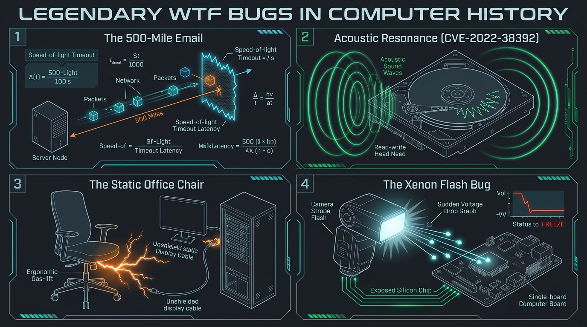

[🇬🇧 Read this article in English](/posts/weirdest-wtf-bugs-in-tech-history-en/)

---

П'ятниця, вечір. Завдання в Jira закриті, продакшен (на диво) не палає, у келиху плескається холодне пиво, а термінал спокійно миготить зеленим курсором. Найкращий час для гарних історій біля віртуального багаття.

Кожен системний адміністратор та інженер хоча б раз у житті ловив відчуття, що в серверній завівся полтергейст. Користувач телефонує й на повному серйозі заявляє: *«Мій комп'ютер перезавантажується щоразу, коли директор сідає у своє крісло»*, або *«У нас не відправляються електронні листи далі ніж на 500 миль»*. Перша реакція будь-якого втомленого адміна — закотити очі, посміхнутися й подумки списати все на «людський фактор» чи чергову байку від бухгалтерії.

Але комп'ютери — істоти на 100% кремнієві. Вони не вірять у магію, привидів чи прокляття. Вони підкоряються фундаментальним законам Всесвіту: швидкості світла, електромагнітній індукції, резонансним коливанням та квантовому фотоефекту.

Сьогодні згадаємо **5 найвідоміших, задокументованих та абсолютно диких WTF-інцидентів** в історії комп'ютерних систем, коли за безглуздими симптомами ховалася сувора фізика.


_Мал. 1. Чотири фізичні парадокси в IT: від обмеження швидкості світла до акустичного кібертероризму_

---

## 1. Легенда про 500-мильний Email (The Case of the 500-Mile Email)

Цю історію вперше опублікував системний адміністратор Трей Дарлі (Trey Darley) з Університету Північної Кароліни на початку 2000-х, і вона назавжди увійшла в золотий фонд системного фольклору.

### Симптом
До Трея звернувся декан статистичного факультету з претензією:
> *«Ми не можемо відправляти електронну пошту далі ніж на 500 миль (близько 800 км). До сусідніх міст листи доходять миттєво. Але спроба відправити лист адресату далі 500 миль завершується помилкою або вічним зависанням»*.

Більшість інженерів на місці Трея ввічливо порадили б користувачеві випити кави. Проте декан був професором математичної статистики й провів ретельний польовий експеримент:
* До Річмонда (200 миль) — лист доходить.
* До Ролі (30 миль) — доходить.
* До Мемфіса (550 миль) — не доходить.
* До Нью-Йорка (600 миль) — не доходить.
* До Бостона (700 миль) — таймаут!

Трей узяв географічну карту США, поставив ніжку циркуля в центр кампусу і накреслив коло радіусом 500 миль. Усі сервери всередині кола відповідали. Усі адресати поза колом — мовчали.

```text
[ Campus UNC ]  --- (200 miles: RTT 3ms)  ---> [ Richmond Server ]  -> OK!
[ Campus UNC ]  --- (480 miles: RTT 7ms)  ---> [ Atlanta Server ]   -> OK!
======================= 500 MILES RADIUS BARRIER =======================
[ Campus UNC ]  --- (600 miles: RTT 11ms) ---> [ New York Server ]  -> TIMEOUT!
[ Campus UNC ]  --- (750 miles: RTT 14ms) ---> [ Boston Server ]    -> TIMEOUT!
```

### Фізичний розтин
Як протокол SMTP чи поштовий демон `sendmail` міг «знати» географічну відстань?

Причина з'ясувалася в конфігурації. Напередодні колега Трея оновлював операційну систему сервера (SunOS) і встановив свіжішу версію демона `sendmail`. Конфігураційний файл `sendmail.cf` писався на вкрай заплутаній макромові M4. 

Під час оновлення директива таймауту на встановлення TCP-з'єднання (`Timeout.connect`) залишилася незаповненою або отримала значення `0`. Але розробники демона реалізували цікаву поведінку: якщо таймаут дорівнював нулю, `sendmail` не чекав вічно, а скидав з'єднання, якщо відповідь не надійшла протягом кількох мілісекунд (фактично, за внутрішній квант таймера ядра).

А тепер підключаємо шкільний курс фізики:
* Швидкість світла у вакуумі: $c \approx 300\,000\text{ км/с}$.
* Оптоволоконний кабель виготовлений зі скла з коефіцієнтом заломлення $n \approx 1.5$.
* Швидкість поширення світлового імпульсу в оптоволокні:
  $$v = \frac{c}{n} \approx \frac{300\,000}{1.5} = 200\,000\text{ км/с} \approx 124\,000\text{ миль/с}$$

Для того, щоб TCP-пакет `SYN` долетів до поштового сервера на відстані 500 миль і повернувся назад із пакетом `SYN-ACK`, світлу необхідно подолати загальну дистанцію у $1000\text{ миль}$ (туди й назад):

$$t_{\text{RTT}} = \frac{1\,000\text{ миль}}{124\,000\text{ миль/с}} \approx 0.00806\text{ с} \approx 8\text{ мілісекунд}$$

Додайте до цього затримки на маршрутизаторах (buffer bloat, обробка пакетів) — і ми отримуємо, що при таймауті у кілька мілісекунд пакети з відстані понад 500 миль **фізично не встигали повернутися на сервер**, навіть якби летіли зі швидкістю світла по ідеально прямій лінії без жодного роутера!

Збільшення `Timeout.connect` до стандартних кількох хвилин миттєво відновило доставку листів до будь-якої точки планети.

---

## 2. CVE-2022-38392: Як кліп Джанет Джексон вбивав вінчестери на 5400 RPM

У серпні 2022 року інженер Microsoft Реймонд Чен (Raymond Chen) опублікував у блозі неймовірну історію, після якої корпорація MITRE була змушена зареєструвати цілком офіційний ідентифікатор вразливості: **CVE-2022-38392**.

### Симптом
У середині 2000-х великий виробник ПК звернувся до Microsoft із містичною проблемою: відтворення музичного кліпу Джанет Джексон на пісню **«Rhythm Nation»** (1989 рік) призводило до миттєвого зависання та виходу з ладу ноутбуків із жорсткими дисками на 5400 об/хв.

Найдикіше було в тому, що:
1. Ноутбук, на якому крутили кліп, зависав у синій екран смерті (BSOD).
2. Але ноутбук колеги, що стояв на сусідньому столі поруч і на якому взагалі нічого не грало, **теж намертво падав**!

```text
 ┌──────────────────────┐                     ┌──────────────────────┐
 │   Laptop A (Music)   │                     │  Laptop B (Adjacent) │
 │                      │                     │                      │
 │ 🔊 Rhythm Nation     │                     │                      │
 │    ~1000 Hz Tone     │   Acoustic Wave     │                      │
 │         )))))))))))) │ ──────────────────> │ (((((((((((((        │
 │                      │      Air/Chassis    │                      │
 │ 💥 HDD Crashes!      │                     │ 💥 HDD Crashes!      │
 └──────────────────────┘                     └──────────────────────┘
```

### Фізичний розтин
Це була класична атака класу *Side-Channel Acoustic Attack*, породжена чистим механічним явищем — **акустичним резонансом**.

У магнітних накопичувачах 5400 RPM зчитувальна голівка ширяє над пластиною на повітряній подушці товщиною буквально в кілька нанометрів (у тисячу разів тонше за людську волосину). Будь-яке механічне зміщення викидає голівку з треку.

Виявилося, що конкретна аудіодоріжка пісні «Rhythm Nation» містила специфічний звуковий тон у районі 1000–1200 Гц. Ця частота ідеально збігалася з власною резонансною частотою магнітної голівки та підвісу популярної серії ноутбучних жорстких дисків. Звукові хвилі з динаміків через повітря та корпус передавали коливання прямо на пластини. 

Голівка диска впадала в резонанс, починала битися об обмежувачі й втрачала доріжку. Контролер диска фіксував критичну аварію позиціонування та екстрено паркував голівку, обриваючи всі операції читання/запису. Операційна система отримувала I/O error і вилітала в Kernel Panic або BSOD.

### Як це пофіксили?
Виробники комп'ютерів не могли відкликати мільйони проданих вінчестерів. Тому вони пішли геніальним шляхом: **таємно додали в аудіодрайвери цифровий режекторний фільтр (notch filter)**, який на льоту просто вирізав цю вузьку частоту під час відтворення будь-якого аудіо через системні динаміки!

---

## 3. Таємниця офісного крісла: як дешевий газліфт перезавантажував сервери

У практиці промислової автоматизації та інженерів дата-центрів є задокументований випадок, коли монітор або навіть ціла стійка серверів демонстрували спонтанні перезавантаження за розкладом, який нагадував поведінку людини.

### Симптом
Монітор робочої станції на 2–3 секунди ставав чорним, або сервер перезавантажувався від сигналу Reset. Проблема виникала виключно в робочі години з 9:00 до 18:00, але ніколи вночі чи на вихідних. Жодних сплесків навантаження за логами `dmesg` чи `journalctl` не спостерігалося.

```text
  [ User sits down on Gas-Lift Chair ]
                   │
                   ▼  Triboelectric Friction
      [ High Voltage Static: 10-15 kV ]
                   │
                   ▼  Fast ESD Spark discharge in piston
       (((( Radio Frequency EMI Burst ))))
                   │
                   ▼  Received by unshielded DisplayPort / Reset wire
       [ Monitor Blackout / Server Reboot ]
```

### Фізичний розтин
Винуватцем виявилося новеньке офісне крісло системного інженера:
1. **Трибоелектричний ефект:** Синтетичні штани інженера терлися об тканину сидіння, накопичуючи статичний заряд у 10–15 кіловольт.
2. **Газліфт як розрядник:** Усередині дешевого пневматичного патрона (газліфта) металевий поршень ковзає в циліндрі. Через відсутність провідного мастила або якісного заземлення між штоком і втулкою виникав мікроскопічний іскровий розряд (Electrostatic Discharge, ESD) щоразу, коли людина сідала чи підводилася.
3. **Електромагнітне випромінювання (EMI):** Цей розряд формував надзвичайно швидкий імпульс струму з крутим фронтом наростання, перетворюючи металеву основу крісла на антену, що випромінювала високочастотний радіоімпульс.
4. **Неякісний кабель:** Поруч проходив дешевий DisplayPort-кабель без належного фольгованого екранування або феритових кілець. Кабель сприймав імпульс як радіоперешкоду. Синхронізація каналу зв'язку (link training) миттєво збивалася, і монітор гас на 3 секунди для повторної синхронізації.

У випадку із сервером цей імпульс наводився на відкриту шину живлення кнопки Reset на передній панелі корпусу, спричиняючи спрацьовування апаратного перезавантаження.

**Вирішення:** Заміна крісла на сертифіковане антистатичне (ESD), встановлення якісних кабелів із подвійним екрануванням та належне заземлення серверної стійки.

---

## 4. Світловий спалах смерті: Raspberry Pi 2 боїться папараці

У лютому 2015 року благодійний фонд Raspberry Pi випустив довгоочікувану модель **Raspberry Pi 2 Model B** — із 4-ядерним процесором і 1 ГБ RAM. Проте на офіційному форумі одразу здійнялася хвиля паніки: користувачі скаржилися, що фотографування плати зі спалахом смартфона або фотоапарата миттєво вирубає мікрокомп'ютер.

### Симптом
Вмикаємо Raspberry Pi 2, запускаємо Linux, наводимо камеру зі ксеноновим спалахом — клац! — і малинка в ту ж мілісекунду йде в жорсткий ребут або вимикається.

Лабораторні тести показали дивовижну річ:
* Звичайне кімнатне світло — працює.
* Світлодіодний ліхтарик смартфона — працює.
* Лазерна указка червоного кольору — працює.
* **Ксеноновий фотоспалах або потужний зелений лазер — миттєвий Hard Reset!**

```text
 📸 Xenon Camera Flash
       │ (High Intensity Photons)
       ▼
 [ Bare Silicon Die: U16 NCP6343 Chip ]
       │
       ▼ Photoelectric Effect (Electron-Hole Pairs)
 [ Core Voltage Rail Drops below 1.2V ]
       │
       ▼
 ⚡ Brownout Detector Triggers Instant System Reset!
```

### Фізичний розтин
Причиною став відкритий Альбертом Ейнштейном **фотоелектричний ефект** (за який він, до речі, і отримав Нобелівську премію).

На платі Raspberry Pi 2 поруч із процесором розташовувався імпульсний стабілізатор живлення — мікросхема **U16 (ON Semiconductor NCP6343)**. Задля економії місця й вартості виробник використав чіп у корпусі типу **WLCSP** (Wafer Level Chip Scale Package). У такому корпусі напівпровідниковий кремнієвий кристал залишається повністю оголеним — без традиційної непрозорої епоксидної кришки.

Ксеноновий спалах генерує надзвичайно інтенсивний імпульс фотонів широкого спектра. Фотони проникали крізь кремній і вибивали електрони з p-n переходів польових транзисторів внутрішньої схеми зворотного зв'язку.

Це створювало внутрішній фотострум, який на частку мікросекунди блокував роботу шим-контролера. Напруга на лінії живлення процесора різко просідала нижче допустимих $1.2\text{ В}$, спрацьовував вбудований захист від просідання живлення (*Brownout Detector*), і процесор негайно перезавантажувався.

**Офіційний патч:** Шматочок чорної ізострічки, крапля непрозорого лаку або кулька клейкої маси Blu-Tack поверх чіпа U16 назавжди вирішували проблему.

---

## 5. «Цей скрипт падає тільки по середах»: підступні пастки часу й локалей

Спитайте будь-якого досвідченого розробника баз даних або бекенду про найгірші кошмари, і вам обов'язково розкажуть про роботу з датами. 

Один із класичних випадків стався у великій європейській логістичній компанії: нічний cron-скрипт збору статистики ідеально працював щопонеділка, щовівторка, щочетверга та у вихідні. Але щосереди він падав із незрозумілою помилкою парсингу бази даних.

```text
Day of Week:    Monday    Tuesday   Wednesday   Thursday   Friday
POSIX (%a):      Mon       Tue        Wed         Thu       Fri   -> 3 chars (OK!)
Ukrainian (%a):   Пн        Вт         Ср          Чт        Пт   -> 2 chars!
German (%a):     Mo        Di         Mi          Do        Fr   -> 2 chars!
Russian (%a):    Пн        Вт        Среда        Чт        Пт   -> 5 chars! (BUFFER OVERFLOW!)
```

### Анатомія проблеми
Скрипт генерував шлях до файлу журналу, використовуючи системний виклик `strftime("%a")` (скорочена назва дня тижня).

* В англійській локалі (`en_US`) усі скорочення днів тижня мають рівно 3 символи: `Mon`, `Tue`, `Wed`, `Thu`, `Fri`, `Sat`, `Sun`.
* Розробник захардкодив буфер фіксованого розміру та регулярний вираз `^[A-Z][a-z]{2}$`.
* Проте сервер за замовчуванням успадковував системну локаль хоста. В інших мовах скорочення для середи могло містити або 2 літери (`Ср`, `Mi`), або в деяких старих версіях libc розгортатися у повне слово з 5 літер (`Среда`).

У середу регулярка відмовлялася матчити назву файлу, або буфер переповнювався, і пайплайн безпорадно зупинявся.

### Високосна секунда (Leap Second) 2012 року
Не можна не згадати ніч з 30 червня на 1 липня 2012 року, коли Міжнародна служба обертання Землі додала високосну секунду (`23:59:60`).

Ядро Linux містило баг у підсистемі високоточних таймерів (`hrtimer`). Коли NTP-сервери передали прапорець високосної секунди, ядро зациклилося в нескінченному циклі очікування події, завантаживши процесори на 100%. У ту ніч одночасно полягли сервери **Reddit, LinkedIn, Mozilla, Foursquare, Gizmodo** та система бронювання австралійської авіакомпанії **Qantas**, спричинивши скасування десятків рейсів!

---

## Головні висновки для сисадміна та Homelab-інженера

Ці курйозні історії не просто смішні — вони нагадують нам про фундаментальні інженерні істини:

1. **Швидкість світла — це не теорія, а мережевий ліміт.** Кожні 100 км відстані неминуче додають близько 1 мілісекунди до RTT в оптиці. Завжди налаштовуйте таймаути з урахуванням фізичної географії.
2. **Екранування та заземлення рятують нерви.** Не купуйте найдешевші кабелі HDMI/DisplayPort та пам'ятайте, що статичний розряд від крісла чи холодильника може легко покласти ваш домашній роутер або mini-PC.
3. **Локаль має значення.** Усі системні скрипти, демони cron та логи повинні примусово запускатися з `LC_ALL=C` або `LANG=C.UTF-8`, якщо ви не хочете сюрпризів у середу вранці.
4. **Не бійтеся перевіряти найабсурдніші версії.** Якщо користувач стверджує, що принтер друкує лише під час дощу — не поспішайте сміятися: можливо, стара телефонна лінія просто окислюється від підвищеної вологості.

🍻 **Гарної п'ятниці, стабільного аптайму вашим серверам і нехай ваші пакети завжди повертаються швидше за будь-який таймаут!**
