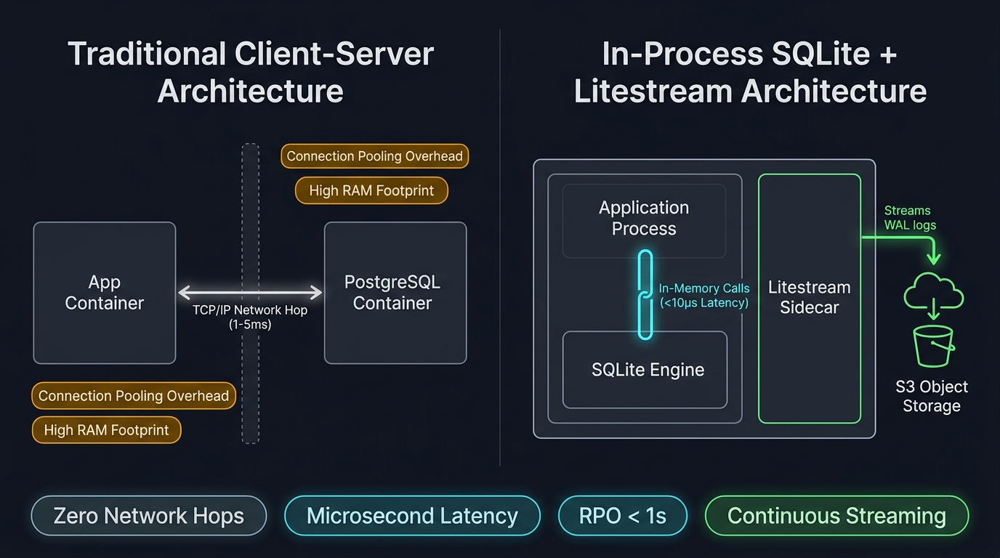

[🇺🇦 Читати цю статтю українською мовою](/posts/sqlite-litestream-production-database-guide/)

---

How many times have you caught yourself following the exact same muscle memory: spinning up a new microservice, launching a Telegram bot, building an internal company backend, or hacking on a weekend pet project — and the very first line inside `docker-compose.yml` is `postgres:16-alpine`?

For decades, the software engineering industry conditioned us to believe that any application more complex than a toy calculator strictly demands a dedicated client-server RDBMS: PostgreSQL or MySQL. SQLite, on the other hand, was relegated to mobile apps, embedded firmware, or ephemeral unit tests.

Yet over the past few years, a quiet architectural revolution has unfolded. Teams at **Fly.io, PocketBase, Tailscale, 37signals (Basecamp/HEY)**, and creators of modern open-source tooling have increasingly abandoned external database servers in favor of in-process SQLite paired with **Litestream**.

Why have client-server databases become a source of unnecessary overhead for 90% of small to mid-sized workloads? How does SQLite deliver tens of thousands of queries per second with sub-millisecond latencies? And how does Litestream turn a humble local file into an indestructible, disaster-proof system with continuous live replication to S3? Let's dive deep into the mechanics.


_Fig. 1. Architecture comparison: Client-server network latencies vs in-process SQLite with asynchronous WAL replication to S3_

---

## The Client-Server "Tax": What Postgres Silently Costs You

PostgreSQL is a monumental, extraordinarily reliable masterpiece of modern software engineering. However, adopting it for small-to-medium microservices, on lightweight VPS instances, or in a homelab carries real infrastructural costs that developers too often accept without question:

1. **Network & IPC Latency (TCP/Socket Overhead):**
   Even when your web application and PostgreSQL container run on the exact same VPS over `localhost` or a Unix domain socket, every single SQL query traverses kernel boundaries: parameter serialization, socket writes, CPU context switches, query parsing in the Postgres daemon, plan execution, and return serialization. A single query typically takes **0.5 to 2.0 milliseconds** before you've even processed a single row. For sequential operations or ORM $N+1$ query patterns, that easily compounds into tens or hundreds of milliseconds of artificial delay.
2. **Memory Appetite:**
   An idle PostgreSQL container immediately reserves between 50 and 150 MB of RAM upon boot. Under real-world load, connection pools, buffer pools (`shared_buffers`), and sort memory (`work_mem`) expand significantly. On an economical 1–2 GB RAM VPS hosting 5 to 6 discrete services, provisioning a dedicated Postgres container for each quickly exhausts system memory.
3. **Backup Operational Friction:**
   Standard `pg_dump` commands can lock tables or spike disk I/O. Implementing true continuous streaming replication and Point-in-Time Recovery (PITR) via tools like `pgBackRest` or `WAL-G` represents a demanding DevOps discipline requiring ongoing maintenance and verification.
4. **Major Version Upgrades:**
   Migrating from Postgres 15 to 16 isn't just changing a container image tag. It involves running `pg_upgrade`, managing disk storage format differences, and accepting potential maintenance downtime.

---

## Modern SQLite: Dispelling 20-Year-Old Myths

SQLite is the most widely deployed software library on planet Earth: running inside every smartphone, modern operating system, Airbus A350 flight system, and Mars rover. Yet among backend engineers, misconceptions from the early 2000s stubbornly persist.

### Myth 1: "SQLite cannot handle concurrent traffic"
**Reality:** That was true prior to the introduction of **WAL (Write-Ahead Logging)** mode. In legacy rollback journal mode, SQLite locked the entire database file during writes. In modern WAL mode, however:
* Readers **never block** the writer.
* The writer **never blocks** readers.
* Dozens of concurrent threads or processes can read the database simultaneously at the raw throughput limit of your NVMe storage.

The only constraint is that write operations are serialized: only one thread can commit a write at any given instant. But on modern server hardware, a single SQLite write transaction takes merely **5 to 50 microseconds**. That translates to 2,000 to 10,000 write transactions per second on an everyday commodity SSD. For read queries, throughput routinely exceeds 100,000+ RPS.

```text
┌─────────────────────────────────────────────────────────────┐
│                    Your Application (Go / Python / Node)    │
│                                                             │
│   Reader 1       Reader 2       Reader 3       Writer       │
│      │              │              │              │         │
│      ▼              ▼              ▼              ▼         │
│ ┌───────────────────────────────────────┐   ┌─────────────┐ │
│ │  Main Database File (.db)             │   │  WAL Journal│ │
│ │  (Shared concurrent non-blocking read)│   │  (.db-wal)  │ │
│ └───────────────────────────────────────┘   └─────────────┘ │
└─────────────────────────────────────────────────────────────┘
```

### Myth 2: "SQLite isn't production-grade because it's just a local file"
Historically, this was the legitimate blocker. If your server suffered a catastrophic hardware failure, a corrupted SSD, or an accidental VPS teardown, your solitary `app.db` file vanished with the host. Taking disk snapshots every 24 hours left you with an unacceptable Recovery Point Objective (RPO) of 24 hours, while copying a live SQLite database during active writes risked data corruption.

To solve this exact architectural dilemma, engineer Ben Johnson created **Litestream**.

---

## What is Litestream and How Does It Work?

**Litestream** is an ultra-lightweight background daemon written in Go. It continuously monitors the SQLite Write-Ahead Log (WAL) and streams changes frame-by-frame in real-time to object storage (AWS S3, Cloudflare R2, MinIO, Backblaze B2, Google Cloud Storage, or SFTP).

```text
  Application
  ┌──────────────┐
  │ SQLite Engine│ ── (Write Transaction) ──► [ app.db-wal ]
  └──────────────┘                                  ▲
                                                    │ Reads new frames
                                                    ▼
                                            ┌───────────────┐
                                            │  Litestream   │
                                            └───────┬───────┘
                                                    │
                                                    │ Asynchronous TLS stream
                                                    ▼
                                      ┌───────────────────────────┐
                                      │ Cloudflare R2 / AWS S3 /  │
                                      │ MinIO Object Storage      │
                                      └───────────────────────────┘
```

### Key Engineering Advantages:
1. **RPO < 1 Second (Near-Zero Data Loss):**
   Litestream syncs WAL frames to cloud storage every second (or on a configured cadence). If your VPS host abruptly experiences a catastrophic power outage right now, you will lose at most the last few hundred milliseconds of transactions.
2. **Zero Performance Penalty on Application Queries:**
   Litestream inspects the WAL file as an external OS process. It does not establish SQL connections, acquire database locks, or consume application thread pool resources.
3. **Point-In-Time Recovery (PITR):**
   Accidentally executed a bad migration or an erroneous `DELETE` query at 14:32:15? Litestream allows you to restore the database to the exact state it was in at `14:32:14` with a single command.
4. **Zero Infrastructure Cost (\$0):**
   Paired with **Cloudflare R2**, you benefit from 10 GB of free storage and, crucially, **\$0 in egress bandwidth fees**.

---

## Architectural Showdown: Postgres vs SQLite + Litestream

| Metric | PostgreSQL in Docker | SQLite + Litestream |
| :--- | :--- | :--- |
| **Architecture** | Client-Server (TCP/Socket) | In-Process (direct C/C++ memory binding) |
| **Single Query Latency** | 0.5 – 3.0 ms | **0.01 – 0.08 ms (10–80 microseconds!)** |
| **Idle RAM Footprint** | 60 – 150 MB | **< 5 MB** |
| **Disaster Recovery** | Complex (dumps, base backups, WAL) | **Single CLI command (`litestream restore`)** |
| **Data Loss on Node Failure**| Dependent on backup interval (hrs/mins)| **< 1 second (RPO < 1s)** |
| **Operational Overhead** | High (memory tuning, poolers, vacuum) | **Zero-configuration maintenance** |
| **Write Scalability** | High (concurrent write connection pools) | Serialized (single writer at a time) |

---

## Practical Guide: Hardening SQLite for Web Production

To ensure SQLite handles web concurrency reliably without throwing concurrency locks, execute these essential **PRAGMA directives** immediately upon opening your database connection:

```sql
-- 1. Enable non-blocking Write-Ahead Logging
PRAGMA journal_mode = WAL;

-- 2. Wait up to 5000ms if another thread is currently committing a write
-- (Permanently eliminates common "database is locked" errors)
PRAGMA busy_timeout = 5000;

-- 3. Optimize disk syncs safely for WAL mode
PRAGMA synchronous = NORMAL;

-- 4. In-memory page cache: negative values denote kilobytes (~20 MB here)
PRAGMA cache_size = -20000;

-- 5. Enforce foreign key constraints (disabled by default in SQLite)
PRAGMA foreign_keys = ON;

-- 6. Store temporary tables and intermediate indices in RAM
PRAGMA temp_store = MEMORY;
```

> [!TIP]
> Setting `PRAGMA synchronous = NORMAL;` in WAL mode is completely crash-safe against OS or application termination, but drastically reduces synchronous `fsync()` system calls, accelerating write throughput by 3x to 5x.

---

## Configuring Litestream: Step-by-Step

Create your Litestream configuration file at `/etc/litestream.yml`. In this example, we target **Cloudflare R2**:

```yaml
dbs:
  - path: /data/production.db
    replicas:
      - type: s3
        bucket: my-homelab-backups
        path: databases/production.db
        endpoint: https://<ACCOUNT_ID>.r2.cloudflarestorage.com
        access-key-id: ${LITESTREAM_ACCESS_KEY_ID}
        secret-access-key: ${LITESTREAM_SECRET_ACCESS_KEY}
        # Take a full database snapshot daily
        snapshot-interval: 24h
        # Retain older snapshots for 3 days
        retention: 72h
```

### The "Exec" Pattern in Docker: Single-Container Simplicity

The most elegant deployment model wraps your application process with Litestream as the container entrypoint.

Consider this minimal `Dockerfile`:

```dockerfile
FROM alpine:3.20

# Install Litestream binary
ADD https://github.com/benbjohnson/litestream/releases/download/v0.3.13/litestream-v0.3.13-linux-amd64.tar.gz /tmp/litestream.tar.gz
RUN tar -C /usr/local/bin -xzf /tmp/litestream.tar.gz && rm /tmp/litestream.tar.gz

WORKDIR /app
COPY my-backend-app /app/
COPY litestream.yml /etc/litestream.yml

RUN mkdir -p /data

COPY run.sh /app/run.sh
RUN chmod +x /app/run.sh

CMD ["/app/run.sh"]
```

Here is the corresponding startup script (`run.sh`):

```bash
#!/bin/sh
set -e

# 1. If the local database file does not exist (new VPS or clean restart),
# Litestream automatically restores the latest snapshot from S3/R2!
if [ ! -f /data/production.db ]; then
    echo "Database missing locally. Restoring from S3..."
    litestream restore -if-replica-exists -config /etc/litestream.yml /data/production.db
fi

# 2. Launch your application under Litestream supervision:
# Continuously replicates WAL changes while the app runs,
# and flushes in-flight transactions cleanly upon container shutdown.
exec litestream replicate -config /etc/litestream.yml -exec "/app/my-backend-app"
```

Your containerized service is now **completely stateless**:
* You can destroy the container and purge its local volume.
* Spin it up on a completely fresh server anywhere in the world.
* Execute `docker compose up -d` — Litestream pulls down the latest database state from Cloudflare R2 in seconds and launches your application seamlessly.

---

## Disaster Recovery Drill: Putting Backups to the Test

Never trust an unverified backup system. Let's simulate catastrophic data loss by purging the database while the system is offline:

```bash
# Simulate total disk loss
rm -f /data/production.db*

# Verify available cloud snapshots
litestream snapshots -config /etc/litestream.yml /data/production.db

# Restore the most recent state
litestream restore -config /etc/litestream.yml /data/production.db
```

Verify database integrity in milliseconds via the SQLite CLI:

```bash
sqlite3 /data/production.db "PRAGMA integrity_check;"
# Output: ok
```

Need to roll back to a specific timestamp before an accidental drop or faulty batch job? Simply pass the `-timestamp` argument:

```bash
litestream restore \
  -config /etc/litestream.yml \
  -timestamp "2026-11-16T15:30:00Z" \
  /data/restored-point-in-time.db
```

---

## When is SQLite NOT the Right Choice?

Rigorous engineering demands understanding system boundaries. You genuinely need PostgreSQL or another distributed engine when:

1. **Massive Concurrent Write Throughput:**
   If your service routinely processes hundreds or thousands of concurrent *write* transactions per second (e.g., high-frequency telemetry tracking or financial ledgering), SQLite's serialized write locks will create backlog queues (`busy_timeout`).
2. **Multi-Region Active-Active Writes:**
   If your system requires simultaneous write operations across Frankfurt, Tokyo, and San Francisco, you need globally distributed engines like CockroachDB or Google Cloud Spanner (though for read-heavy distributed workloads, the related **LiteFS** project provides distributed SQLite read replicas).
3. **Multi-Terabyte Datasets:**
   While SQLite theoretically supports databases up to 281 TB, handling single monolithic files exceeding 1–2 TB without sharding becomes unwieldy during initial network restores.
4. **Granular Multi-User Role-Based Access Control:**
   SQLite lacks native user management like `GRANT SELECT ON table TO user`. Authorization is strictly enforced at the application code or OS filesystem permission layer.

---

## Conclusion: Embracing Radical Simplicity

For over 90% of self-hosted homelabs, company internal dashboards, content platforms, Telegram bots, and early-stage SaaS MVPs, reaching for PostgreSQL is an act of premature optimization that introduces needless operational complexity, memory overhead, and network serialization costs.

The **SQLite + Litestream** paradigm:
* Slashes backend response times to the microsecond realm.
* Reclaims gigabytes of server RAM.
* Guarantees continuous, bulletproof disaster recovery to S3 without database locking risks.
* Drastically simplifies deployment pipelines down to a single stateless container.

Great engineering isn't measured by how many moving parts you can stitch together, but by how many unnecessary layers you can fearlessly strip away. Give SQLite and Litestream a try in your next deployment — your server metrics and your sanity will thank you.
