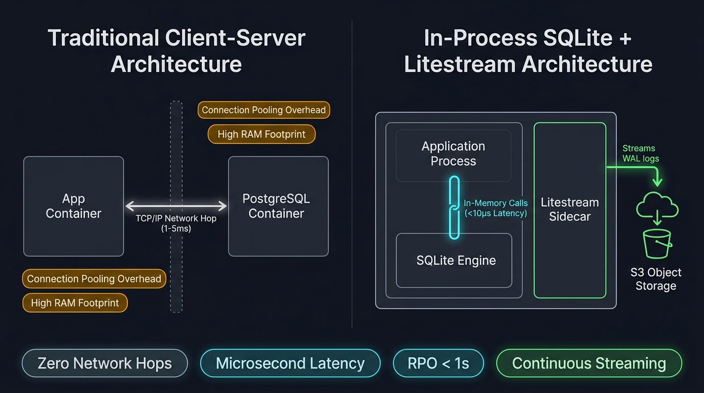

[🇬🇧 Read this article in English](/posts/sqlite-litestream-production-database-guide-en/)

---

Скільки разів ви ловили себе на стандартному рефлексі: потрібно написати новий мікросервіс, підняти Telegram-бота, створити внутрішній бекенд або запустити pet-проєкт — і першим рядком у `docker-compose.yml` з'являється образ `postgres:16-alpine`?

Десятиліттями індустрія привчала нас, що будь-який застосунок, складніший за шкільний калькулятор, зобов'язаний мати повноцінну клієнт-серверну СУБД: PostgreSQL або MySQL. А SQLite традиційно вважалася чимось для мобільних додатків, локальних тестів або «іграшкових» проєктів.

Проте за останні кілька років у світі розробки та системної архітектури стався тектонічний зсув. Команди **Fly.io, PocketBase, Tailscale, 37signals (Basecamp/HEY)** та творці багатьох сучасних open-source інструментів дедалі частіше відмовляються від зовнішніх баз даних на користь вбудованої (in-process) SQLite у зв'язці з **Litestream**.

Чому клієнт-серверні бази даних стали джерелом зайвого оверхеду для 90% невеликих і середніх проєктів, як SQLite видає десятки тисяч RPS із мікросекундними затримками, і як Litestream перетворює звичайний локальний файл на невбивну відмовостійку систему з неперервним бекапом в S3? Розбираємося детально.


_Мал. 1. Порівняння архітектур: клієнт-серверні затримки проти in-process SQLite з асинхронною WAL-реплікацією в S3_

---

## «Податок» на клієнт-сервер: що ми втрачаємо з Postgres

PostgreSQL — це приголомшливий, надійний і потужний інженерний шедевр. Але за його використання в невеликих сервісах, на VPS чи в Homelab ми платимо відчутну ціну, яку часто сприймаємо як належне:

1. **Мережеві затримки (TCP/Socket overhead):**
   Навіть якщо додаток і Postgres крутяться на одному VPS через localhost або Unix-сокет, кожен SQL-запит проходить через стеки ядра ОС: серіалізація параметрів, запис у сокет, перемикання контексту процесора (context switch), десеріалізація в процесі Postgres, виконання плану, зворотна передача результату. На один запит ви витрачаєте від **0.5 до 2 мілісекунд** ще до того, як взагалі прочитаєте дані. Для послідовних транзакцій (N+1 запити) це виливається в десятки мілісекунд затримок.
2. **Апетит до оперативної пам'яті:**
   «Голий» контейнер Postgres одразу після запуску резервує від 50 до 150 МБ RAM. Під навантаженням підключаються пули з'єднань, кеші буферів (`shared_buffers`), пам'ять під сортування (`work_mem`). Якщо у вас VPS на 1–2 ГБ оперативки, де крутиться 5–6 контейнерів, окремий Postgres для кожного сервісу швидко з'їдає всю доступну пам'ять.
3. **Експлуатаційна складність бекапів:**
   Класичний `pg_dump` блокує таблиці або створює серйозне навантаження на I/O. Налаштування справжньої streaming-реплікації та Point-in-Time Recovery (PITR) через `pgBackRest` чи `WAL-G` — це окрема інженерна дисципліна, яка вимагає десятків годин налаштування та моніторингу.
4. **Міграції версій:**
   Оновлення з Postgres 15 на 16 — це не просто змінити тег образу в Compose. Це запуск `pg_upgrade`, ризик несумісності форматів даних на диску та потенційний даунтайм.

---

## Міфи про SQLite у 2026 році

SQLite — найпоширеніша програмна бібліотека у світі: від кожного iPhone та Android до літаків Airbus A350 і марсоходів. Проте серед бекенд-розробників досі живі міфи двадцятирічної давнини.

### Міф 1: «SQLite не тримає паралельне навантаження»
**Реальність:** Так було до появи режиму **WAL (Write-Ahead Logging)**. У стандартному режимі SQLite дійсно блокувала весь файл під час запису. Але в режимі WAL:
* Читачі **ніколи не блокують** письменника.
* Письменник **ніколи не блокує** читачів.
* Десятки потоків або процесів можуть одночасно читати базу на максимальній швидкості вашого NVMe-накопичувача.

Єдине обмеження — у будь-який момент часу запис може здійснювати лише один потік. Але на сучасному залізі транзакція запису в SQLite займає від **5 до 50 мікросекунд**. Тобто база здатна проводити від 2 000 до 10 000 транзакцій запису на секунду на звичайному споживчому SSD! А для операцій читання пропускна здатність сягає 100 000+ RPS.

```text
┌─────────────────────────────────────────────────────────────┐
│                    Ваш Застосунок (Go / Python / Node)      │
│                                                             │
│   Читач 1        Читач 2        Читач 3       Письменник    │
│      │              │              │              │         │
│      ▼              ▼              ▼              ▼         │
│ ┌───────────────────────────────────────┐   ┌─────────────┐ │
│ │  Головний файл бази даних (.db)       │   │  WAL-журнал │ │
│ │  (Спільне читання без блокувань)      │   │  (.db-wal)  │ │
│ └───────────────────────────────────────┘   └─────────────┘ │
└─────────────────────────────────────────────────────────────┘
```

### Міф 2: «SQLite не підходить для продакшену, бо це один локальний файл»
А ось це була справжня проблема! Якщо сервер раптово згорить, помре диск або хостинг видалить віртуальну машину — ваш єдиний файл `data.db` зникав разом із нею. Робити копіювання файлу кожні 24 години — це ризик втратити день даних (Recovery Point Objective, RPO = 24 години), а копіювання живої бази під час запису могло призвести до корупції файлу.

Саме для вирішення цієї фундаментальної проблеми інженер Бен Джонсон (Ben Johnson) створив **Litestream**.

---

## Що таке Litestream і як він працює?

**Litestream** — це надлегкий фоновий процес (демон), написаний на Go, який моніторить WAL-файл SQLite і в режимі реального часу стримить кожну зміну в об'єктне сховище (AWS S3, Cloudflare R2, MinIO, Backblaze B2 тощо).

```text
  Застосунок
  ┌──────────────┐
  │ SQLite Engine│ ── (Запис транзакції) ──► [ app.db-wal ]
  └──────────────┘                                  ▲
                                                    │ читає нові фрейми
                                                    ▼
                                            ┌───────────────┐
                                            │  Litestream   │
                                            └───────┬───────┘
                                                    │
                                                    │ Асинхронний TLS-потік
                                                    ▼
                                      ┌───────────────────────────┐
                                      │ Cloudflare R2 / AWS S3 /  │
                                      │ MinIO Object Storage      │
                                      └───────────────────────────┘
```

### Чому ця схема геніальна:
1. **RPO < 1 секунда (майже нульова втрата даних):**
   Litestream скидає фрейми WAL-журналу в S3 кожну секунду (або частіше за потреби). Якщо ваш VPS буде знищено фізично прямо зараз, ви втратите максимум останні кількасот мілісекунд транзакцій.
2. **Нульовий вплив на продуктивність додатку:**
   Litestream читає WAL-файл як звичайний процес операційної системи. Він не підключається до SQLite через SQL, не блокує транзакції і не уповільнює ваш бекенд.
3. **Point-In-Time Recovery (відновлення на будь-яку секунду в минулому):**
   Випадково виконали `DROP TABLE` або зіпсували дані помилковим скриптом о 14:32:15? Litestream дозволяє однією командою відновити базу на стан `14:32:14`!
4. **Ціна обслуговування: \$0:**
   Використовуючи **Cloudflare R2**, ви отримуєте 10 ГБ сховища безкоштовно та, головне, **0 гривень за вихідний трафік (Zero Egress Fees)**.

---

## Архітектурний батл: Postgres проти SQLite + Litestream

| Параметр | PostgreSQL у Docker | SQLite + Litestream |
| :--- | :--- | :--- |
| **Архітектура** | Клієнт-Сервер (TCP/Socket) | In-Process (прямий виклик C/C++ бібліотеки) |
| **Затримка одного запиту** | 0.5 – 3.0 мс | **0.01 – 0.08 мс (10–80 мікросекунд!)** |
| **Споживання RAM (Idle)** | 60 – 150 МБ | **< 5 МБ** |
| **Складність відновлення** | Складна (dumps, wal recovery) | **Одна команда (`litestream restore`)** |
| **Втрата даних при аварії** | Залежить від реплікації (години/хвилини) | **< 1 секунди (RPO < 1s)** |
| **Ціна інфраструктури** | Потрібен більший VPS через RAM | **Працює навіть на найдешевшому VPS за \$3** |
| **Масштабування запису** | Високе (пули з'єднань) | Обмежене (один потік на запис) |

---

## Практичний гайд: Налаштовуємо SQLite для максимального продакшену

Щоб SQLite працювала як годинник під навантаженням веб-серверів, перед виконанням першого запиту завжди налаштовуйте такі **PRAGMA-директиви**:

```sql
-- 1. Переводимо базу в неблокуючий режим WAL
PRAGMA journal_mode = WAL;

-- 2. Чекаємо до 5000 мс при спробі запису, якщо база зайнята іншим потоком
-- (Рятує від типової помилки "database is locked")
PRAGMA busy_timeout = 5000;

-- 3. Безпечна оптимізація синхронізації диска для WAL
PRAGMA synchronous = NORMAL;

-- 4. Розмір кешу в пам'яті: від'ємне число означає кілобайти (тут ~20 МБ)
PRAGMA cache_size = -20000;

-- 5. Обов'язкова підтримка зовнішніх ключів (у SQLite за замовчуванням вимкнена)
PRAGMA foreign_keys = ON;

-- 6. Тимчасові таблиці та індекси зберігати виключно в оперативній пам'яті
PRAGMA temp_store = MEMORY;
```

> [!TIP]
> Директива `PRAGMA synchronous = NORMAL;` у режимі WAL є абсолютно безпечною від корупції при падінні додатку чи ОС, але зменшує кількість важких операцій `fsync()` у рази, підвищуючи швидкість запису в 3–5 разів!

---

## Налаштування Litestream: крок за кроком

Створимо конфігураційний файл Litestream `/etc/litestream.yml`. У прикладі використаємо **Cloudflare R2** (S3-сумісне сховище):

```yaml
dbs:
  - path: /data/production.db
    replicas:
      - type: s3
        bucket: my-homelab-backups
        path: databases/production.db
        endpoint: https://<ACCOUNT_ID>.r2.cloudflarestorage.com
        access-key-id: ${LITESTREAM_ACCESS_KEY_ID}
        secret-access-key: ${LITESTREAM_SECRET_ACCESS_KEY}
        # Як часто створювати повний снепшот (наприклад, раз на добу)
        snapshot-interval: 24h
        # Як довго зберігати старі снепшоти
        retention: 72h
```

### Паттерн «Exec» у Docker: магія одного контейнера

Найелегантніший спосіб запуску в контейнері — коли Litestream виступає як оболонка запуску (entrypoint) вашого основного застосунку.

Розглянемо приклад `Dockerfile`:

```dockerfile
FROM alpine:3.20

# Встановлюємо Litestream
ADD https://github.com/benbjohnson/litestream/releases/download/v0.3.13/litestream-v0.3.13-linux-amd64.tar.gz /tmp/litestream.tar.gz
RUN tar -C /usr/local/bin -xzf /tmp/litestream.tar.gz && rm /tmp/litestream.tar.gz

WORKDIR /app
COPY my-backend-app /app/
COPY litestream.yml /etc/litestream.yml

# Створюємо директорію для бази даних
RUN mkdir -p /data

# Скрипт запуску
COPY run.sh /app/run.sh
RUN chmod +x /app/run.sh

CMD ["/app/run.sh"]
```

А ось магічний скрипт запуску `run.sh`:

```bash
#!/bin/sh
set -e

# 1. Якщо локальної бази даних ще немає (новий сервер чи після збою),
# Litestream автоматично відновить її з S3/R2 перед стартом програми!
if [ ! -f /data/production.db ]; then
    echo "База не знайдена на диску. Відновлюємо з S3..."
    litestream restore -if-replica-exists -config /etc/litestream.yml /data/production.db
fi

# 2. Запускаємо Litestream у режимі exec:
# Він постійно реплікує зміни, поки працює ваш застосунок,
# а при зупинці контейнера акуратно скидає всі фінальні транзакції.
exec litestream replicate -config /etc/litestream.yml -exec "/app/my-backend-app"
```

Тепер ваш контейнер став **повністю Stateless**! 
* Ви можете видалити контейнер разом із томом.
* Перенести його на абсолютно новий VPS у будь-якій точці світу.
* Запустити `docker compose up -d` — Litestream за пару секунд затягне актуальну базу з Cloudflare R2 і запустить ваш додаток рівно на тому місці, де він зупинився.

---

## Тренування аварійного відновлення (Disaster Recovery Drill)

Ніколи не вірте системі бекапів, доки не перевірили відновлення на практиці.

Зімітуємо катастрофу: повне видалення файлу бази даних прямо під час роботи:

```bash
# Симулюємо фатальний збій диску
rm -f /data/production.db*

# Перевіряємо доступні снепшоти в хмарі
litestream snapshots -config /etc/litestream.yml /data/production.db

# Відновлюємо найсвіжіший стан
litestream restore -config /etc/litestream.yml /data/production.db
```

За лічені секунди база повністю відновлена, а її цілісність можна перевірити через SQLite CLI:

```bash
sqlite3 /data/production.db "PRAGMA integrity_check;"
# Відповідь: ok
```

А якщо треба відкотитися в конкретний момент часу (наприклад, до невдалої міграції чи випадкового видалення таблиці):

```bash
litestream restore \
  -config /etc/litestream.yml \
  -timestamp "2026-11-16T15:30:00Z" \
  /data/restored-point-in-time.db
```

---

## Коли SQLite все ж НЕ підходить?

Чесна інженерія вимагає розуміння меж застосування. Вам дійсно потрібен PostgreSQL, якщо:

1. **Величезний обсяг паралельних операцій запису:**
   Якщо ваш сервіс обробляє сотні або тисячі одночасних транзакцій на *запис* у секунду (наприклад, високонавантажений трекінг аналітики чи фінтех-транзакції), блокування на рівні файлу створить чергу (`busy_timeout`).
2. **Розподілена багаторегіональна архітектура з кількома майстрами:**
   Якщо вам потрібно писати в базу одночасно з Франкфурта, Токіо та Нью-Йорка, потрібні рішення на кшталт CockroachDB або Google Cloud Spanner (хоча для реплікацій на читання у SQLite є споріднений проєкт **LiteFS**).
3. **Обсяг даних понад 1–2 Терабайти:**
   Теоретична межа SQLite — 281 ТБ, але оперувати єдиним файлом понад терабайт без шардингу стає незручно при відновленні по мережі.
4. **Складна система користувачів і прав доступу на рівні таблиць:**
   У SQLite немає понять `GRANT SELECT ON table TO user`. Доступ регулюється виключно правами файлової системи Linux.

---

## Підсумки: повернення до простоти

Для 95% завдань у сфері Homelab, внутрішніх інструментів компаній, блогів, Telegram-ботів та стартапів на стадії MVP вибір PostgreSQL — це передчасна оптимізація, яка створює оверхед на адміністрування, пам'ять та мережу.

Зв'язка **SQLite + Litestream**:
* Знижує час відгуку бекенду до мікросекундного рівня.
* Заощаджує гігабайти оперативної пам'яті на серверах.
* Забезпечує неперервне резервне копіювання в S3 без ризику корупції даних.
* Робить ваш стек неймовірно простим і надійним.

Іноді найкраще інженерне рішення полягає не в ускладненні стеку, а у відмові від зайвих шарів. Спробуйте SQLite з Litestream у своєму наступному проєкті — і ви здивуєтеся, наскільки приємнішим стає життя сисадміна та розробника.
