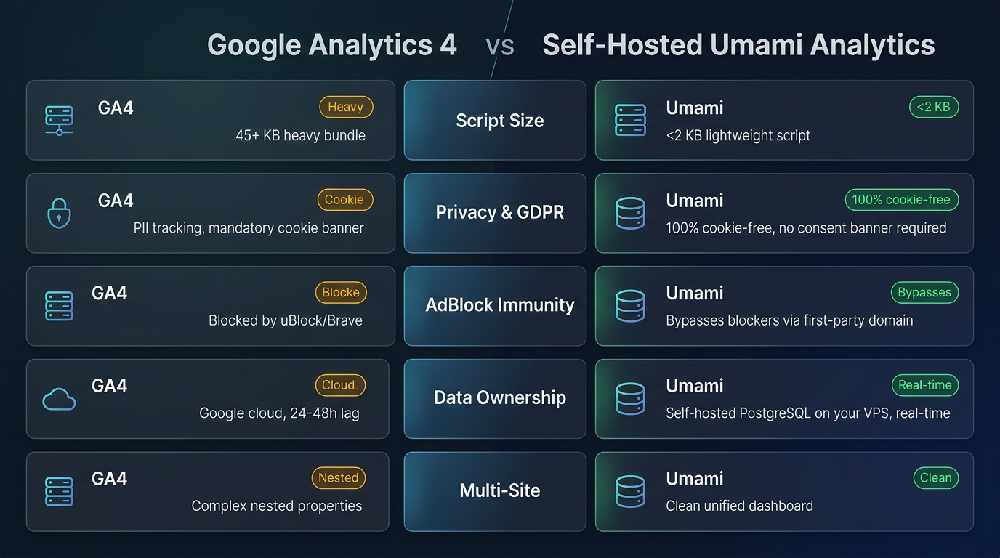

[🇺🇦 Читати цю статтю українською мовою](/posts/umami-self-hosted-web-analytics-docker-guide/)

---

If you have ever tried navigating the maze of modern **Google Analytics 4 (GA4)**, you are undoubtedly familiar with the headache. The dashboard is cluttered with dozens of convoluted enterprise reports designed for multimillion-dollar corporate marketing teams. Data updates lag behind by 24 to 48 hours, and the heavy tracking bundle introduces noticeable latency to page load speeds and Core Web Vitals.

Even worse is the regulatory baggage. Because Google collects cross-border personally identifiable data, international privacy frameworks (such as GDPR and ePrivacy) mandate intrusive, site-breaking consent banners demanding that visitors "Accept All Cookies." Factor in that **40% to 60% of technical audiences** actively block Google Analytics using uBlock Origin, Brave, or AdGuard — and your metrics end up fundamentally skewed.

For a personal tech blog, homelab services, indie tools, developer portfolios, or small SaaS products, all you genuinely need are straightforward answers:
* How many people visited?
* What specific articles or pages did they read?
* Where did they arrive from (Google, Reddit, Twitter, or Telegram)?
* Which countries, devices, and operating systems did they use?
* Did they click key actions like downloading a PDF or toggling the theme?

This is why the developer community has been rapidly migrating to **Umami** — a modern, lightweight, privacy-first open-source alternative to Google Analytics.

Let's explore why Umami has become the new gold standard for developers, how to deploy it in 5 minutes using Docker on your own VPS, and how to manage analytics for a dozen different websites from a single elegant dashboard.


_Fig. 1. Architecture comparison: Google Analytics 4 vs self-hosted lightweight Umami analytics_

---

## 5 Reasons to Choose Umami Over GA4

| Feature | Google Analytics 4 (GA4) | Umami Self-Hosted |
| :--- | :--- | :--- |
| **Script Bundle Size** | ~45–50 KB (heavy JS payload) | **< 2 KB (featherweight)** |
| **Cookies** | Yes (Mandatory GDPR cookie banner) | **Zero Cookies (No banner needed!)** |
| **AdBlock Resistance** | Blocked by 40–60% of users | **Near 100% capture via first-party subdomain**|
| **Data Latency** | Up to 24–48 hours for full processing| **Instant Real-Time (0 seconds)** |
| **Data Ownership** | Stored on Google's cloud servers | **100% yours on your VPS in PostgreSQL** |
| **Multi-Site Management**| Fragmented data streams & properties | **Unified single-pane dashboard** |

### 1. Blazing Speed & Core Web Vitals
The Umami client script weighs less than 2 kilobytes. Delivered with the asynchronous `defer` attribute, it executes in mere milliseconds without delaying browser layout or content painting.

### 2. No Annoying Cookie Consent Banners
Umami does not use cookies and never stores personal identifiable information (PII). It identifies unique daily visitors through an anonymous cryptographic one-way hash:
$$\text{Session ID} = \text{SHA256}(\text{Client IP} + \text{User-Agent} + \text{Daily Secret Salt})$$
The secret salt rotates automatically at midnight, making it mathematically impossible to track individuals across multiple days or across disparate websites. Consequently, Umami fully satisfies **GDPR, CCPA, and PECR** requirements out of the box without requiring invasive consent popups.

### 3. Immunity to AdBlockers
Ad blockers target public tracker domains like `google-analytics.com` or `googletagmanager.com`. Because your self-hosted Umami instance runs on your own subdomain (e.g., `stats.sedunlab.com`), client browsers recognize it as a trusted first-party resource. You capture accurate traffic insights, including visitors using privacy-focused browsers like Firefox and Brave.

### 4. Unlimited Websites in One Clean Interface
You can monitor an unlimited number of domains: personal blogs, portfolio sites, community forums, or client MVPs. Each website receives an independent `data-website-id`, while you retain full oversight within a unified administration portal.

---

## Deploying Umami with Docker on VPS

Umami is built on Node.js (Next.js) and backed by a robust PostgreSQL database.

### Step 1. Project Directory Setup

Connect to your VPS via SSH and initialize an isolated deployment folder:

```bash
mkdir -p /opt/umami
cd /opt/umami
```

### Step 2. Secret Generation and Environment Setup

Generate secure cryptographic tokens for the database password and application secret:

```bash
DB_PASSWORD=$(openssl rand -hex 16)
APP_SECRET=$(openssl rand -hex 24)

cat <<EOF > /opt/umami/.env
POSTGRES_DB=umami
POSTGRES_USER=umami
POSTGRES_PASSWORD=${DB_PASSWORD}
DATABASE_URL=postgresql://umami:${DB_PASSWORD}@db:5432/umami
DATABASE_TYPE=postgresql
APP_SECRET=${APP_SECRET}
PORT=3000
EOF
```

### Step 3. Authoring `docker-compose.yml`

Define the dual-container stack running PostgreSQL 16 and Umami:

```yaml
# /opt/umami/docker-compose.yml
services:
  umami:
    image: ghcr.io/umami-software/umami:postgresql-latest
    container_name: umami
    restart: unless-stopped
    environment:
      DATABASE_URL: ${DATABASE_URL}
      DATABASE_TYPE: ${DATABASE_TYPE}
      APP_SECRET: ${APP_SECRET}
    ports:
      - "127.0.0.1:3000:3000"
    depends_on:
      db:
        condition: service_healthy

  db:
    image: postgres:16-alpine
    container_name: umami-db
    restart: unless-stopped
    environment:
      POSTGRES_DB: ${POSTGRES_DB}
      POSTGRES_USER: ${POSTGRES_USER}
      POSTGRES_PASSWORD: ${POSTGRES_PASSWORD}
    volumes:
      - umami-db-data:/var/lib/postgresql/data
    healthcheck:
      test: ["CMD-SHELL", "pg_isready -U ${POSTGRES_USER} -d ${POSTGRES_DB}"]
      interval: 5s
      timeout: 5s
      retries: 5

volumes:
  umami-db-data:
```

Note that port `3000` is bound strictly to `127.0.0.1`. We do not expose the Node.js application directly to the public internet — all inbound traffic will pass through a secure reverse proxy with TLS encryption.

### Step 4. Launching the Stack

Spin up the containers:

```bash
docker compose up -d
```

On initial startup, Umami connects to PostgreSQL, runs database schema migrations, and prepares the tables. Inspect initialization via container logs:

```bash
docker logs -f umami
# Output: "All migrations have been successfully applied. Ready in 0ms"
```

---

## Reverse Proxy and SSL Configuration (OpenLiteSpeed / Nginx)

To access your analytics securely at `https://stats.sedunlab.com`:

### 1. DNS A-Record
In your domain registrar's DNS management panel (Cloudflare, GoDaddy, etc.), create an A-record:
* **Type:** `A`
* **Host / Name:** `stats`
* **Value / IP:** `Your VPS Public IP`
* **TTL:** `600` seconds (or Auto)

### 2. Virtual Host Setup
Under **OpenLiteSpeed** or **CyberPanel**, add the following proxy definition to your virtual host configuration (`vhost.conf`):

```text
extprocessor umami {
  type                    proxy
  address                 127.0.0.1:3000
  maxConns                100
  initTimeout             120
  retryTimeout            0
  respBuffer              0
  keepAliveTimeout        120
}

context / {
  type                    proxy
  handler                 umami
  allowBrowse             1
  addDefaultCharset       off
  sendfileEnable          0
  accessControl  {
    allow                 *
  }
}
```

For standard **Nginx** deployments, the reverse proxy configuration is equally straightforward:

```nginx
server {
    listen 80;
    server_name stats.sedunlab.com;
    return 301 https://$host$request_uri;
}

server {
    listen 443 ssl http2;
    server_name stats.sedunlab.com;

    ssl_certificate /etc/letsencrypt/live/stats.sedunlab.com/fullchain.pem;
    ssl_certificate_key /etc/letsencrypt/live/stats.sedunlab.com/privkey.pem;

    location / {
        proxy_pass http://127.0.0.1:3000;
        proxy_set_header Host $host;
        proxy_set_header X-Real-IP $remote_addr;
        proxy_set_header X-Forwarded-For $proxy_add_x_forwarded_for;
        proxy_set_header X-Forwarded-Proto $scheme;
    }
}
```

Issue a free SSL certificate via CyberPanel or Certbot:
```bash
certbot --nginx -d stats.sedunlab.com
```

---

## Onboarding and Tracking Integration

1. Navigate to `https://stats.sedunlab.com` (or access via SSH tunnel `ssh -L 3000:localhost:3000 root@vps` at `http://localhost:3000`).
2. Log in with the default credentials:
   * **Username:** `admin`
   * **Password:** `umami`
3. Promptly open **Settings → Profile** and update your administrator credentials.
4. Go to **Settings → Websites** and click **Add Website**:
   * Specify a descriptive name (e.g., `SedunLab`) and your domain (`sedunlab.com`).
   * Copy the generated `data-website-id`.

### Integrating the Tracking Snippet

Insert a single line into your site's `<head>` template (for Jekyll sites, inside `_includes/head.html`):

```html
<script defer src="https://stats.sedunlab.com/script.js" data-website-id="YOUR-UNIQUE-WEBSITE-ID"></script>
```

### Tracking Custom Events

Umami makes event tracking remarkably simple. No complex JavaScript SDKs or tag managers are required — simply add the `data-umami-event` HTML attribute to any button or link:

```html
<!-- Track PDF export button clicks -->
<button data-umami-event="export-pdf-button">Download PDF</button>

<!-- Track theme toggle interactions -->
<button data-umami-event="toggle-dark-mode">Switch Theme</button>
```

Interaction counts appear instantly inside your real-time analytics dashboard!

---

## Real-World VPS Resource Usage

Here is the exact live telemetry output from `docker stats` running on our production server:

```text
CONTAINER ID   NAME       CPU %     MEM USAGE / LIMIT    MEM %
c5a14d2e8b91   umami      0.03%     208MiB / 3.47GiB     5.86%
e39178ad0b22   umami-db   0.03%     27.54MiB / 3.47GiB   0.78%
```

* **RAM Footprint:** The PostgreSQL container consumes a microscopic **27 MB of RAM**, while the Umami Next.js daemon hovers around **200 MB**.
* **CPU Activity:** Idles at **0.03%**.
* **Storage Footprint:** Combined image sizes measure under 300 MB.

---

## Conclusion: Simplicity and Privacy Restored

Transitioning to self-hosted web analytics brings clarity and peace of mind:
* Web pages load noticeably faster without tracking bloat.
* Visitors are spared annoying, intrusive cookie consent modals.
* Analytics figures reflect true, unfiltered human traffic rather than what slips past AdBlock filters.
* All data remains securely in your hands without being monetized for corporate advertising algorithms.

If you value performance, privacy, and minimalist design, self-hosting Umami is one of the most rewarding additions you can make to your server infrastructure.
