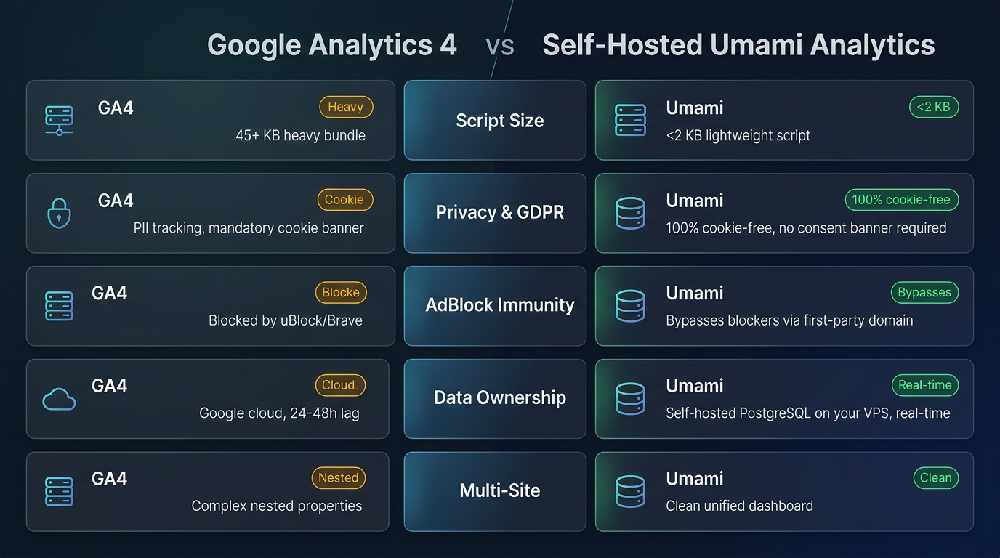

[🇬🇧 Read this article in English](/posts/umami-self-hosted-web-analytics-docker-guide-en/)

---

Якщо ви хоч раз пробували розібратися в сучасному **Google Analytics 4 (GA4)**, ви напевно відчули цей специфічний головний біль. Інтерфейс перевантажений десятками непотрібних звітів, розрахованих на маркетингові відділи корпорацій із мільйонними бюджетами. Оновлення даних відбувається із затримкою у 24–48 годин, а важкий скрипт стеження додає відчутний оверхед до швидкості завантаження сторінок (Core Web Vitals).

Але найгірше — це юридичний тягар. Оскільки Google збирає транскордонні персональні ідентифікатори, європейське законодавство (GDPR та ePrivacy) вимагає вішати на сайт величезні потворні банери з кнопками «Прийняти всі файли cookie». Додайте до цього факт, що від **40% до 60% технічної аудиторії** блокують Google Analytics за допомогою uBlock Origin, Brave або AdGuard — і ви отримуєте спотворену, далеку від реальності статистику.

Для особистого блогу, Homelab-сервісів, інструментів, портфоліо чи невеликого SaaS-проєкту все, що вам насправді потрібно, це прості та чесні відповіді:
* Скільки людей заходило на сайт?
* Які саме статті чи сторінки вони читали?
* Звідки вони прийшли (Google, Reddit, Twitter чи Telegram)?
* З яких країн та пристроїв відкривали ресурс?
* Чи натискали вони на кнопки завантаження або перемикання тем?

Саме тому технічна спільнота масово мігрує на **Umami** — відкриту, надлегку та орієнтовану на приватність Self-Hosted альтернативу Google Analytics.

Розглянемо, чому Umami став стандартом для розробників, як розгорнути його за 5 хвилин у Docker на власному VPS та як збирати статистику з десятка різних сайтів в єдиному красивому дашборді.


_Мал. 1. Архітектурне порівняння: Google Analytics 4 проти легкої автономної аналітики Umami_

---

## 5 причин обрати Umami замість GA4

| Параметр | Google Analytics 4 (GA4) | Umami Self-Hosted |
| :--- | :--- | :--- |
| **Розмір скрипта** | ~45–50 КБ (важкий JS-бандл) | **< 2 КБ (featherweight)** |
| **Файли Cookie** | Так (потрібен банер згоди GDPR) | **Жодних Cookie (банер не потрібен!)** |
| **Імунітет до AdBlock** | Блокується у 40–60% користувачів | **Майже 100% збір через власний піддомен** |
| **Затримка даних** | До 24–48 годин у звітах | **Абсолютний Real-Time (0 секунд)** |
| **Володіння даними** | На серверах Google (США) | **100% на вашому VPS у PostgreSQL** |
| **Мультидоменність** | Заплутані «потоки» та «властивості» | **Всі сайти в єдиному чистому списку** |

### 1. Швидкість та Core Web Vitals
Скрипт Umami важить менше ніж 2 кілобайти. Він завантажується асинхронно з атрибутом `defer`, виконується буквально за кілька мілісекунд і взагалі не блокує рендеринг сторінки браузером.

### 2. Жодних нав'язливих Cookie-банерів
Umami взагалі не використовує cookies і не зберігає жодних персональних даних (PII). Ідентифікація унікального відвідувача протягом доби відбувається за допомогою криптографічного одностороннього хешу:
$$\text{Session ID} = \text{SHA256}(\text{IP-адреса} + \text{User-Agent} + \text{Щоденна секретна сіль})$$
Сіль автоматично змінюється щоночі. Це унеможливлює відстеження пересування людини між різними днями чи різними сайтами в мережі. Відповідно, сервіс повністю відповідає вимогам **GDPR, CCPA та PECR** без необхідності дратувати відвідувачів банерами згоди!

### 3. Обхід блокувальників реклами (AdBlock)
Блокувальники реклами блокують трафік на домени на кшталт `google-analytics.com` або `googletagmanager.com`. Оскільки ваш екземпляр Umami працює на вашому власному піддомені (наприклад, `stats.sedunlab.com`), браузери вважають його First-Party ресурсом вашого сайту. Ви бачите реальну відвідуваність, включно з користувачами Firefox, Safari та Brave.

### 4. Усі ваші сайти в одному місці
Ви можете додати необмежену кількість доменів: свій блог, сайти друзів, корпоративні лендінги чи пет-проєкти. Кожен сайт отримує власний унікальний `data-website-id`, але ви бачите всю картину в єдиному акаунті.

---

## Розгортання Umami в Docker на VPS

Umami працює на базі Node.js (Next.js) та використовує базу даних PostgreSQL.

### Крок 1. Підготовка робочої папки

Підключаємося до VPS по SSH і створюємо ізольовану директорію для проєкту:

```bash
mkdir -p /opt/umami
cd /opt/umami
```

### Крок 2. Генерація секретів та створення файлу `.env`

Для безпеки згенеруємо надійний пароль для бази даних і випадковий секретний рядок `APP_SECRET`:

```bash
# Генеруємо 32-значні випадкові токени
DB_PASSWORD=$(openssl rand -hex 16)
APP_SECRET=$(openssl rand -hex 24)

cat <<EOF > /opt/umami/.env
POSTGRES_DB=umami
POSTGRES_USER=umami
POSTGRES_PASSWORD=${DB_PASSWORD}
DATABASE_URL=postgresql://umami:${DB_PASSWORD}@db:5432/umami
DATABASE_TYPE=postgresql
APP_SECRET=${APP_SECRET}
PORT=3000
EOF
```

### Крок 3. Створення `docker-compose.yml`

Описуємо стек із двох контейнерів: бази даних PostgreSQL 16 та самого сервісу Umami:

```yaml
# /opt/umami/docker-compose.yml
services:
  umami:
    image: ghcr.io/umami-software/umami:postgresql-latest
    container_name: umami
    restart: unless-stopped
    environment:
      DATABASE_URL: ${DATABASE_URL}
      DATABASE_TYPE: ${DATABASE_TYPE}
      APP_SECRET: ${APP_SECRET}
    ports:
      - "127.0.0.1:3000:3000"
    depends_on:
      db:
        condition: service_healthy

  db:
    image: postgres:16-alpine
    container_name: umami-db
    restart: unless-stopped
    environment:
      POSTGRES_DB: ${POSTGRES_DB}
      POSTGRES_USER: ${POSTGRES_USER}
      POSTGRES_PASSWORD: ${POSTGRES_PASSWORD}
    volumes:
      - umami-db-data:/var/lib/postgresql/data
    healthcheck:
      test: ["CMD-SHELL", "pg_isready -U ${POSTGRES_USER} -d ${POSTGRES_DB}"]
      interval: 5s
      timeout: 5s
      retries: 5

volumes:
  umami-db-data:
```

Зверніть увагу: порт `3000` прокинуто на `127.0.0.1:3000`. Ми не виставляємо застосунок у відкритий інтернет напряму — весь публічний доступ буде йти через захищений зворотний проксі-сервер з HTTPS!

### Крок 4. Запуск контейнерів

Запускаємо стек:

```bash
docker compose up -d
```

Під час першого запуску Umami автоматично підключиться до PostgreSQL, виконає всі міграції схем і підготує таблиці. Перевірити готовність можна за логами:

```bash
docker logs -f umami
# Побачимо: "All migrations have been successfully applied. Ready in 0ms"
```

---

## Налаштування зворотного проксі та SSL (OpenLiteSpeed / Nginx)

Щоб аналітика була доступна за адресою `https://stats.sedunlab.com`:

### 1. Створення DNS A-запису
У панелі керування вашим доменом (Cloudflare, GoDaddy тощо) додайте A-запис:
* **Тип:** `A`
* **Ім'я / Host:** `stats`
* **Значення / IP:** `IP-адреса вашого VPS`
* **TTL:** `600` секунд (або Auto)

### 2. Конфігурація віртуального хосту
Якщо ви використовуєте **OpenLiteSpeed** або **CyberPanel**, створіть сайт `stats.sedunlab.com` та додайте до конфігурації хосту (`vhost.conf`) блок проксі:

```text
extprocessor umami {
  type                    proxy
  address                 127.0.0.1:3000
  maxConns                100
  initTimeout             120
  retryTimeout            0
  respBuffer              0
  keepAliveTimeout        120
}

context / {
  type                    proxy
  handler                 umami
  allowBrowse             1
  addDefaultCharset       off
  sendfileEnable          0
  accessControl  {
    allow                 *
  }
}
```

Для класичного **Nginx** блок конфігурації виглядає ще простіше:

```nginx
server {
    listen 80;
    server_name stats.sedunlab.com;
    return 301 https://$host$request_uri;
}

server {
    listen 443 ssl http2;
    server_name stats.sedunlab.com;

    ssl_certificate /etc/letsencrypt/live/stats.sedunlab.com/fullchain.pem;
    ssl_certificate_key /etc/letsencrypt/live/stats.sedunlab.com/privkey.pem;

    location / {
        proxy_pass http://127.0.0.1:3000;
        proxy_set_header Host $host;
        proxy_set_header X-Real-IP $remote_addr;
        proxy_set_header X-Forwarded-For $proxy_add_x_forwarded_for;
        proxy_set_header X-Forwarded-Proto $scheme;
    }
}
```

Випускаємо безкоштовний сертифікат через CyberPanel або Certbot:
```bash
certbot --nginx -d stats.sedunlab.com
```

---

## Перший вхід та підключення відстеження

1. Відкриваємо `https://stats.sedunlab.com` (або через SSH-тунель `ssh -L 3000:localhost:3000 root@vps` за адресою `http://localhost:3000`).
2. Входимо за стандартними даними:
   * **Логін:** `admin`
   * **Пароль:** `umami`
3. Обов'язково заходимо в **Settings → Profile** та змінюємо стандартний пароль на надійний.
4. Переходимо в **Settings → Websites** та натискаємо **Add Website**:
   * Вказуємо назву (наприклад, `SedunLab`) та домен (`sedunlab.com`).
   * Отримуємо згенерований `data-website-id`.

### Додавання скрипта на сайт

У файл шаблону вашого блогу чи сайту (для Jekyll це `_includes/head.html`) додаємо лише один рядок:

```html
<script defer src="https://stats.sedunlab.com/script.js" data-website-id="ВАШ-УНІКАЛЬНИЙ-WEBSITE-ID"></script>
```

### Відстеження кастомних подій (Custom Events)

Umami дозволяє без жодного складного коду відстежувати взаємодію користувачів. Просто додайте атрибут `data-umami-event` до будь-якої кнопки чи посилання:

```html
<!-- Відстеження натискання на кнопку експорту PDF -->
<button data-umami-event="export-pdf-button">Завантажити PDF</button>

<!-- Відстеження перемикання теми оформлення -->
<button data-umami-event="toggle-dark-mode">Змінити тему</button>
```

У дашборді миттєво з'явиться лічильник натискань по кожній із подій!

---

## Реальне споживання ресурсів на VPS

Ось реальні показники команди `docker stats` на нашому робочому сервері:

```text
CONTAINER ID   NAME       CPU %     MEM USAGE / LIMIT    MEM %
c5a14d2e8b91   umami      0.03%     208MiB / 3.47GiB     5.86%
e39178ad0b22   umami-db   0.03%     27.54MiB / 3.47GiB   0.78%
```

* **Оперативна пам'ять:** уся база даних PostgreSQL бере смішні **27 МБ RAM**, а веб-сервіс Umami — близько **200 МБ**.
* **Процесор:** 0.03% у стані спокою.
* **Дисковий простір:** образ займає менше 300 МБ.

---

## Висновок: чому це того варте

Перехід на власну аналітику повертає відчуття контролю:
* Ваші сторінки стають легшими та вантажаться швидше.
* Читачі не страждають від нав'язливих вікон зі згодою на збір cookies.
* Ви бачите точну статистику, не порізану AdBlock-розширеннями.
* Усі дані зберігаються на вашому власному сервері, ніхто не передає їх третім сторонам для таргетованої реклами.

Якщо ви цінуєте приватність, швидкість та естетику мінімалізму — Self-Hosted Umami стане одним із найприємніших і найкорисніших сервісів у вашому стеку!
