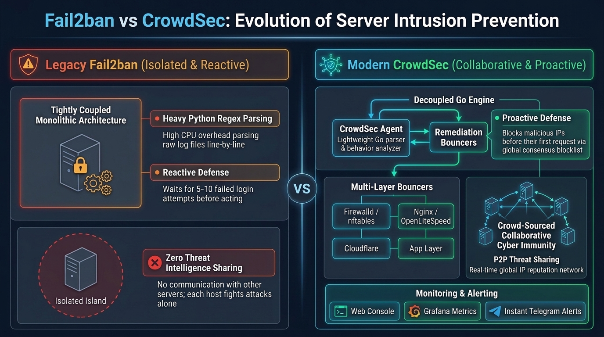

[🇺🇦 Читати цю статтю українською мовою](/posts/crowdsec-vps-collaborative-security-guide/)

---

Every systems administrator knows this unwritten rule of the public internet: the moment you spin up a fresh VPS and expose port 22 (SSH) or ports 80/443 (HTTP/HTTPS), automated background noise floods your system logs within **60 seconds**.

Script kiddies run credential stuffing against `root`, distributed botnets probe for `.env` files and forgotten `phpMyAdmin` setups, while compromised IoT nodes scan for newly published CVEs.

For over two decades, the universal default defense across the Linux world has been **Fail2ban**. It is familiar, battle-tested, and handles basic log parsing. Yet Fail2ban's underlying architectural assumptions were formulated back in 2004.

In 2026, its fundamental limitations have become difficult to ignore:
1. **Strictly Reactive Defense:** Your server must absorb 5 to 10 authentication failures and waste CPU cycles handling brute-force requests before an offending IP is finally banned.
2. **The "Isolated Island" Syndrome:** If a botnet scans 10,000 servers in sequence, each server must independently suffer the scan, completely blind to the fact that neighboring machines already flagged and banned the IP.
3. **Heavy Python Regex Engine:** Fail2ban's regex log parsing can generate noticeable CPU overhead under high-volume web traffic or DDoS floods.

Enter **CrowdSec** — an open-source, modern intrusion detection and prevention system (IDS/IPS) written in Go, frequently hailed as the **"Waze of cybersecurity."**

Let's explore how crowdsourced cyber defense functions, why CrowdSec outperforms legacy Fail2ban, and how to set it up on Linux in under 10 minutes.


_Fig. 1. Evolution of server defense: Isolated reactive Fail2ban vs proactive collaborative CrowdSec immunity_

---

## What is CrowdSec and Why is It a Paradigm Shift?

**CrowdSec** is a free, open-source security platform written in Go that inspects system logs (SSH, Nginx, Caddy, Docker, auth logs) using declarative YAML scenarios to detect anomalous behaviors.

Its genuine superpower, however, lies in **Crowdsourced Threat Intelligence**.

### The "Waze for Servers" Mechanism:
1. A botnet begins brute-forcing a server in Tokyo or New York running CrowdSec.
2. The local CrowdSec Agent detects the malicious pattern (SSH brute-force, web vulnerability probe, or port scan) and bans the IP locally.
3. The threat signal is anonymized and transmitted to CrowdSec's central consensus engine.
4. If verified through automated consensus algorithms (filtering out false positives and benign scanners), the IP is enrolled in the **Global Threat Intelligence Blocklist**.
5. Hundreds of thousands of CrowdSec nodes worldwide (including your own homelab or VPS) automatically ingest the updated blocklist.
6. When that identical botnet eventually tries to probe your server — **its packets are dropped at the Linux kernel firewall level before it can even complete a TCP handshake!**

```text
┌─────────────────┐       ┌─────────────────┐       ┌─────────────────┐
│ Server in Tokyo │       │ Server in       │       │ Your VPS /      │
│   (Attacked!)   │       │   Frankfurt     │       │   Homelab       │
└────────┬────────┘       └────────┬────────┘       └────────┬────────┘
         │                         │                         │
         │ 1. Attack detected      │                         │ 4. Preemptive
         ▼                         ▼                         ▼    drop
   ┌─────────────────────────────────────────────────────────────┐
   │             CrowdSec Central Consensus Engine               │
   │       (False-Positive Filtering + Global Blocklist)         │
   └─────────────────────────────────────────────────────────────┘
```

---

## Architectural Showdown: Fail2ban vs CrowdSec

| Metric | Fail2ban (2004) | CrowdSec (2026) |
| :--- | :--- | :--- |
| **Engine Runtime** | Python (heavy regex matching) | **Go (efficient, < 50 MB RAM footprint)**|
| **Defense Model** | Strictly reactive (5–10 failures)| **Proactive (global consensus intelligence)**|
| **Threat Sharing** | None (each machine fights alone) | **P2P consensus across hundreds of thousands**|
| **Architecture** | Monolithic (log parser + firewall) | **Decoupled (Agent + Remediation Bouncers)**|
| **Remediation Types** | Drop/Reject IP only (iptables) | **Firewall, Web (403), Cloudflare, CAPTCHA** |
| **Observability** | Raw text logs, custom scripts | **Web Console, Grafana, Telegram, Discord** |

### The Core Advantage: Decoupled Agent & Bouncers
In Fail2ban, architecture is tightly coupled: a single process monitors logs and directly manipulates iptables rules.

In CrowdSec, responsibilities are cleanly bifurcated:
1. **CrowdSec Agent:** Responsible solely for ingesting log streams, normalizing event structures, and evaluating detection scenarios.
2. **Remediation Bouncers:** Specialized enforcement modules. You can deploy a bouncer at the kernel packet filter level (`nftables` / `iptables`), or run an **Nginx bouncer** that serves suspicious web visitors an unobtrusive **Cloudflare Turnstile CAPTCHA** rather than a hard TCP reject!

---

## Step-by-Step Guide: Deploying CrowdSec on Linux (AlmaLinux / Debian / Ubuntu)

Let's configure full perimeter security on a production server.

### Step 1. Repository Setup & Agent Installation

For RHEL / AlmaLinux 9 systems:

```bash
# Add official CrowdSec package repository
curl -s https://packagecloud.io/install/repositories/crowdsecurity/crowdsec/script.rpm.sh | bash

# Install the core CrowdSec agent
dnf install crowdsec -y

# Enable and start the systemd daemon
systemctl enable --now crowdsec
```

*(On Debian/Ubuntu, use the identical flow with `script.deb.sh` and `apt install crowdsec`).*

During installation, CrowdSec automatically scans your running host, identifies existing workloads (SSH, Nginx, Systemd logs), and installs the appropriate detection collections out of the box.

### Step 2. Installing the Remediation Firewall Bouncer

The agent evaluates threats and makes decisions, but does not block traffic itself. To enforce packet drops, install the **Firewall Bouncer**:

```bash
# For AlmaLinux / RHEL utilizing modern nftables:
dnf install crowdsec-firewall-bouncer-nftables -y

# Alternatively, for legacy iptables:
# dnf install crowdsec-firewall-bouncer-iptables -y

# Start the bouncer service
systemctl enable --now crowdsec-firewall-bouncer
```

Verify that the bouncer is authenticated with the local CrowdSec API:

```bash
cscli bouncers list
```

You should see a registered bouncer with a `valid` status connected over `127.0.0.1`.

---

## Operating CrowdSec via `cscli`

The `cscli` command-line utility provides intuitive observability into your defensive posture.

### 1. Inspecting Active Bans
```bash
cscli decisions list
```
The resulting table displays both local offenders flagged by your server's logs and community-sourced threats received from the **CrowdSec Community Blocklist**.

### 2. Live Telemetry & Metrics
```bash
cscli metrics
```
This prints clean terminal dashboards detailing: lines parsed per log file, scenario match frequencies, and raw packet counts dropped by the kernel bouncer.

### 3. Managing Detection Scenarios via Hub
Similar to Docker Hub, the CrowdSec Hub hosts community-maintained detection scenarios and parsers:

```bash
# Harden web layers (Nginx / OpenLiteSpeed)
cscli collections install crowdsecurity/nginx

# Protect core Linux operating system components
cscli collections install crowdsecurity/linux

# Guard popular web frameworks against vulnerability scans
cscli collections install crowdsecurity/wordpress

# Reload configuration seamlessly
systemctl reload crowdsec
```

---

## Connecting the Free CrowdSec Web Console

CrowdSec provides a free, feature-rich cloud dashboard ([app.crowdsec.net](https://app.crowdsec.net)) for fleet observability:

1. Create a free account at [app.crowdsec.net](https://app.crowdsec.net).
2. Click **Add Instance** and copy the personalized enrollment command:
   ```bash
   cscli console enroll <YOUR_ENROLL_KEY>
   ```
3. Restart the agent: `systemctl restart crowdsec`.

Your cloud console now displays:
* An interactive global attack origin map.
* Automated vulnerability bulletins (0-day CVE alerts matching your stack).
* Fleet-wide metrics and historical attack analysis.

---

## Native Telegram Alerting

No more writing custom Python scripts or cron jobs to get security updates — CrowdSec ships with native notification plugins.

Edit `/etc/crowdsec/notifications/telegram.yaml`:

```yaml
type: telegram
name: telegram_alert
log_level: info

format: |
  🚨 <b>CrowdSec Alert on {{ .Node.Name }}</b>
  <b>Offender IP:</b> {{ .Alert.Source.IP }} ({{ .Alert.Source.Cn }})
  <b>Scenario:</b> {{ .Alert.Scenario }}
  <b>Action:</b> {{ .Decision.Type }} for {{ .Decision.Duration }}

token: "YOUR_TELEGRAM_BOT_TOKEN"
chat_id: "YOUR_CHAT_ID"
```

Activate notifications inside `/etc/crowdsec/profiles.yaml` under `notifications: [telegram_alert]`, then restart CrowdSec. Whenever a malicious threat is neutralized, an immediate alert lands in your Telegram chat.

---

## Safeguarding Docker Workloads

If you run web services (such as Umami, Vaultwarden, Nextcloud, or Ghost) in Docker, CrowdSec does not require agent sidecars inside every container.

The host agent can parse container JSON log streams directly:

```yaml
# /etc/crowdsec/acquis.yaml
filenames:
  - /var/lib/docker/containers/*/*-json.log
labels:
  type: docker
```

CrowdSec inspects application logs in real-time, spots application-level attacks, and instructs the host `nftables` bouncer to sever the attacker's network connection before their next request reaches your containers.

---

## Conclusion: Time to Retire Fail2ban

Fail2ban deserves immense respect for securing the early internet. But in an era of distributed cloud botnets and automated CVE scanners, defending an isolated server without threat sharing is an obsolete strategy.

**Key Advantages of Upgrading to CrowdSec:**
* **Preemptive Defense:** Mitigates the majority of scanners before their very first request.
* **Resource Optimization:** Fast Go runtime eliminating heavy regex log scraping.
* **Remediation Versatility:** Enforce drops, rate limits, or CAPTCHA challenges depending on threat confidence.
* **Modern Tooling:** Unified web console, rich metrics, and native push notifications.

Deploy CrowdSec on your VPS or homelab — and let hundreds of thousands of servers worldwide help defend your digital perimeter.
