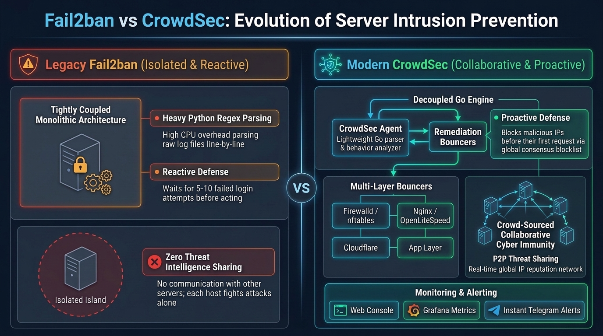

[🇬🇧 Read this article in English](/posts/crowdsec-vps-collaborative-security-guide-en/)

---

Будь-який сисадмін знає це незмінне правило інтернету: варто підняти новий VPS і відкрити стандартний 22-й порт для SSH чи 80/443 для вебу, як уже за **60 секунд** у системні логи посиплеться нескінченний град автоматизованого сміття.

Китайські ботнети перебирають паролі `root`, скрапери шукають забуті файли `.env` та панелі `phpMyAdmin`, а заражені IoT-камери намагаються промацати свіжі CVE-вразливості.

Понад два десятиліття стандартною відповіддю інженерів на цей хаос була утиліта **Fail2ban**. Вона проста, знайома кожному й робить базову роботу. Проте концепція Fail2ban була закладена ще в далекому 2004 році. 

У 2026 році її фундаментальні вади стають надто очевидними:
1. **Суто реактивний захист:** сервер зобов'язаний витримати 5–10 атак і марно витратити ресурси процесора на обробку спроб авторизації, перш ніж IP потрапить у бан.
2. **Синдром самотнього острова:** якщо один і той самий зловмисник послідовно атакує 10 000 серверів, кожен сервер мусить пережити атаку самостійно, не знаючи, що сусіди його вже забанили.
3. **Важкий Python-рушій:** регулярні вирази Fail2ban під високим навантаженням на веб-серверах помітно вантажать процесор.

На заміну застарілій парадигмі прийшов **CrowdSec** — сучасна Open-Source система виявлення та запобігання вторгненням (IDS/IPS), яку часто називають **«Waze для кібербезпеки»**.

Розбираємося, як працює колективний кібер-імунітет, чим CrowdSec перевершує Fail2ban і як налаштувати його на Linux за 10 хвилин.


_Мал. 1. Еволюція захисту: ізольований реактивний Fail2ban проти проактивного колективного імунітету CrowdSec_

---

## Що таке CrowdSec і чому це революція?

**CrowdSec** — це безкоштовна платформа кіберзахисту з відкритим вихідним кодом (написана на Go), яка аналізує системні логи (SSH, Nginx, Caddy, Docker, системні служби) за допомогою сценаріїв на базі YAML і блокує загрози.

Але головна магія криється в **колективному інтелекті (Crowd-Sourced Threat Intelligence)**.

### Як працює принцип «Waze для серверів»:
1. Хакер починає сканувати сервер у Токіо або Нью-Йорку, де встановлено CrowdSec.
2. Локальний агент фіксує шкідливу поведінку (брутфорс SSH, SQL-ін'єкція чи сканування портів) і блокує IP на цьому сервері.
3. Сигнал анонімно відправляється в центральний консенсусний рушій CrowdSec.
4. Якщо факт атаки підтверджується алгоритмами верифікації (щоб виключити false-positives), цей IP потрапляє в **Глобальний чорний список**.
5. Усі вузли CrowdSec у світі (включно з твоїм домашнім Homelab чи VPS) автоматично отримують оновлення бази.
6. Коли цей самий ботнет нарешті добирається до твого сервера — **його з'єднання блокується на рівні ядра Linux ще до першого байта запиту!**

```text
┌─────────────────┐       ┌─────────────────┐       ┌─────────────────┐
│ Сервер у Токіо  │       │ Сервер у Франк- │       │ Твій VPS /      │
│  (Атаковано!)   │       │     фурті       │       │    Homelab      │
└────────┬────────┘       └────────┬────────┘       └────────┬────────┘
         │                         │                         │
         │ 1. Фіксація атаки       │                         │ 4. Превентивне
         ▼                         ▼                         ▼    блокування
   ┌─────────────────────────────────────────────────────────────┐
   │         Центральний консенсусний рушій CrowdSec             │
   │       (Фільтрація false-positives + Global Blocklist)       │
   └─────────────────────────────────────────────────────────────┘
```

---

## Архітектурний батл: Fail2ban проти CrowdSec

| Параметр | Fail2ban (2004) | CrowdSec (2026) |
| :--- | :--- | :--- |
| **Мова рушія** | Python (важкі regex) | **Go (швидкий, пам'ять < 50 МБ)** |
| **Тип захисту** | Суто реактивний (після 5–10 спроб) | **Проактивний (завдяки глобальній базі)** |
| **Обмін загрозами** | Немає (кожен сервер сам за себе) | **P2P консенсус між сотнями тисяч серверів** |
| **Архітектура** | Монолітна (парсить і блокує в одному) | **Декаплінг (Агент + Bouncers)** |
| **Рівні блокування** | Тільки скидання IP (iptables) | **Мережа, Веб, CAPTCHA, Cloudflare, App-level** |
| **Моніторинг** | Текстові логи, самописні скрипти | **Web-консоль, Grafana, Telegram, Discord** |

### Головна фішка: Декаплінг (Agent vs Bouncers)
У Fail2ban все жорстко пов'язано: один процес читає лог і той самий процес лізе в iptables. 

У CrowdSec архітектура розділена на дві незалежні частини:
1. **CrowdSec Agent:** відповідає лише за читання логів, нормалізацію подій та детекцію зловмисних патернів.
2. **Remediation Bouncers:** спеціалізовані модулі блокування. Ви можете поставити bouncer на файрвол (`nftables` / `iptables`), або плагін у веб-сервер **Nginx**, який замість жорсткого бану повертатиме підозрілому користувачеві сторінку з **Cloudflare Turnstile CAPTCHA**!

---

## Покроковий гайд: Встановлення CrowdSec на Linux (AlmaLinux / Debian / Ubuntu)

Розгорнемо повноцінний захист на сервері.

### Крок 1. Підключення репозиторію та встановлення агента

Для дистрибутивів на базі RHEL / AlmaLinux 9:

```bash
# Підключаємо офіційний репозиторій CrowdSec
curl -s https://packagecloud.io/install/repositories/crowdsecurity/crowdsec/script.rpm.sh | bash

# Встановлюємо агент CrowdSec
dnf install crowdsec -y

# Запускаємо та додаємо в автозавантаження
systemctl enable --now crowdsec
```

*(Для Debian/Ubuntu використовується той самий скрипт через `script.deb.sh` та `apt install crowdsec`).*

Під час інсталяції CrowdSec автоматично просканує вашу систему, знайде встановлені сервіси (SSH, Nginx, Syslog) і сам встановить потрібні колекції правил!

### Крок 2. Встановлення файрвол-баунсера (Remediation Component)

Сам агент лише аналізує загрози. Щоб фізично блокувати ворожі пакети, встановлюємо **Firewall Bouncer**:

```bash
# Для AlmaLinux / RHEL з nftables:
dnf install crowdsec-firewall-bouncer-nftables -y

# Або для iptables:
# dnf install crowdsec-firewall-bouncer-iptables -y

# Запускаємо службу блокувальника
systemctl enable --now crowdsec-firewall-bouncer
```

Перевірити статус зв'язки між агентом і баунсером можна командою:

```bash
cscli bouncers list
```

Ви побачите зареєстрований bouncer зі статусом `valid` та IP-адресою `127.0.0.1`.

---

## Керування системою через `cscli`

Утиліта командного рядка `cscli` — один із найприємніших і найпродуманіших інструментів у CrowdSec.

### 1. Перегляд активних банів
```bash
cscli decisions list
```
У таблиці ви побачите як порушників, яких засік ваш особистий сервер, так і величезний перелік небезпечних IP, які прилетіли з **Community Blocklist** від CrowdSec!

### 2. Жива телеметрія та метрики
```bash
cscli metrics
```
Команда виведе красиву консольну статистику: скільки рядків логів прочитано, які сценарії спрацювали найчастіше, скільки пакетів відкинуто файрволом на рівні ядра.

### 3. Керування колекціями правил
CrowdSec має власний **Hub**, схожий на Docker Hub. Ви можете доставляти готові правила під будь-які технології:

```bash
# Захист веб-сервера Nginx / OpenLiteSpeed
cscli collections install crowdsecurity/nginx

# Захист від сканування вразливостей Linux
cscli collections install crowdsecurity/linux

# Захист популярних CMS та фреймворків
cscli collections install crowdsecurity/wordpress

# Перезавантажуємо конфігурацію агента
systemctl reload crowdsec
```

---

## Безкоштовна хмарна консоль CrowdSec

CrowdSec надає абсолютно безкоштовну SaaS-консоль ([app.crowdsec.net](https://app.crowdsec.net)), де можна візуалізувати стан безпеки всіх ваших серверів в одному вікні.

1. Реєструємо безкоштовний акаунт на [app.crowdsec.net](https://app.crowdsec.net).
2. Натискаємо **Add Instance** і копіюємо команду реєстрації з вашим токеном:
   ```bash
   cscli console enroll <ВАШ_ENROLL_KEY>
   ```
3. Перезавантажуємо службу: `systemctl restart crowdsec`.

Після цього у веб-інтерфейсі з'явиться:
* Інтерактивна карта світу з точками походження атак.
* Автоматичні сповіщення про загрози нульового дня (0-day CVE).
* Метрики навантаження на систему захисту.

---

## Налаштування сповіщень у Telegram

Більше не потрібно писати кастомні Python-скрипти з кроном, щоб отримати алерт про атаку — у CrowdSec сповіщення вбудовані прямо в коробку!

Відкриваємо конфігураційний файл `/etc/crowdsec/notifications/telegram.yaml`:

```yaml
type: telegram
name: telegram_alert
log_level: info

format: |
  🚨 <b>CrowdSec Alert на {{ .Node.Name }}</b>
  <b>IP атакуючого:</b> {{ .Alert.Source.IP }} ({{ .Alert.Source.Cn }})
  <b>Сценарій:</b> {{ .Alert.Scenario }}
  <b>Дія:</b> {{ .Decision.Type }} на {{ .Decision.Duration }}

token: "ВАШ_ТЕЛЕГРАМ_БОТ_ТОКЕН"
chat_id: "ВАШ_CHAT_ID"
```

Підключаємо сповіщення в `/etc/crowdsec/profiles.yaml` у секції `notifications: [telegram_alert]` і перезапускаємо службу. Тепер щойно сервер знешкодить зловмисника, ви отримаєте миттєве красиве сповіщення на смартфон.

---

## Захист Docker-контейнерів без оверхеду

Якщо ви запускаєте веб-сервіси (Umami, Vaultwarden, Nextcloud чи Ghost) у Docker, CrowdSec не вимагає встановлювати агенти всередину кожного контейнера.

Агент на хостовій системі може читати логи безпосередньо з Docker daemon:

```yaml
# /etc/crowdsec/acquis.yaml
filenames:
  - /var/lib/docker/containers/*/*-json.log
labels:
  type: docker
```

CrowdSec самостійно розбирає логи контейнерів, виявляє спроби зламу веб-додатків і через хостовий `nftables`-баунсер блокує IP зловмисника ще на рівні мережевого інтерфейсу сервера!

---

## Висновок: чому 2026 рік — час попрощатися з Fail2ban

Fail2ban виконав свою історичну місію і заслужив почесне місце в залі слави Linux-утиліт. Але боротися з сучасними ботнетами поодинці — це програшна стратегія.

**Переваги переходу на CrowdSec:**
* **Блокування на випередження:** ваш сервер захищений від 90% сканерів ще до того, як вони надішлють перший SYN-пакет.
* **Економія ресурсів:** швидкий рушій на Go без нескінченних важких регулярних виразів у логах.
* **Гнучкість bouncers:** можливість показувати CAPTCHA замість грубого бану для звичайних користувачів.
* **Прозорість:** красива консоль моніторингу та нативні сповіщення.

Встановіть CrowdSec на свій VPS чи домашній сервер — і ви отримаєте надійний бронежилет, підкріплений досвідом сотень тисяч інженерів з усього світу.
