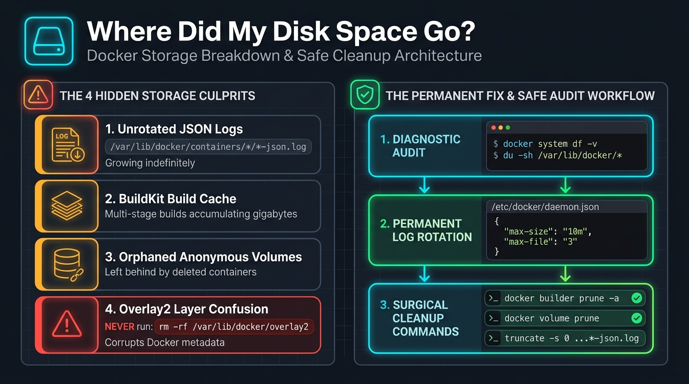

[🇺🇦 Читати цю статтю українською мовою](/posts/docker-disk-cleanup-overlay2-storage-guide/)

---

It is the universal recurring nightmare of every systems administrator, DevOps engineer, and homelab enthusiast.

In the middle of a workday, monitoring alerts fire simultaneously: production web services respond with HTTP 500 errors, databases enter emergency shutdown, and your terminal shell greets you with an ominous message upon login:
```text
No space left on device
```

You connect via SSH, run a quick disk inspection, and find an alarming reality:
```bash
df -h /
# Filesystem: /dev/vda1, Used: 99%, Available: 0
```

A quick directory traversal with `du -sh /*` immediately points a finger at the usual suspect — the Docker root directory:
```bash
du -sh /var/lib/docker/overlay2/
# 47G   /var/lib/docker/overlay2/
```

The instinctive reaction of almost every engineer is to run the standard command prescribed by basic tutorials:
```bash
docker system prune -a --volumes
```

Docker triumphantly prints: *"Total reclaimed space: 420MB"*. You hopefully rerun `df -h`... only to find that your disk is **still 98% full**, while `/var/lib/docker/overlay2` stubbornly holds onto the exact same tens of gigabytes!

As panic sets in, a reckless thought inevitably crosses your mind: *"What if I just run `rm -rf /var/lib/docker/overlay2/*`?"*

**Stop right there!** In this deep-dive guide, we will break down why manually deleting this directory will irrevocably destroy your Docker environment, where your disk space actually vanished, how to safely recover gigabytes in under 3 minutes, and how to immunize your server so this storage leak never happens again.


_Fig. 1. Anatomy of Docker storage: The 4 hidden disk hogs and permanent server protection workflow_

---

## Why You Must NEVER Run `rm -rf /var/lib/docker/overlay2`

To newcomers, the `overlay2` directory looks like an ordinary folder filled with disposable "cache." But it is not a cache.

**Overlay2** is a Linux Union File System driver that powers the fundamental container isolation architecture. It organizes filesystem state into hierarchical layers:
* **Lowerdir (Read-Only):** Immutable layers inherited from your base images (e.g., core system binaries of Alpine, Ubuntu, or Node.js).
* **Upperdir (Read-Write):** The ephemeral, writable layer dedicated to a specific running container.
* **Merged (Unified View):** The synthesized union mount that the container perceives as its cohesive root filesystem.

```text
┌────────────────────────────────────────────────────────┐
│  Merged View: What the container sees (/app, /bin, ...)│
├────────────────────────────────────────────────────────┤
│  ▲ Upperdir: Files created or modified by container    │  (Read / Write)
├────────────────────────────────────────────────────────┤
│  ▲ Lowerdir: Base image layers (Dockerfile steps, etc) │  (Read-Only)
└────────────────────────────────────────────────────────┘
```

Crucially, alongside the files on disk, the Docker daemon maintains a strict internal metadata state database inside `/var/lib/docker/image/overlay2/layerdb/`. This tracks exact cryptographic hash associations: mapping which directory belongs to which container layer.

> [!CAUTION]
> If you manually remove even a single directory inside `overlay2` using `rm -rf`, Docker's metadata database desynchronizes instantly. Subsequent operations will fail with catastrophic errors such as `failed to register layer: layer does not exist` or `storage driver error`. No containers will boot, and recovery typically requires purging and reinstalling the entire Docker engine from scratch!

---

## The 4 Hidden Storage Culprits: Why `system prune` Failed

The default `docker system prune` command strictly targets **stopped containers, unused networks, and dangling images** (untagged `<none>` images).

It completely bypasses the real culprits consuming 80%+ of your SSD capacity:

---

### 1. Bloated JSON Container Logs (The Silent Killer)

By default, Docker routes all `stdout` and `stderr` streams from every container into a plain-text JSON logfile:
```text
/var/lib/docker/containers/<container-id>/<container-id>-json.log
```

**Docker has ZERO default limits on logfile size!**
If a container runs for several months and continuously logs access traffic, error stack traces, or debug output (e.g., Nginx reverse proxies, Uptime Kuma monitors, databases, or application backends), this single JSON file quietly swells to **15, 30, or even 60 Gigabytes**!

Because the container is actively running, `docker system prune` considers it strictly untouchable.

#### Auditing Large Container Logs:
Run this command to surface the top 10 largest logfiles currently residing on your host:

```bash
find /var/lib/docker/containers/ -name "*-json.log" -exec du -sh {} + | sort -hr | head -n 10
```

You will often discover outputs like:
```text
28G    /var/lib/docker/containers/a1b2c3d4.../a1b2c3d4...-json.log
12G    /var/lib/docker/containers/f5e6d7c8.../f5e6d7c8...-json.log
```

#### Safe Zero-Downtime Log Truncation:
Do not delete the logfile with `rm`! If the container process holds an open file descriptor, the Linux kernel will not release the underlying disk blocks until the process terminates.

Instead, employ the **`truncate`** utility, which instantly resets the file size to zero bytes while preserving the active descriptor:

```bash
# Truncate a specific oversized log:
truncate -s 0 /var/lib/docker/containers/<ID>/<ID>-json.log

# Or truncate ALL container logs host-wide in one swift command:
truncate -s 0 /var/lib/docker/containers/*/*-json.log
```

*Executing this immediately returns tens of gigabytes to `df -h` without dropping a single connection!*

---

### 2. BuildKit Build Cache (`docker builder`)

If you build custom Dockerfiles on your host (or employ automated deployment pipelines via Git hooks or Coolify), Docker's **BuildKit** engine aggressively caches intermediate build stages.

Standard `docker system prune` ignores the build cache unless explicitly instructed.

#### Inspecting Build Cache Consumption:
```bash
docker system df
```

Look for the Build Cache entry:
```text
TYPE            TOTAL     ACTIVE    SIZE      RECLAIMABLE
Build Cache     42        0         18.4GB    18.4GB (100%)
```

#### Purging Build Cache:
Purge all lingering build layers:
```bash
docker builder prune -a -f
```

---

### 3. Orphaned Anonymous Volumes (Dangling Volumes)

When running stateful images (such as PostgreSQL, Redis, or MongoDB) without declaring explicit named volumes, Docker generates **anonymous volumes** assigned arbitrary UUIDs like `d41d8cd98f00b204e9800998ecf8427e`.

If you later remove the container via `docker rm` or recreate it using `docker compose down` without the `-v` flag, that volume remains orphaned on disk permanently inside `/var/lib/docker/volumes/`.

#### Pruning All Orphaned Volumes:
```bash
docker volume prune -f
```

> [!WARNING]
> Verify that all active production services are running, or that their persistent volumes are explicitly named in your compose definitions, so you don't accidentally prune cold databases from stopped projects.

---

### 4. Upperdir Bloat: Runaway Container Writes

Occasionally, containerized processes write large temporary files (session caches, database dumps, uncompressed archives) directly into container paths (like `/tmp` or `/app/logs`) instead of a mounted volume.

Every written byte accumulates directly inside that container's `upperdir` layer in `overlay2`.

#### Identifying Write-Heavy Containers:
Inspect the writable layer size of all running containers using the `-s` flag:

```bash
docker ps -s --format "table {{.Names}}\t{{.Size}}"
```

Look for bloated values in the first column:
```text
NAMES        SIZE
my-app       15.2GB (virtual 15.8GB)
umami        2.1MB (virtual 350MB)
```
If the container size displays double-digit gigabytes, it is actively leaking files into its internal writable layer!

Inspect which specific files were modified or created inside that container:
```bash
docker diff my-app | head -n 30
```
Flag `A` indicates an added file; `C` denotes modified content.

---

## Permanent Immunization: Capping Docker Logs Globally

Preventative engineering is always superior to emergency firefighting. To ensure container logs never consume your host disk unchecked, establish global log-rotation rules at the daemon layer.

Create or edit `/etc/docker/daemon.json`:

```json
{
  "log-driver": "json-file",
  "log-opts": {
    "max-size": "10m",
    "max-file": "3"
  }
}
```

### Architectural Meaning:
* `max-size: 10m` — When a container's logfile reaches 10 Megabytes, Docker automatically rolls over into a secondary log.
* `max-file: 3` — Docker retains a strict maximum of 3 historical rotated logs before purging the oldest.

Under this configuration, any container running on your host is permanently capped at a **maximum of 30 MB of logs** across its entire operational lifecycle!

Reload the Docker daemon to enforce the configuration:
```bash
systemctl reload docker || systemctl restart docker
```

*(Note: Existing running containers inherit this policy upon their next restart or recreation via `docker compose down && docker compose up -d`).*

---

## The Quick-Reference Emergency Cleanup Workflow

Bookmark this battle-tested command sequence to safely liberate maximum disk space within 30 seconds:

```bash
# 1. Diagnose storage distribution
docker system df

# 2. Instantly truncate bloated container logs on the fly
truncate -s 0 /var/lib/docker/containers/*/*-json.log

# 3. Purge stopped containers and all unreferenced images
docker system prune -a -f

# 4. Wipe lingering BuildKit cache
docker builder prune -a -f

# 5. Reclaim orphaned anonymous volumes
docker volume prune -f

# 6. Verify reclaimed capacity
df -h /
```

---

## Summary

The `overlay2` storage driver is robust, performant, and reliable — but requires basic operational hygiene:
1. **Never touch `/var/lib/docker/overlay2` directly with `rm -rf`** — it desynchronizes internal layerdb metadata and bricks the daemon.
2. **The primary invisible culprit is `*-json.log`**. Zero it out using `truncate -s 0` and enforce global caps inside `/etc/docker/daemon.json`.
3. **Regularly audit BuildKit cache:** multi-stage builds silently accumulate gigabytes of historical build layers.

Applying log rotation to `daemon.json` takes 60 seconds and permanently eliminates midnight "disk full" outages from your infrastructure!
