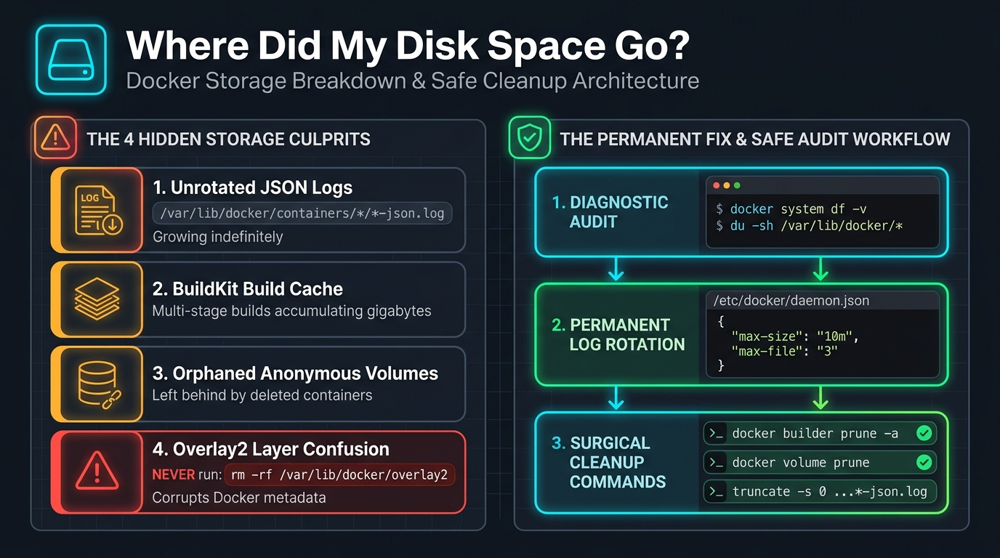

[🇬🇧 Read this article in English](/posts/docker-disk-cleanup-overlay2-storage-guide-en/)

---

Це класичний нічний кошмар кожного сисадміна, DevOps-інженера чи ентузіаста Homelab.

Посеред робочого дня моніторинг починає бити на сполох: сайти падають із помилкою 500, бази даних аварійно зупиняються, а термінал зустрічає зловісним повідомленням:
```text
No space left on device
```

Ви підключаєтеся по SSH, вводите команду перевірки дисків і бачите невтішну картину:
```bash
df -h /
# Файлова система: /dev/vda1, Використано: 99%, Вільно: 0
```

Швидке сканування за допомогою `du -sh /*` одразу вказує пальцем на головного винуватця — каталог Docker:
```bash
du -sh /var/lib/docker/overlay2/
# 47G   /var/lib/docker/overlay2/
```

Перша реакція будь-якого розробника — виконати стандартну команду, про яку пишуть у кожному базовому туторіалі:
```bash
docker system prune -a --volumes
```

Docker урочисто звітує: *«Total reclaimed space: 420MB»*. Ви з надією знову запускаєте `df -h`... і бачите, що дисковий простір **все одно забитий на 98%**, а папка `overlay2` важить ті ж самі гігабайти! 

Паніка наростає, і в голові з'являється небезпечна думка: *«А що, якщо просто зробити `rm -rf /var/lib/docker/overlay2/*`?»*

**Зупиніться!** У цій статті ми розберемо, чому ручне видалення цієї папки гарантовано вб'є ваш Docker, куди насправді зникають десятки гігабайтів дискового простору, як безпечно повернути своє місце за 3 хвилини та як налаштувати сервер так, щоб ця проблема більше ніколи не повторилася.


_Мал. 1. Анатомія пам'яті Docker: 4 приховані пожирачі диска та схема постійного захисту сервера_

---

## Чому НЕ МОЖНА писати `rm -rf /var/lib/docker/overlay2`?

Для новачків каталог `overlay2` виглядає як звичайна папка з якимось «тимчасовим кешем». Але це не кеш. 

**Overlay2** — це драйвер файлової системи Linux (Union File System), на якому тримається вся магія ізоляції контейнерів. Він працює за принципом шарів:
* **Lowerdir (нижні шари):** незмінні шари ваших базових образів (наприклад, системні файли Alpine чи Ubuntu).
* **Upperdir (верхній шар):** шар для запису конкретного запущеного контейнера (Read-Write layer).
* **Merged (об'єднаний шар):** те, що контейнер бачить як єдину кореневу файлову систему.

```text
┌────────────────────────────────────────────────────────┐
│  Merged View: Те, що бачить контейнер (/app, /bin, ...) │
├────────────────────────────────────────────────────────┤
│  ▲ Upperdir: Файли, створені чи змінені контейнером   │  (Read / Write)
├────────────────────────────────────────────────────────┤
│  ▲ Lowerdir: Тіло образу (шари Dockerfile, apt/apk...) │  (Read-Only)
└────────────────────────────────────────────────────────┘
```

Паралельно з файлами на диску Docker веде сувору внутрішню базу метаданих у каталозі `/var/lib/docker/image/overlay2/layerdb/`. Там записані точні зв'язки хешів: якому контейнеру належить який підкаталог.

> [!CAUTION]
> Якщо ви видалите хоча б одну папку з `overlay2` вручну через `rm -rf`, база метаданих миттєво розсинхронізується. Ви отримаєте фатальні помилки: `failed to register layer: layer does not exist` або `storage driver error`. Жоден контейнер більше не запуститься, а лікувати це доведеться повним видаленням і перевстановленням усього Docker з нуля!

---

## 4 приховані пожирачі диска: чому `system prune` не спрацював?

Команда `docker system prune` за замовчуванням видаляє лише **зупинені контейнери, невикористані мережі та dangling-образи** (образи без тегів `<none>`). 

Вона взагалі не чіпає те, що найчастіше з'їдає 80% вашого SSD:

---

### 1. Роздуті JSON-логи контейнерів (головний шкідник!)

За замовчуванням Docker записує весь вивід `stdout` та `stderr` кожного контейнера у звичайний JSON-файл:
```text
/var/lib/docker/containers/<container-id>/<container-id>-json.log
```

**У Docker за замовчуванням немає обмеження на розмір логів!**
Якщо контейнер працює кілька місяців і активно сипле помилками, access-логами чи дебаг-повідомленнями (наприклад, Nginx, Uptime Kuma, база даних чи бекенд-сервіс), цей текстовий файл непомітно розростається до **15, 30 або навіть 60 Гігабайтів**!

А оскільки контейнер зараз запущений, `docker system prune` вважає його недоторканним.

#### Як знайти товсті логи:
Виконайте команду, яка покаже топ-10 найбільших файлів логів на сервері:

```bash
find /var/lib/docker/containers/ -name "*-json.log" -exec du -sh {} + | sort -hr | head -n 10
```

Ви часто побачите щось на зразок:
```text
28G    /var/lib/docker/containers/a1b2c3d4.../a1b2c3d4...-json.log
12G    /var/lib/docker/containers/f5e6d7c8.../f5e6d7c8...-json.log
```

#### Як безпечно очистити їх на льоту (без перезавантаження):
Не видаляйте файл командою `rm`! Якщо процес контейнера тримає файл відкритим, операційна система не звільнить місце, поки процес не впаде. 

Замість цього скористайтеся утилітою **`truncate`**, яка миттєво обнуляє розмір файлу:

```bash
# Очистити конкретний гігантський лог:
truncate -s 0 /var/lib/docker/containers/<ID>/<ID>-json.log

# Або обнулити взагалі всі логи всіх контейнерів одним рядком:
truncate -s 0 /var/lib/docker/containers/*/*-json.log
```

*Після цього `df -h` миттєво поверне вам десятки вільних гігабайтів!*

---

### 2. Кеш збірки BuildKit (`docker builder`)

Якщо ви хоча б раз збирали власні Dockerfile на сервері (або використовуєте автодеплой через Coolify чи Git hooks), рушій збірки **BuildKit** агресивно кешує всі проміжні шари.

Команда `docker system prune` не очищає цей кеш, якщо їй явно не сказати про це.

#### Як перевірити:
```bash
docker system df
```

Ви побачите рядок:
```text
TYPE            TOTAL     ACTIVE    SIZE      RECLAIMABLE
Build Cache     42        0         18.4GB    18.4GB (100%)
```

#### Як очистити:
Видаляємо весь неактивний кеш білдера:
```bash
docker builder prune -a -f
```

---

### 3. Завислі анонімні томи (Dangling Volumes)

Коли ви запускаєте контейнери баз даних (PostgreSQL, Redis, MongoDB) без явного іменування волюмів, Docker автоматично створює так звані **анонімні томи** з назвами на зразок `d41d8cd98f00b204e9800998ecf8427e`.

Якщо ви потім видалите контейнер через `docker rm` або перезапустите через `docker compose down` без прапорця `-v`, цей том залишиться на диску назавжди в каталозі `/var/lib/docker/volumes/`.

#### Як очистити всі безхозні томи:
```bash
docker volume prune -f
```

> [!WARNING]
> Переконайтеся, що всі ваші важливі сервіси наразі запущені, або їхні томи мають постійні імена в `docker-compose.yml`, щоб випадково не видалити базу даних зупиненого проєкту.

---

### 4. Шар запису (Upperdir) розпухлих контейнерів

Іноді розробники роблять помилку: скрипт всередині контейнера генерує тимчасові файли (кеш, дампи бази, розпаковані архіви) у звичайну теку контейнера (наприклад, `/tmp` чи `/app/data`), замість того, щоб змонтувати окремий волюм.

Усі ці файли осідають у `upperdir` драйвера overlay2.

#### Як знайти контейнер, який нагенерував сміття:
Подивіться на розмір шару запису кожного контейнера за допомогою прапорця `-s` (size):

```bash
docker ps -s --format "table {{.Names}}\t{{.Size}}"
```

Стовпчик `Size` покаже два числа:
```text
NAMES        SIZE
my-app       15.2GB (virtual 15.8GB)
umami        2.1MB (virtual 350MB)
```
Якщо ви бачите гігабайти у першому числі — цей контейнер активно смітить у власну файлову систему!

Дізнатися, які саме файли були створені чи змінені всередині контейнера, можна безпосередньо:
```bash
docker diff my-app | head -n 30
```
Літера `A` означає доданий файл, `C` — змінений.

---

## Вакцинація: як назавжди заборонити Docker забивати диск

Найкраще лікування — це профілактика. Щоб логи контейнерів більше ніколи не росли безконтрольно, налаштуємо глобальну ротацію логів на рівні демона Docker.

Відкриваємо або створюємо конфігураційний файл `/etc/docker/daemon.json`:

```json
{
  "log-driver": "json-file",
  "log-opts": {
    "max-size": "10m",
    "max-file": "3"
  }
}
```

### Що це означає:
* `max-size: 10m` — щойно файл логу контейнера досягає 10 Мегабайтів, Docker починає новий файл.
* `max-file: 3` — зберігається не більше 3 таких файлів (старі автоматично видаляються).

Тепер будь-який контейнер на вашому сервері гарантовано займатиме **не більше 30 МБ логів** за весь свій життєвий цикл!

Перезавантажуємо Docker для застосування конфігурації:
```bash
systemctl reload docker || systemctl restart docker
```

*(Зверніть увагу: це правило застосується до всіх нових контейнерів, або після перестворення існуючих через `docker compose down && docker compose up -d`).*

---

## Шпаргалка: Скрипт повної безпечної ревізії

Збережіть собі цю послідовність команд, яка за 30 секунд повертає максимум вільного місця:

```bash
# 1. Оцінити ситуацію
docker system df

# 2. Обнулити роздуті логи працюючих контейнерів на льоту
truncate -s 0 /var/lib/docker/containers/*/*-json.log

# 3. Видалити всі зупинені контейнери та невикористані образи
docker system prune -a -f

# 4. Видалити завислий кеш білдера (BuildKit)
docker builder prune -a -f

# 5. Очистити анонімні «мертві» томи
docker volume prune -f

# 6. Перевірити результат
df -h /
```

---

## Висновки

Файлова система `overlay2` — це надійний і швидкий механізм, але він вимагає розуміння своєї внутрішньої кухні:
1. **Ніколи не чіпайте `/var/lib/docker/overlay2` через `rm -rf`** — це руйнує базу метаданих і призводить до відмови демона.
2. **Головний невидимий ворог — це `*-json.log`**. Очищуйте їх через `truncate -s 0` і обов'язково увімкніть ліміти в `daemon.json`.
3. **Регулярно чистіть BuildKit:** кеш збірок образів непомітно з'їдає гігабайти, якщо ви деплоїте сервіси з вихідного коду.

Один раз налаштований `daemon.json` збереже вам купу нервів і врятує ваш сервер від раптових нічних падінь із помилкою «диск переповнений»!
