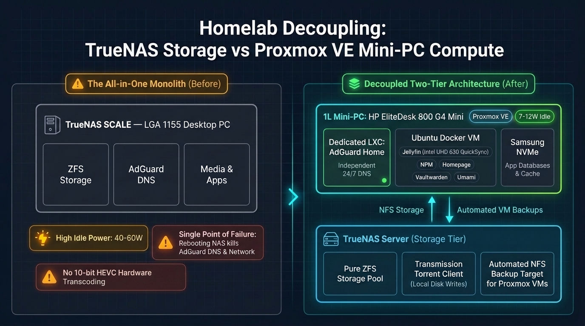
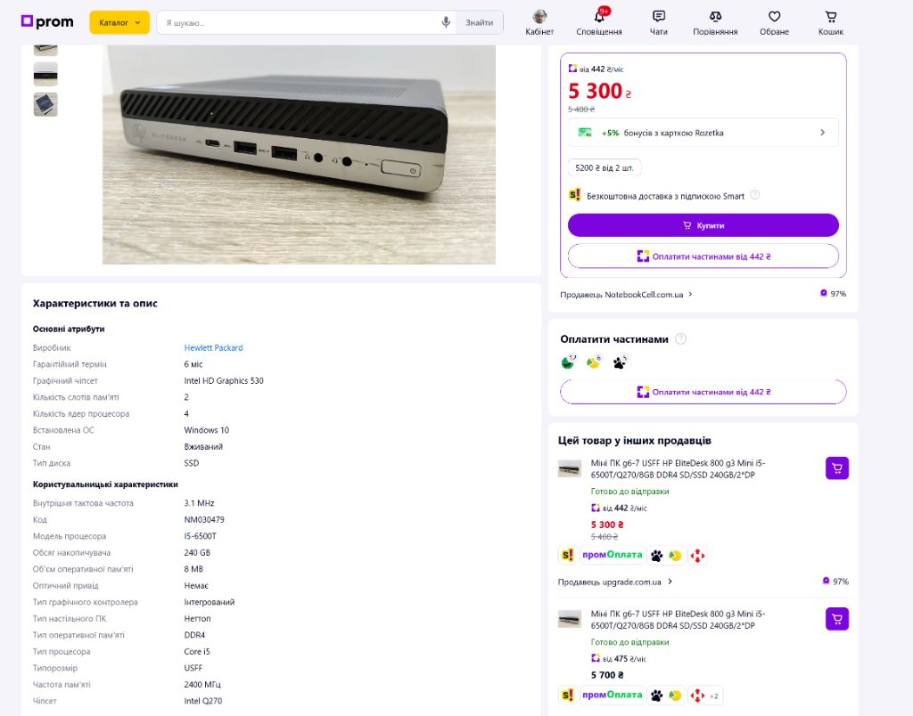
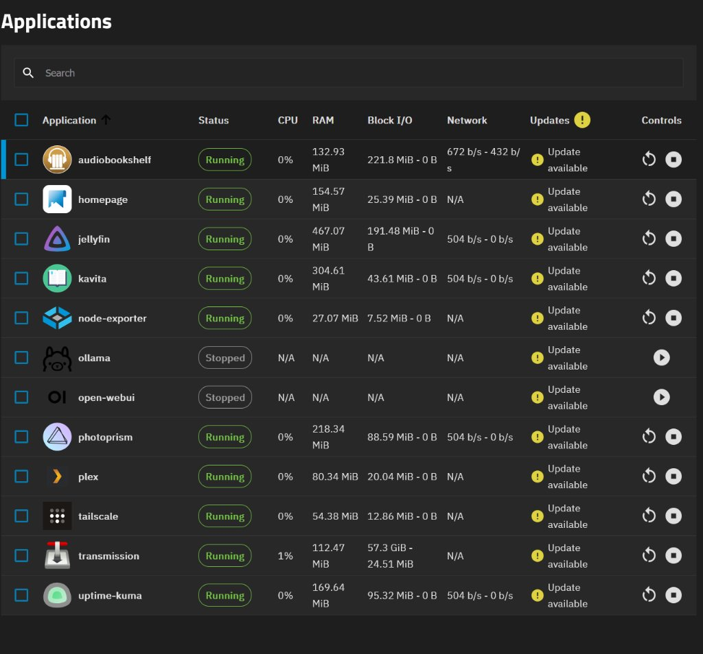
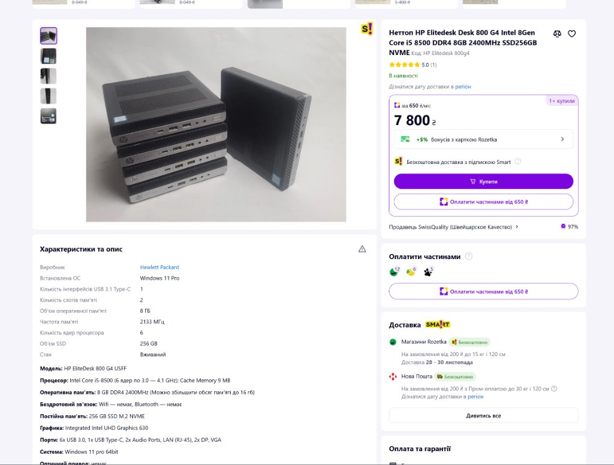
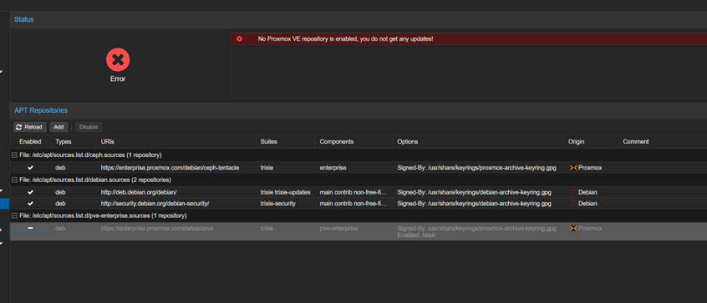
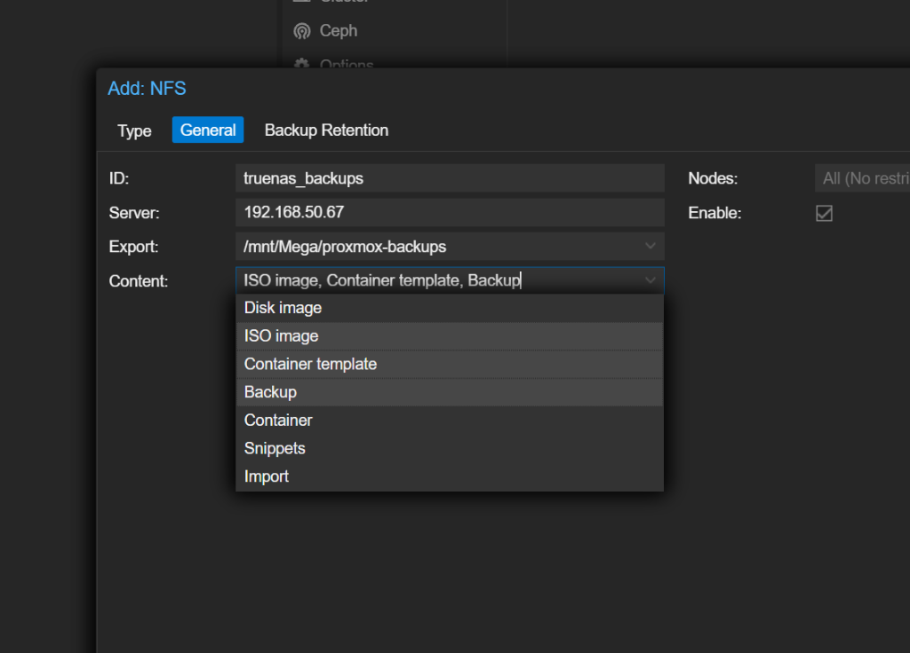
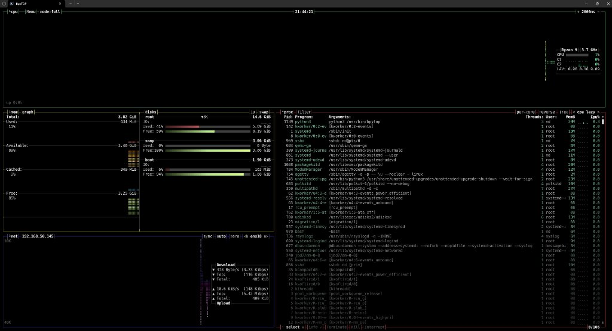

[🇺🇦 Читати цю статтю українською мовою](/posts/homelab-separation-truenas-proxmox-minipc-guide/)

---

Almost every homelab journey begins with an identical, time-honored ritual: you rescue an aging desktop PC that has outlived its usefulness as your primary workstation, drop in a few high-capacity hard drives, install **TrueNAS SCALE**, and watch the magic unfold.

For a long time, this "all-in-one" monolith feels like an absolute engineering victory. Within a single chassis, you manage a bulletproof ZFS storage pool, host media streaming engines, run home network DNS sinkholes, and orchestrate a dozen Docker microservices.

Yet as a home server evolves from a weekend hobby into critical 24/7 household infrastructure, the **"everything in one box on legacy desktop hardware"** paradigm inevitably begins to crumble under operational reality.

In this deep-dive article, I want to walk you through the architectural audit of my homelab: why I decided to offload all compute and application workloads from TrueNAS onto a dedicated 1-liter micro-PC powered by **Proxmox VE**, how I navigated the used corporate enterprise market to pair with an existing Samsung NVMe SSD, why I abandoned Windows 11 as a host, and how I completed a dry-run test drive of Proxmox VE 9 inside Hyper-V before spending a single dollar on new hardware.


_Fig. 1. Homelab Evolution: Transitioning from an all-in-one monolith to an efficient two-tier decoupled architecture_

---

## 1. The Starting Baseline: What Ran on TrueNAS SCALE

My primary TrueNAS node was constructed on a legacy platform that has earned legendary status in computing history:
* **Motherboard:** `ASUS P8B75-V` (LGA 1155 socket, vintage 2012, 1× SATA 6Gb/s + 5× SATA 3Gb/s).
* **CPU:** 4-core `Intel Core i5-3550` (3.3 GHz, 77W TDP, legacy Intel HD Graphics 2500).
* **RAM:** `24 GB DDR3-1333` in dual-channel (`4+8+4+8 GB` layout, providing a generous cache for the ZFS Adaptive Replacement Cache / ARC).


_Fig. 2. TrueNAS SCALE hardware telemetry dashboard: Core i5-3550 CPU and 24 GB DDR3 RAM on an ASUS desktop motherboard_

On this single machine, two distinct software tiers operated simultaneously:

1. **Ubuntu 24.04 LTS VM inside TrueNAS** (allocated 2 GB RAM, 28 GB virtual disk) hosting 8 critical Docker containers:
   * `adguardhome` — whole-home DNS server and ad-blocker;
   * `nginx-proxy-manager` — reverse proxy handling domain routing and SSL certificates;
   * Observability stack: `prometheus`, `grafana`, `node-exporter`, `docker-proxy`;
   * `couchdb` — synchronization backend for my Obsidian second brain;
   * `tuya-dashboard` — smart home telemetry board.


_Fig. 3. Active Docker containers listed via SSH inside the TrueNAS Ubuntu virtual machine_

2. **TrueNAS SCALE Apps (Native Catalog Workloads):**
   * Media & document libraries: `jellyfin`, `plex`, `photoprism`, `audiobookshelf`, `kavita`;
   * Networking & metrics: `homepage`, `uptime-kuma`, `tailscale`;
   * Torrent downloader: `transmission`.


_Fig. 4. Native TrueNAS SCALE Apps catalog overview running on the primary storage node_

---

## 2. Why the "All-in-One" Monolith Failed

Over months of operation, four fundamental architectural bottlenecks emerged:

### 1. Household Network Dependency on Storage (Single Point of Failure)
Routine maintenance on the storage server — physical dust cleaning, rebooting after a TrueNAS OS upgrade, ZFS pool scrubs, or replacing a drive cable — immediately knocked offline `AdGuard Home`. 
Instantly, the entire household lost DNS resolution: family smartphones lost internet connectivity, smart TVs froze mid-stream, and IoT devices dropped offline. Forcing your storage server to act as a single point of failure for baseline household networking is an architectural anti-pattern.

### 2. High Idle Power Draw During Outages
An aging ATX power supply and an older 77W TDP desktop processor draw between **40W and 65W+ strictly at idle**. During seasonal electrical grid outages, home UPS units and portable power stations drain rapidly. In contrast, a modern 1-liter corporate micro-PC idles at an astonishing **7W to 12W**!

### 3. Missing Modern Hardware Transcoding (Intel QuickSync)
The vintage `i5-3550` (Ivy Bridge) lacks modern hardware acceleration for modern HEVC/H.265 (and 10-bit HDR) media. When Jellyfin or Plex attempted to transcode a high-bitrate 4K stream for a remote mobile client, the CPU pegged at 100% load, stuttering into an unwatchable slideshow.

### 4. TrueNAS SCALE App Lifecycle Friction
TrueNAS SCALE is phenomenal as a storage operating system. However, its application subsystem (notably the major transition from Kubernetes/k3s to native Docker compose) occasionally introduces breaking changes during version upgrades. By offloading compute workloads, TrueNAS returns to its purest, most stable form: an immutable, rock-solid ZFS storage appliance.

---

## 3. Mini-PC Shootout: Matching Hardware to a Samsung 512 GB NVMe

I already had an ultra-fast, high-endurance **Samsung 512 GB M.2 NVMe SSD** ready to serve as the local storage drive. Consequently, the replacement micro-PC had to feature a **native M.2 PCIe 3.0 x4 slot**.

I evaluated the popular corporate enterprise surplus market:

| Model | Hardware Specs | Approximate Price | Pros | Cons / Gotchas |
| :--- | :--- | :--- | :--- | :--- |
| **Intel NUC5i3RYH** | `i3-5005U` (2c/4t), DDR3L, no SSD | ~$75 | Cheapest option, 6–10W idle | Vintage 2015 tech, DDR3L 1.35V only, Mini-HDMI/Mini-DP, PCIe 2.0 (picky BIOS with modern NVMe), no 10-bit HEVC |
| **HP EliteDesk 800 G3 Mini** | `i5-6500T` (4c/4t, 35W), 8 GB DDR4 | ~$135 | Quiet, DDR4, native M.2 NVMe PCIe 3.0 + 2.5" SATA, full DisplayPort | Intel HD Graphics 530 (Skylake) lacks robust 10-bit HEVC QuickSync |
| **HP EliteDesk 800 G4 Mini (65W)** | **`i5-8500` (6c/6t), 8 GB DDR4** | ~$195 | **The Gold Standard:** 6 true cores for PhotoPrism, **Intel UHD 630 (10-bit HEVC/VP9 QuickSync)**, **Dual M.2 NVMe slots!** | Requires 90W power brick; recommended to upgrade to 16 GB RAM for a full Proxmox stack |

### ⚠️ The Treacherous M.2 NVMe Surplus Trap
If you own an NVMe SSD and browse used hardware listings, **be exceptionally cautious!**
* Many celebrated ultra-cheap thin clients (`Dell Wyse 5070`, `HP T630 / T640`, `Fujitsu Futro S740`) and the `Lenovo M700` have M.2 slots that support **strictly SATA-bus SSDs**. A PCIe NVMe drive will simply not be recognized by the BIOS.
* Budget lines like the `HP ProDesk 400 G3 Mini` or `Dell OptiPlex 3040 Micro` omit M.2 drive slots entirely (featuring only 2.5" SATA bays).
* Proven corporate workhorses with genuine PCIe 3.0 x4 support include: **HP EliteDesk 800 G3/G4**, **Lenovo ThinkCentre M710q / M720q / M920q**, **Dell OptiPlex 3050 / 7050 Micro**, or contemporary **Intel N100 / N150** units.

The definitive winner was the **HP EliteDesk 800 G4 Mini**: 6 physical cores on the i5-8500, Intel UHD 630 for effortless 4K hardware transcoding, and two M.2 NVMe drive bays for future expansion.

---

## 4. Target Architecture: Proxmox VE vs Ubuntu vs Windows

How should compute and storage responsibilities be cleanly decoupled?

```text
┌────────────────────────────────────────────────────────┐
│               TrueNAS SCALE (Storage Tier)             │
│   • ZFS RAIDZ Pool for media, backups, and photos      │
│   • Transmission (local high-speed torrent writes)     │
│   • Node-Exporter (NAS hardware metrics)               │
└──────────────────────────┬─────────────────────────────┘
                           │ NFS Shares (Gigabit LAN)
┌──────────────────────────▼─────────────────────────────┐
│             HP EliteDesk 800 G4 (Proxmox VE 9)         │
│                                                        │
│  ┌──────────────────┐    ┌──────────────────────────┐  │
│  │ LXC Container    │    │ Virtual Machine (VM)     │  │
│  │ AdGuard Home     │    │ Ubuntu 24.04 + Docker    │  │
│  │ (24/7 DNS, 256MB)│    │ • Nginx Proxy Manager    │  │
│  └──────────────────┘    │ • Jellyfin (UHD 630 QSV) │  │
│                          │ • PhotoPrism, Vaultwarden│  │
│  ┌──────────────────┐    │ • CouchDB, Tuya, Umami   │  │
│  │ Samsung 512G NVMe│    │ • Grafana + Prometheus   │  │
│  │ (ext4 / LVM-Thin)│    └──────────────────────────┘  │
│  └──────────────────┘                                  │
└────────────────────────────────────────────────────────┘
```

### Why Proxmox Over Windows 11 as a Host?
It was initially tempting to leave Windows 11 Pro on the HP machine and run Docker Desktop via WSL2. For a dedicated 24/7 server, however, this proved a non-starter:
1. **Memory Overhead:** Windows 11 and WSL2 consume 3.5 to 4.5 GB of RAM before running a single container.
2. **Unpredictable Reboots:** Windows updates trigger unprompted reboots, and Docker Desktop does not reliably initialize containers as background daemons prior to user GUI login.
3. **QuickSync & NFS Complexity:** Passing through the Intel GPU and maintaining persistent NFS mounts inside WSL2 remains fragile.
4. *(Bonus Insight):* The digital Windows 11 Pro license is permanently embedded in the HP motherboard's ACPI MSDM firmware table. If you ever need to restore Windows down the road, it reactivates automatically.

### Why ext4 (LVM-Thin) Instead of ZFS on a Single SSD?
Proxmox defaults to suggesting ZFS during installation. However, on a **single consumer NVMe SSD** (Samsung EVO/PRO):
* Running ZFS on a non-mirrored drive yields minimal resilience benefits while generating high metadata write volume, accelerating flash wear (TBW).
* ZFS ARC aggressively claims up to 50% of total host RAM by default.
* The standard **ext4 + LVM-Thin** configuration in Proxmox supports instant snapshots, delivers maximum raw NVMe I/O performance, and preserves your precious RAM for running containers.

---

## 5. Practical Test Drive: Running Proxmox VE 9 inside Hyper-V

To validate the entire networking and NFS integration with TrueNAS without upfront financial investment, I deployed a full Proxmox testbed inside **Hyper-V** on my primary workstation.

Four Hyper-V configuration parameters are mandatory to avoid network connectivity issues:

### Hyper-V VM Configuration Checklist:
1. **Generation:** Strictly **Generation 2**.
2. **Security:** **Disable `Secure Boot`** in VM settings.
3. **Memory:** **Uncheck `Dynamic Memory`** (Proxmox demands a static, fixed RAM allocation).
4. **Nested Virtualization & MAC Address Spoofing (Critical):**
   Open PowerShell as Administrator with the VM powered off and execute:
   ```powershell
   # Enable running guest VMs inside Proxmox (Nested Virtualization)
   Set-VMProcessor -VMName "Proxmox" -ExposeVirtualizationExtensions $true

   # Allow Proxmox to bridge virtual network interfaces (MAC Spoofing)
   Set-VMNetworkAdapter -VMName "Proxmox" -MacAddressSpoofing On
   ```
   > [!IMPORTANT]
   > Without `MacAddressSpoofing On`, the Proxmox host will obtain an IP address on your local LAN, but nested VMs and LXC containers inside it will be completely unable to reach the network!


_Fig. 5. Hyper-V VM configuration: Disabling Secure Boot and configuring the virtual network adapter for MAC address spoofing_

---

## 6. Navigating First-Day Proxmox VE 9 Nuances

Booting into Proxmox VE 9 (`trixie`) requires a few immediate configuration adjustments:

### 1. Activating the Free Repository
By default, Proxmox checks enterprise repositories and throws `401 Unauthorized` errors:
* Navigate in the web GUI: `Node → Updates → Repositories`.
* Disable both enterprise sources: **`pve-enterprise`** and **`ceph-tentacle`**.
* Click **Add** and select the community **`No-Subscription`** repository.

### 2. Connecting TrueNAS via NFS (The Maproot Gotcha)
To allow Proxmox to store automated VM backups on TrueNAS:
1. Create a `proxmox-backups` dataset in TrueNAS and export it over **NFS**.
2. **Crucial TrueNAS NFS Requirement:** In the NFS Share settings, open *Advanced Options* and explicitly configure:
   * **`Maproot User: root`**
   * **`Maproot Group: wheel`** (or `root`).
   *(Skipping this will cause Proxmox to hit `Permission Denied` errors during backup creation).*
3. In Proxmox: `Datacenter → Storage → Add → NFS`:
   * Enter the TrueNAS IP, share path, and assign content types: **`ISO image, Container template, VZDump backup file`**.

### 3. Deploying the Docker Host VM (Ubuntu 24.04 LTS)
* Download the Ubuntu ISO directly through the Proxmox GUI (`Download from URL`).
* When creating the VM, ensure:
  * **Qemu Agent:** `Enabled` (for clean shutdowns and telemetry).
  * **Hard Disk:** Check **`Discard`** (enables TRIM commands to protect SSD lifespan).
  * **CPU:** Type **`host`** (passes through all native CPU instruction sets).

Inside Ubuntu, install the guest agent:
```bash
sudo apt update && sudo apt install -y qemu-guest-agent
sudo systemctl enable --now qemu-guest-agent
```
At idle, a minimal Ubuntu 24.04 install consumes merely **~430 MB of RAM**!


_Fig. 6. Ubuntu 24.04 VM summary in Proxmox VE 9: lean resource utilization with ~430 MiB of idle RAM consumption_

> [!TIP]
> **Ubuntu Server LVM Trick:** By default, the Ubuntu installer allocates only 50% of the virtual disk to the root `/` logical volume. Expand it to 100% instantly with a single command:
> ```bash
> sudo lvextend -l +100%FREE -r /dev/ubuntu-vg/ubuntu-lv
> ```

### 4. The "Missing Backup" Rookie Trap
After completing my first test backup to the TrueNAS NFS share (`Backup now`), I opened `VM → Backup` only to see a completely blank list!
The explanation is simple: in the upper-right corner of the backup panel, the **`Storage`** dropdown defaults to `local`. Switching the filter to `truenas_backups` immediately revealed the backup archive.


_Fig. 7. Resolving the Proxmox backup view: selecting the 'truenas_backups' NFS storage filter reveals the backup archive_

---

## Conclusion: The Ultimate Homelab Upgrade

Decoupling compute from storage between a **TrueNAS Storage Box** and a **Proxmox VE Mini-PC**:
1. **Eliminates single points of failure:** TrueNAS reboots no longer disrupt home DNS, proxying, or telemetry.
2. **Cuts continuous power consumption:** 24/7 services draw ~10W instead of 60W, extending UPS battery runtimes.
3. **Unlocks modern QuickSync:** Effortlessly transcode 4K media without thermal stress.
4. **Simplifies backup automation:** Virtual machines snapshot in seconds, and automated nightly backups stream over NFS to TrueNAS ZFS storage.

If your homelab has outgrown an all-in-one desktop tower, a surplus 1-liter micro-PC is the most cost-effective, energy-efficient, and professional upgrade you can make to your home server ecosystem!
