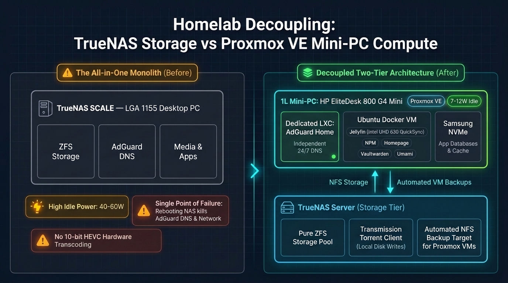

[🇬🇧 Read this article in English](/posts/homelab-separation-truenas-proxmox-minipc-guide-en/)

---

Майже кожен шлях у світ **Homelab** починається за одним і тим самим класичним сценарієм: береться старий домашній комп'ютер, який уже відслужив своє як основна робоча станція, до нього додається кілька жорстких дисків, встановлюється **TrueNAS SCALE** — і починається магія.

Певний час такий «комбайн» відчувається як абсолютна інженерна перемога. На одному залізі у вас і надійний ZFS-масив, і медіасервери, і домашній DNS-блокувальник, і десяток Docker-контейнерів.

Але в міру того, як домашній сервер перетворюється з іграшки на критичну інфраструктуру для всієї родини, концепція **«все в одному на старій платформі»** починає тріщати по швах. 

Сьогодні я хочу поділитися практичним досвідом архітектурного аудиту мого Homelab: чому я вирішив забрати всі обчислення з TrueNAS на окремий 1-літровий міні-ПК із **Proxmox VE**, як підбирав залізо під швидкий NVMe-диск, чому відкинув ідею з Windows 11 і як провів повноцінний тест-драйв Proxmox VE 9 усередині Hyper-V ще до покупки нового обладнання.


_Мал. 1. Еволюція Homelab: від монолітного «все-в-одному» до дворівневої відмовостійкої архітектури_

---

## 1. Вихідна точка: що жило на TrueNAS SCALE

Мій поточний сервер TrueNAS зібраний на платформі, яка вже стала справжньою класикою комп'ютерної ери:
* **Материнська плата:** `ASUS P8B75-V` (сокет LGA 1155, 2012 рік, 1× SATA 6Gb/s + 5× SATA 3Gb/s).
* **Процесор:** 4-ядерний `Intel Core i5-3550` (3.3 GHz, 77W TDP, стара вбудована графіка Intel HD 2500).
* **Оперативна пам'ять:** `24 GB DDR3-1333` у двоканалі (комбінація `4+8+4+8 GB`, що дає чудовий запас під ZFS ARC).

На цьому одному залізі паралельно крутилися два рівні сервісів:

1. **Віртуальна машина Ubuntu 24.04 LTS всередині TrueNAS** (виділено 2 GB RAM, 28 GB диск), де жили 8 критичних Docker-контейнерів:
   * `adguardhome` — головний DNS-сервер для всієї квартири з блокуванням реклами;
   * `nginx-proxy-manager` — reverse proxy для маршрутизації доменів та SSL;
   * стек моніторингу: `prometheus`, `grafana`, `node-exporter`, `docker-proxy`;
   * `couchdb` — синхронізація бази знань Obsidian;
   * `tuya-dashboard` — панель розумного дому.
2. **TrueNAS SCALE Apps (нативні застосунки):**
   * медіатека та книги: `jellyfin`, `plex`, `photoprism`, `audiobookshelf`, `kavita`;
   * дашборди й зв'язок: `homepage`, `uptime-kuma`, `tailscale`;
   * завантажувач: `transmission`.

---

## 2. Чому моноліт «все в одному» перестав працювати

З часом викристалізувалися чотири критичні проблеми, які більше не можна було ігнорувати:

### 1. Залежність домашньої мережі 24/7 від сховища (SPOF)
Будь-яке регламентне обслуговування NAS — чистка від пилу, перезавантаження після оновлення TrueNAS, перевірка дисків ZFS чи заміна кабелю — миттєво вирубало `AdGuard Home`. 
У ту ж секунду вся родина втрачала DNS: зникав інтернет на смартфонах, смарт-ТВ зависали посеред фільму, а розумні розетки втрачали зв'язок. Робити сховище єдиною точкою відмови (Single Point of Failure) для всієї квартири — погана інженерна практика.

### 2. Енергоспоживання під час блекаутів
Старий системник з ATX-блоком живлення та процесором 77W TDP споживає **від 40 до 65+ Вт навіть у стані простою**. Під час відключень світла домашній ДБЖ або портативна зарядна станція тануть на очах. Для порівняння: сучасний 1-літровий корпоративний міні-ПК бере в простої всього **7–12 Вт**!

### 3. Відсутність сучасного апаратного транскодингу (QuickSync)
Старенький `i5-3550` (Ivy Bridge) позбавлений підтримки кодеків HEVC/H.265 (тим паче 10-bit HDR). Коли Jellyfin чи Plex намагаються транслювати 4K-фільм на планшет або мобільний телефон, процесор влітає в 100% завантаження і починає показувати слайд-шоу.

### 4. Стабільність оновлень TrueNAS
TrueNAS SCALE — геніальна операційна система для зберігання даних. Але підсистема застосунків (особливо історичний перехід з Kubernetes/k3s на чистий Docker) при мажорних апдейтах іноді потребує ручного втручання. Відокремивши сервіси, ми перетворюємо TrueNAS на «чистий, стабільний і надійний залізобетонний NAS».

---

## 3. Битва Міні-ПК: вибираємо платформу під наявний Samsung 512 GB NVMe

У мене вже був готовий високошвидкісний накопичувач **Samsung NVMe M.2 на 512 GB**, тож новий міні-ПК мав не просто бути компактним, а мати **повноцінний слот M.2 PCIe 3.0 x4**.

Ми проаналізували вторинний ринок корпоративних неттопів в Україні:

| Модель | Характеристики | Орієнтовна ціна | Плюси | Мінуси / Підводні камені |
| :--- | :--- | :--- | :--- | :--- |
| **Intel NUC5i3RYH** | `i3-5005U` (2c/4t), DDR3L, без SSD | ~2 970 ₴ | Найдешевший, компактний, 6–10 Вт | Застарілий (2015 р.), лише DDR3L 1.35V, Mini-HDMI/Mini-DP, PCIe 2.0 (вередливий BIOS до сучасних NVMe), немає 10-bit HEVC |
| **HP EliteDesk 800 G3 Mini** | `i5-6500T` (4c/4t, 35W), 8 GB DDR4 | ~5 300 ₴ | Тихий, DDR4, чесний M.2 NVMe PCIe 3.0 + 2.5" SATA, DisplayPort | Графіка Intel HD 530 (6 gen) ще не має повноцінного апаратного 10-bit HEVC QuickSync |
| **HP EliteDesk 800 G4 Mini (65W)** | **`i5-8500` (6c/6t), 8 GB DDR4** | ~7 800 ₴ | **Ідеальний вибір:** 6 повноцінних ядер під PhotoPrism, **Intel UHD 630 (QuickSync 10-bit HEVC/VP9)**, **2 слоти M.2 NVMe!** | Потрібен БЖ на 90W; під Proxmox і повний стек варто докупити планку до 16 GB |

### ⚠️ Головна пастка вторинного ринку з NVMe
Якщо у вас, як і в мене, є свій NVMe SSD — **будьте надзвичайно уважні!**
* Популярні тонкі клієнти (`Dell Wyse 5070`, `HP T630 / T640`, `Fujitsu Futro S740`) та ПК серії `Lenovo M700` мають слот M.2, який підтримує **лише SATA-протокол**. NVMe-диск там просто не визначиться в системі.
* А бюджетні моделі на кшталт `HP ProDesk 400 G3 Mini` чи `Dell OptiPlex 3040 Micro` взагалі не мають M.2-слота під накопичувач (тільки 2.5" SATA).
* Тому перевіреними варіантами з чесним PCIe 3.0 x4 є: **HP EliteDesk 800 G3/G4**, **Lenovo ThinkCentre M710q / M720q / M920q**, **Dell OptiPlex 3050 / 7050 Micro** або свіжі китайські міні-ПК на **Intel N100 / N150**.

Переможцем став **HP EliteDesk 800 G4 Mini**: 6 ядер i5-8500, графіка UHD 630 для миттєвого апаратного транскодингу будь-якого відео та два слоти під NVMe-накопичувачі на майбутнє.

---

## 4. Цільова архітектура: Proxmox VE проти Ubuntu та Windows

Як правильно розділити ролі між сховищем та обчислювальним вузлом?

```text
┌────────────────────────────────────────────────────────┐
│               TrueNAS SCALE (Файлове сховище)          │
│   • Масив ZFS (RAIDZ) для фільмів, бекапів і фото      │
│   • Transmission (локальне завантаження торрентів)     │
│   • Node-Exporter (моніторинг заліза NAS)              │
└──────────────────────────┬─────────────────────────────┘
                           │ NFS Shares (Гігабітна мережа)
┌──────────────────────────▼─────────────────────────────┐
│             HP EliteDesk 800 G4 (Proxmox VE 9)         │
│                                                        │
│  ┌──────────────────┐    ┌──────────────────────────┐  │
│  │ LXC Контейнер    │    │ Віртуальна машина (VM)   │  │
│  │ AdGuard Home     │    │ Ubuntu 24.04 + Docker    │  │
│  │ (DNS 24/7, 256MB)│    │ • Nginx Proxy Manager    │  │
│  └──────────────────┘    │ • Jellyfin (UHD 630 QSV) │  │
│                          │ • PhotoPrism, Vaultwarden│  │
│  ┌──────────────────┐    │ • CouchDB, Tuya, Umami   │  │
│  │ Samsung 512G NVMe│    │ • Grafana + Prometheus   │  │
│  │ (ext4 / LVM-Thin)│    └──────────────────────────┘  │
│  └──────────────────┘                                  │
└────────────────────────────────────────────────────────┘
```

### Чому Proxmox, а не Windows 11 як хост?
Спочатку була спокуса залишити на HP вшиту ліцензію Windows 11 Pro і запустити Docker Desktop (WSL2). Але для 24/7-сервера це глухий кут:
1. **Апетит до оперативної пам'яті:** Windows 11 разом із WSL2 з'їдають 3.5–4.5 ГБ RAM ще до того, як ви запустили перший контейнер.
2. **Непередбачувані ребути:** Оновлення Windows люблять перезавантажувати систему посеред ночі, а Docker Desktop не вміє автоматично підніматися у фоні до введення пароля користувача.
3. **Проблеми з QuickSync та NFS:** Прокидання Intel GPU та стабільне монтування NFS-шар у WSL2 — це вічні «танці з бубном».
4. *(Приємний бонус):* Цифрова ліцензія Windows 11 Pro надійно прошита в таблиці ACPI MSDM материнської плати HP. Якщо за рік знадобиться повернути Windows — вона активується автоматично.

### Чому для одного споживчого NVMe обрано ext4 (LVM-Thin), а не ZFS?
Proxmox при інсталяції наполегливо пропонує ZFS. Але якщо у вас **один споживчий NVMe SSD** (Samsung EVO/PRO):
* ZFS на одному диску без дзеркала дає мінімум переваг, зате пише величезну кількість метаданих, прискорюючи деградацію флеш-пам'яті (TBW).
* ZFS ARC за замовчуванням забирає до 50% усієї оперативної пам'яті хоста.
* Стандартна розмітка **ext4 + LVM-Thin** у Proxmox підтримує швидкі снепшоти, дає максимальну швидкість читання/запису і залишає всю RAM під ваші сервіси.

---

## 5. Практичний тест-драйв: тестуємо Proxmox VE 9 у Hyper-V

Щоб перевірити всю схему взаємодії з TrueNAS без зайвих витрат, ми підняли тестовий стенд усередині **Hyper-V** на основному робочому комп'ютері.

Ось 4 критичні налаштування Hyper-V, без яких Proxmox або не запуститься, або гостьові віртуалки залишаться без інтернету:

### Налаштування віртуальної машини в Hyper-V:
1. **Покоління:** строго **Generation 2**.
2. **Безпека:** обов'язково **зняти прапорець `Enable Secure Boot`** у налаштуваннях VM.
3. **Пам'ять:** **вимкнути `Dynamic Memory`** (Proxmox вимагає суворо фіксованого обсягу RAM).
4. **Вкладена віртуалізація та Spoofing MAC-адрес (найголовніше!):**
   Відкриваємо PowerShell від імені адміністратора при вимкненій тестовій VM і виконуємо дві команди:
   ```powershell
   # Дозволяємо запускати віртуалки всередині Proxmox (Nested Virtualization)
   Set-VMProcessor -VMName "Proxmox" -ExposeVirtualizationExtensions $true

   # Дозволяємо Proxmox створювати віртуальні мережеві інтерфейси (MAC Spoofing)
   Set-VMNetworkAdapter -VMName "Proxmox" -MacAddressSpoofing On
   ```
   > [!IMPORTANT]
   > Без прапорця `MacAddressSpoofing On` сам Proxmox отримає IP-адресу у вашій домашній мережі, але жодна створена всередині нього віртуалка чи контейнер не зможе вийти в інтернет!

---

## 6. Перші кроки та «підводні камені» Proxmox VE 9

Після завантаження Proxmox VE 9 (`trixie`) ми пройшли кілька обов'язкових кроків налаштування:

### 1. Перемикання на безкоштовні репозиторії
За замовчуванням Proxmox намагається оновлюватися з платного enterprise-репозиторію і видає помилку `401 Unauthorized`.
* Заходимо у веб-інтерфейс: `Node → Updates → Repositories`.
* Вимикаємо обидва платні репозиторії: **`pve-enterprise`** та **`ceph-tentacle`**.
* Натискаємо **Add** і додаємо безкоштовний репозиторій **`No-Subscription`**.

### 2. Підключення TrueNAS для бекапів по NFS (секрет Maproot)
Щоб Proxmox міг автоматично скидати резервні копії всіх віртуалок на TrueNAS:
1. У TrueNAS створили датасет `proxmox-backups` і розшарили його через **NFS**.
2. **Головний підводний камінь TrueNAS NFS:** в налаштуваннях NFS Share обов'язково відкриваємо *Advanced Options* і виставляємо:
   * **`Maproot User: root`**
   * **`Maproot Group: wheel`** (або `root`).
   *(Якщо цього не зробити, Proxmox отримає помилку `Permission Denied` під час спроби записати бекап чи завантажити образ).*
3. У Proxmox: `Datacenter → Storage → Add → NFS`:
   * Вказуємо IP TrueNAS, шлях до шари та обираємо вміст: **`ISO image, Container template, VZDump backup file`**.

### 3. Створення віртуальної машини під Docker (Ubuntu 24.04 LTS)
* Завантажили ISO-образ безпосередньо через веб-інтерфейс Proxmox (`Download from URL` з офіційного дзеркала Ubuntu).
* Під час створення VM обов'язково активували опції:
  * **Qemu Agent:** `Enabled` (для коректного моніторингу та graceful shutdown).
  * **Диск:** увімкнули прапорець **`Discard`** (щоб SSD вчасно отримував команди TRIM і не деградував).
  * **Процесор:** тип `host` (передає всі інструкції процесора безпосередньо у віртуалку).

Після інсталяції ставимо гостьовий агент:
```bash
sudo apt update && sudo apt install -y qemu-guest-agent
sudo systemctl enable --now qemu-guest-agent
```
У простої чиста Ubuntu 24.04 бере всього **~430 МБ оперативної пам'яті**!

> [!TIP]
> **Маленький трюк інсталятора Ubuntu Server:** за замовчуванням LVM виділяє під кореневий розділ `/` лише половину віртуального диска. Щоб миттєво віддати під систему 100% простору без перезавантажень, виконайте:
> ```bash
> sudo lvextend -l +100%FREE -r /dev/ubuntu-vg/ubuntu-lv
> ```

### 4. Пастка новачка з бекапами в Proxmox
Коли ми зробили перший тестовий бекап віртуалки на NFS-шару TrueNAS (`Backup now`), зайшли у вкладку `VM → Backup` і... побачили порожній список! Перша думка — бекап не зберігся.
Але причина банальна: у правому верхньому кутку сторінки бекапів є випадаючий список **`Storage`**, де за замовчуванням обрано локальне сховище `local`. Варто лише перемкнути фільтр на `truenas_backups` — і наш створений архів миттєво з'являється у списку.

---

## Підсумки: чому це найкраща еволюція домашнього сервера

Розподіл ролей між **TrueNAS** (надійне сховище даних) та **Міні-ПК на Proxmox** (гнучкі обчислення):
1. **Знищує єдину точку відмови:** перезавантаження NAS більше не торкається DNS-сервера та домашньої мережі.
2. **Економить електроенергію:** 24/7 сервіси споживають 10 Вт замість 60 Вт.
3. **Дає апаратний QuickSync:** 4K-відео транскодується плавно й без навантаження на процесор.
4. **Робить бекапи легкими:** snapshot віртуальної машини робиться за 2 секунди, а автоматичний нічний бекап летить на ZFS-масив TrueNAS по NFS.

Якщо ваш Homelab виріс із рамок одного системника — сміливо дивіться в бік 1-літрових корпоративних міні-ПК. Це найдешевший, найенергоефективніший і найпрофесійніший апгрейд, який можна зробити для свого домашнього серверного куточка!
